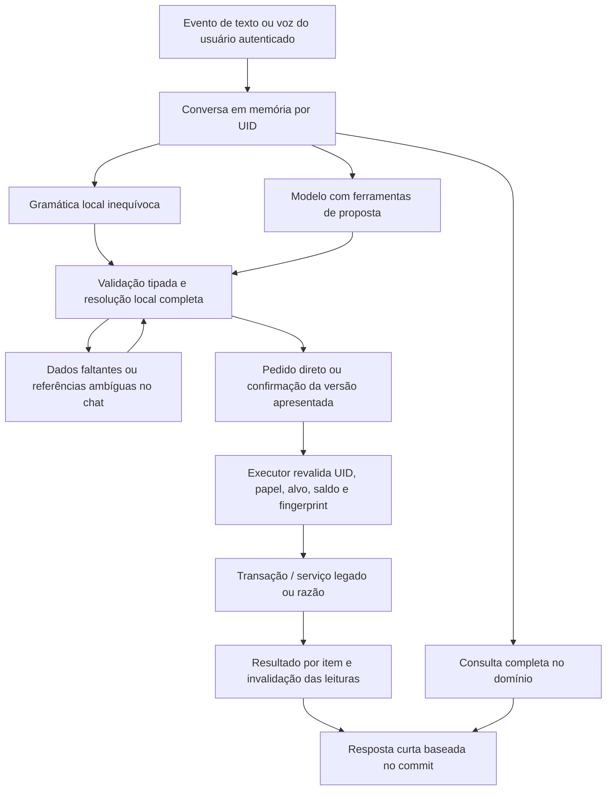

# Assistente Lumus

<!-- spark-progress:start -->
## Progresso Spark — 19/10/2026

Assistente no escopo Spark: **38% implementado / 62% restante**. A01, conversa/IA/voz: **78%**; A02, catálogo/consultas/execução financeira Spark: **25%**. Parser, voz e confirmação existentes não substituem o transporte Spark das operações. Ver [[Status da Implementação Spark]].

As porcentagens medem entregas do escopo Spark, não tempo restante nem cobertura de testes. Esta revisão prevalece sobre listas históricas de pendências abaixo.
<!-- spark-progress:end -->

Interface conversacional compartilhada por Web e mobile para consultar e operar os serviços reais do Lumus. A pessoa informa dados, escolhe referências por nome ou ordinal, corrige, confirma e cancela no chat. Cartões, seletores e paginação financeira deixaram de ser etapas necessárias para concluir operações. O modelo interpreta e propõe; o aplicativo valida, governa a autorização e informa o resultado persistido.

A matriz [[Cobertura Conversacional Lumus]] registra todas as rotas físicas, adaptadores, fluxos internos e exceções. Um executor disponível não comprova todos os pedidos possíveis em linguagem natural. Evidência em memória, testes de protocolo, Emulator, navegador e aparelho deve ser identificada separadamente.

## Caminho e autorização

- `LumusAssistantProvider` fica dentro do contexto financeiro na raiz autenticada. A conversa sobrevive à navegação entre telas; UID trocado, logout, revogação e limpar conversa encerram a sessão. Configuração/disponibilidade são carregadas ao abrir o assistente, sem avaliação antecipada de módulos Firebase nativos no Expo Go.
- `assistantConversationService` mantém intenções, alvos, dependências, origem, versões e resultados fora do histórico truncável do modelo. Texto e áudio transcrito usam a mesma entrada; a transcrição permanece editável e não prova execução.
- Comandos completos de criação/registro elegíveis podem executar diretamente. Exclusão, estorno, transferência, investimento, reconciliação e alterações relevantes mostram o efeito e aguardam confirmação textual. Lotes podem exigir uma confirmação agregada; nenhum item exige botão financeiro.
- A autorização financeira é uma capacidade local não serializável, ligada ao UID, sessão ativa, evento do usuário e assinatura de ID/tipo/argumentos/snapshot/dependências. Copiar o token, trocar UID, alterar argumentos ou encerrar a sessão invalida essa capacidade. `confirmed:true` do modelo não concede autorização.
- Uma confirmação só vale para a versão ativa **quando a mensagem chegou**, além da verificação no processamento. Um “sim” enviado antes do resumo ou enfileirado antes de uma correção não autoriza a versão criada depois.
- Pergunta paralela conserva as intenções e invalida o foco de confirmação; “retome” reapresenta o pedido. Correção material revalida e cria novo resumo. Nome ambíguo pede distinção em texto; ordinal resolve somente as opções apresentadas. “Não” recusa a confirmação; cancelamento nomeado preserva os demais pedidos e cancela dependências.
- O compositor continua disponível durante interpretação, confirmação e processamento. As execuções dependentes são serializadas. Cancelar interrompe o início de novos itens; uma operação em commit recebe resultado real, sem promessa de rollback.

## Domínios

| Área | Integração conversacional |
|---|---|
| Dashboard/análise | saldo atual, visão mensal, maior/menor gasto ou ganho, categorias e pesquisa do período completo |
| Despesas/receitas | criar, corrigir, excluir; movimentos confirmados no razão usam estorno e novo evento |
| Recorrências/parcelas | definir, alterar, remover, pagar/receber quantidades, desfazer, ciclos/dias úteis/lembretes |
| Bancos/Caixa | gestão de contas, abertura, extrato, transferência, saque, ajuste e reversão conforme papel/armazenamento |
| Investimentos/CDI | definição, aporte, resgate, sincronização, reversões e taxas cadastradas; posição confirmada separada de simulação |
| Previsão | horizontes de 3/6/12 meses pelas premissas do serviço, sem garantia de resultado |
| Perfil/vínculos | consulta, alteração de nome, vínculos bidirecionais autorizados, cópia local do próprio identificador |
| Preferências | tema, valores ocultos, cache confiável, visibilidade de rotas, comportamento após formulário, leitura automática e revogação |
| Anotações | listar/ler/criar/editar/renomear no armazenamento local por UID; nenhum conteúdo/ID é enviado como resultado ao modelo |
| Navegação/sessão | abrir destino suportado mantendo a conversa; logout pela rotina de limpeza segura |

O quadro detalhado de ações, permissões e evidência fica na matriz. Login/cadastro/recuperação são fronteiras de autenticação; o assistente autenticado não inventa escrita em login. Permissões do microfone/notificações dependem do sistema. Não há integração para pagar em banco externo, cotação financeira em tempo real ou administração de papéis/grupos além dos serviços existentes.

## Lotes, dependências e persistência

- Conjuntos por filtro são selecionados na fonte local completa, com cursor/chunks de consulta. A ferramenta do modelo transmite filtro/argumentos, nunca centenas de documentos. Itens explícitos também passam pelo mesmo executor.
- O resumo informa elegíveis, excluídos, somente leitura e histórico indisponível. Pagamento/recebimento exclui ciclo concluído, parcelas encerradas e datas fora do contrato. Um ciclo anterior não recebe automaticamente a data de hoje.
- Preparação aloca IDs locais, remapeia referências `action:` e conserva o identificador durante retry. Dependência só é liberada depois do sucesso persistido; falha não libera o próximo efeito dependente.
- “Detalhes do lote”, “mostre as falhas do lote” e “mais detalhes” leem os resultados estruturados do último pedido financeiro em grupos de oito no chat, sem nova interpretação ou escrita. Cancelamento conta separadamente itens persistidos, falhos e não iniciados.
- Execução financeira serial preserva atomicidade dentro de cada operação; lote com vários itens não promete rollback integral. Progresso agregado, falhas e pendências ficam no chat. Retry usa os mesmos IDs e não repete sucesso.
- A cota distribuída permanece em 120 chamadas/minuto por UID/operação, incluindo previews de ajustes. Uma recusa anterior ao handler retorna `functions/resource-exhausted` com `details.reason=rate-limit` e `retryAfterMs`. O cliente aguarda esse prazo com margem do servidor e permite até três novas tentativas por chamada, mantendo argumentos, ID e autorização. Erros de rede ou resultado incerto não recebem repetição automática. Um aviso por turno informa a espera no chat; esgotar as tentativas produz motivo de limite temporário, sem anunciar gravação incerta.
- Cancelar durante a espera aborta o timer; cancelamento por nome interrompe apenas o item e seus dependentes. Limpar, revogar ou encerrar a sessão também impede reenvio tardio. Antes de cada chamada, inclusive após a espera, o executor revalida UID e grant; commits já confirmados conservam sucesso. A preparação de ajustes mantém no máximo oito previews simultâneos e não acrescenta propostas atrasadas após cancelamento.
- Serviços legados e callables do razão conservam recibo com owner/ator, identidade e fingerprint do pedido. Resultado incerto é reconciliado antes de repetir. Snapshot concorrente exige nova preparação.
- Lotes locais de preferências/anotações/vínculos mantêm checkpoint por UID/requestId e estado por item, assinatura de autorização, cancelamento e retry. Limpar/revogar/sair troca a sessão e apaga checkpoints em memória.
- Leituras das telas são invalidadas após commit. Uma falha na atualização ou na agenda de lembrete não transforma o commit em falha financeira; repetir lembrete não repete pagamento.

## Consultas e datas

- Valores são centavos inteiros; taxas seguem ponto fixo do domínio. Datas civis e ciclos usam `America/Sao_Paulo`, inclusive quando aparelho/Node estão em UTC.
- “Hoje” pode ser armazenado ao meio-dia civil. Saldo, categorias, previsão e consultas do mês incluem o dia civil atual inteiro; o dia seguinte continua excluído. O corte pelo instante antes do meio-dia omitia lançamentos já registrados e foi corrigido.
- Ranking, extrato, pesquisa e categorias consultam o mês completo em páginas de 200, com escopo legível e tratamento de estornos. Originais estornados não são receita/despesa ativa. Extrato conserva os eventos e pernas; transferências/saques/aportes não viram resultado econômico duplicado.
- Saldo usa a posição atual. Um saldo histórico indisponível não é inventado a partir da Home. Perguntas pontuais respondem primeiro com o resultado; extratos detalhados continuam por “mostre os demais”, sem selecionar alvos financeiros.
- Pendências respeitam ciclo, parcelamento e início/fim. Templates legados ou migrados que preservaram apenas o último ciclo não permite reconstruir todos os meses anteriores: itens sem evidência ficam desconhecidos, e o total parcial é identificado. Novos eventos/templates conservam histórico de ciclos.
- A carteira migrada usa contas/eventos do razão e metadados autorizados; não recorre a saldos legados. CDI só estima quando dono, taxa, data-base e metadados são verificáveis. Sem eles, conserva a base confirmada. Taxa cadastrada não é cotação externa.
- A resposta de um pedido composto lê depois dos commits. Falha parcial mantém os sucessos e identifica que a consulta mostra a posição efetivamente persistida.

## Exportações pelo chat

“Exporte o extrato do Nubank de 2026-10 em PDF”, “Exporte despesas fixas em PDF”, “Exporte receitas fixas em PDF” e “Exporte a análise da categoria Alimentação com histórico de 3 meses em PDF” usam os leitores e builders existentes. Extrato aceita Caixa, datas civis, tipo e categoria; análise aceita histórico em meses ou intervalo. Nome ambíguo é resolvido por texto/ordinal. O resultado entrega a geração para impressão Web ou compartilhamento nativo; não afirma que um arquivo foi salvo pelo sistema.

Recorrências usam lançamento, último ciclo e `completedCycles`; ausência de evidência não se transforma em pagamento nem pendência, inclusive após migração. Data de criação/início exclui ciclos anteriores ao contrato. Quantidades/valores desconhecidos não compõem um total confirmado inventado. Privacidade e sessão são revalidadas depois das leituras e antes de abrir o relatório; troca de privacidade durante a geração cancela o resultado e arquivos temporários próprios são removidos no transporte nativo.

## Ferramentas e privacidade

O gateway declara `search_financial_catalog`, `prepare_financial_actions`, `update_pending_actions`, `request_financial_batch`, `request_financial_report` e `prepare_application_commands`. Todas interpretam, localizam ou propõem; nenhuma grava diretamente no Firestore.

O catálogo inicial contém um recorte relevante com handles opacos. Uma busca local lê o conjunto completo e retorna no máximo 40 referências, indicando total/completude; ambiguidade não autoriza escolher o primeiro. IDs reais ficam no cliente/executor. Os dados de nome/descrição/anotação não são instruções. UID, email, JWT e chaves Firebase são retirados do texto/catalogo/resumo enviados ao modelo.

Valores ocultos são mascarados antes do prompt, na interface, em resumos e no TTS. Relatórios e resultados locais ficam em memória para a pessoa e não retornam ao histórico do modelo. Respostas gerais sem dados da conta podem compor pares de histórico; o pedido atual não é duplicado nem recebe mensagens futuras da fila. Estado financeiro crítico não depende desses pares.

A sessão não persiste mensagens/áudio no Firestore. Consentimento e leitura automática são locais por UID. Revogação interrompe imediatamente trabalho/TTS e invalida retornos tardios, incluindo bootstrap, áudio e troca de conta.

## Limites e experiência

- Mensagem: 4.000 caracteres; excesso é recusado integralmente, sem truncar itens ou colar parte de um pedido. Áudio: até 60 segundos/20MB conforme adaptador, com arquivo temporário apagado após uso/cancelamento/revogação/desmontagem.
- Modelo: até 20 ações explícitas e oito ferramentas por resposta, limites Remote Config mantidos. Excesso/contrato inválido invalida escritas daquele resultado, com mensagem explícita. Lote determinístico não herda o limite de 20 documentos do prompt.
- Cota de modelo por UID, não por operação local. Comandos locais e leituras determinísticas podem continuar quando modelo/App Check está indisponível; a interface identifica capacidades de voz/modelo separadamente.
- Web/mobile compartilham estado e regras. Layout, teclado, áudio, foco, temas e controles de pelo menos 44px continuam nos adaptadores. As telas não montam o fluxo de cartões editáveis/confirmadores financeiros.
- Etapas observáveis e progresso agregado não expõem raciocínio privado nem argumentos/identificadores em logs. O aviso híbrido identifica os serviços locais e os remotos.

## Evidência e pendências de validação

[[Validação Conversacional Lumus]] registra os gates finais e percentis comparáveis: tipos, backend e exportações Web/Android passaram; Jest geral passou 670 testes e manteve duas falhas do baseline. [[Comandos Financeiros Conversacionais]] cruza as 38 ações com legado/razão e evidência; [[Validação de Lotes Conversacionais]] registra treze famílias reais de 211 itens, falha parcial/retry e cancelamento. A matriz mantém 82 rotas físicas e as exceções de plataforma, papel, dados históricos e serviços. Esses resultados não certificam aparelho instalado, compreensão universal nem quota/latência do modelo remoto.

No baseline, lint de estilos já falhava em `ConfigurationsScreen.web.tsx`; testes de perfil e layout do Login tinham uma falha cada. As alterações preexistentes de cadastro de receita e `skills-lock.json` foram preservadas. Nenhum deploy, migração de produção, alteração externa Firebase ou operação financeira real foi autorizado/realizado neste trabalho.

## Arquivos principais

- `services/lumusAssistant/assistantConversationService.ts` e `assistantAuthorization.ts`: conversa, fila, foco/versionamento, autorização e cancelamento.
- `assistantBatchService.ts`: gramáticas locais, seleção completa e busca reduzida/redigida.
- `assistantApplicationService.ts`: gestão local/perfil/vínculos, preparações e checkpoints.
- `assistantGatewayCore.ts` / `assistantPrompt.ts` / schemas: contratos, ferramentas e limites.
- `financeCommandService.ts`, `assistantCatalogService.ts`, `assistantReportService.ts` e `assistantExportService.ts`: domínios financeiros, escopo, fingerprints, referências e consultas.
- `contexts/LumusAssistantContext.tsx`: adaptação aos providers, UID/consentimento, leitura, navegação e invalidação.
- `screens/mobile/LumusAssistantScreen.tsx` / `screens/web/LumusAssistantScreen.web.tsx`: histórico/compositor/áudio/configurações, sem negócio financeiro.
- `functions/` / `backend/src/`: leitores legados/razão, callables, recibos, revalidação e atomicidade.
- `utils/financialCivilDate.ts`: conversão entre instantes e calendário de São Paulo nos cálculos compartilhados.
- `tests/lumusAssistant*.test.ts`, `tests/ledgerProjectionReads.test.ts`, testes backend no Emulator: evidência por comportamento; matriz registra sua associação.

## Integração Firebase por plataforma

### Web

- `firebase/ai` com `GoogleAIBackend`.
- `firebase/app-check` inicializado com `ReCaptchaEnterpriseProvider` antes da primeira chamada de IA.
- A site key pública fica em `EXPO_PUBLIC_FIREBASE_APP_CHECK_RECAPTCHA_ENTERPRISE_KEY`; ela não é uma chave Gemini.
- No alvo Emulator Web, um app Firebase nomeado `LUMUS_ASSISTANT_DEVELOPMENT` usa os identificadores públicos do projeto remoto somente para AI Logic, App Check e Remote Config. No Expo Go, a configuração do mesmo app Web é usada apenas no transporte HTTP do AI Logic/App Check. O `app` primário e o `SECONDARY` continuam ligados ao Auth/Firestore/Functions locais.
- No alvo Emulator Web, o SDK ativa o App Check Debug inclusive no export local em modo production, gera um token quando nenhum foi fornecido e mantém o assistente indisponível até conseguir emitir um token válido. O token deve ser cadastrado no Console e nunca versionado; os scripts de deploy Web limpam esse token antes do export remoto.
- Em produção Web, o preflight inicializa App Check antes de ler Remote Config e usa reCAPTCHA Enterprise. A mensagem de falha pode mostrar o código/nome do erro retornado pelo SDK, sem incluir token, para distinguir problemas de emissão/configuração. O token de debug só se aplica ao alvo Emulator; diagnóstico da chave/domínio e do cadastro do app Web depende do erro real e de teste autenticado no domínio publicado.
- `firebase@12.19.0` incorpora `@firebase/ai@2.16.0` no import `firebase/ai`. Essa versão envia `functionResponse` como conteúdo `user`, aceito pelos modelos Gemini 3.x. A versão anterior emitia `role: function`, rejeitado pelo serviço com HTTP `400`. O adaptador mantém o `id` da chamada ao devolver o resultado da ferramenta.

### Android

- `@react-native-firebase/ai`, `app-check` e `remote-config` em versões alinhadas.
- App Check usa `debug` somente em desenvolvimento/preview e Play Integrity em produção. `EXPO_PUBLIC_FIREBASE_APP_CHECK_ANDROID_PROVIDER` explicita o provider do perfil; o token de debug é fornecido separadamente e cadastrado no console.
- Auth e Firestore existentes continuam no Firebase JS. O adaptador nativo expõe ao SDK de IA apenas uma fachada com `getIdToken()` do usuário atual.
- No alvo Emulator, o app continua exigindo um usuário autenticado localmente, mas não envia o ID token de `demo-lumus-financas` ao AI Logic de `finances-app-e8685`. A chamada remota é atestada pelo App Check Debug; em preview/produção, a fachada de Auth volta a acompanhar a chamada normalmente.
- `google-services.json` fica fora do Git e entra localmente ou por `GOOGLE_SERVICES_JSON` no EAS. O worker de todo build EAS Android (`development`, `preview`, `production` e `production-apk`) falha sem esse arquivo; assim, não é possível instalar um client EAS que abra o app sem conter os módulos nativos da IA. A CLI local não consegue ler a variável de arquivo secreta; o check definitivo ocorre no worker. Fora do EAS, o plugin `@react-native-firebase/app` continua condicional para que Expo Go e o app-base preservem o diagnóstico de indisponibilidade.
- A disponibilidade nativa só fica positiva depois de inicializar o App Check e obter um token string não vazio. Falhas nesse preflight mantêm o restante do aplicativo e a sessão financeira disponíveis e mostram o diagnóstico de App Check/configuração no painel do assistente; o usuário pode disparar novo preflight pelo botão **Tentar novamente**.
- `@react-native-firebase/ai@25.1.0` ainda atribui `role: function` a `chat.sendMessage(functionResponse)`. O adaptador Android usa `generateContent` com histórico local da conversa e devolve a ferramenta em um conteúdo `user`, preservando `id` e as partes originais da resposta do modelo. O resultado continua sendo apenas uma proposta; nenhum comando financeiro é executado nesse adaptador. A correção nativa exige gerar e instalar um novo development client para validação em aparelho.

### Remote Config

| Chave | Padrão | Limite local |
|---|---:|---:|
| `lumus_ai_enabled` | `true` | kill switch |
| `lumus_ai_model` | `gemini-3.8-flash` | aceita a versão estável principal e `gemini-3.5-flash-lite`; rejeita outros nomes não validados, preview/experimental/`-latest` e modalidades não conversacionais |
| `lumus_ai_max_context_turns` | `12` | 2–12 |
| `lumus_ai_max_actions` | `20` | 1–20 |
| `lumus_ai_max_tool_calls` | `8` | 1–8 |
| `lumus_ai_max_requests_per_minute` | `10` | 1–10 |

Falha ao buscar ou inicializar Remote Config usa padrões seguros locais. Um valor de kill switch já ativado continua prevalecendo quando o fetch falha. No plano Spark não existe fallback pago; a única alternativa local em erro de cota/indisponibilidade é o modelo gratuito documentado acima.

Expo Go não consegue inicializar o SDK de Remote Config e usa os defaults locais acima, mantendo `remoteConfigLoaded=false`. O kill switch remoto não é observado nesse runtime; rode Web ou um development build nativo para receber valores remotos. O caminho Expo Go só é habilitado em desenvolvimento com alvo Emulator.

O arquivo `remote_config.json` foi publicado em 2026-09-21 como versão 1 no projeto `finances-app-e8685`. O mesmo modelo está no fallback Web/Android. A configuração de geração mantém somente `maxOutputTokens` (e `responseMimeType` na transcrição), pois os parâmetros amostrais antigos foram removidos para compatibilidade com Gemini 3.x.
Esse registro de publicação é histórico. Em 2026-09-25, a CLI leu o template remoto ativo sem alterá-lo e confirmou `lumus_ai_enabled=true` e `lumus_ai_model=gemini-3.8-flash`; não havia condições no template. Uma sonda sem dados pessoais confirmou troca do token App Check Debug (`200`), pedido simples ao modelo principal (`200`), sobrecarga no pedido com prompt e ferramentas reais (`500`), cota em uma tentativa posterior (`429`) e ciclo de chamada de função com `gemini-3.5-flash-lite` (`200` na primeira resposta e na continuação com `role: user`). A continuação com `role: function` foi rejeitada com `400`. Essas sondas não substituem um teste de ponta a ponta autenticado no navegador ou em aparelho.

## Consentimento e proteção de dados

- O aviso informa que não há escuta em segundo plano, o áudio é temporário e a conversa não vai para o Firestore.
- Também informa que, no nível gratuito da Gemini Developer API, o Google pode usar conteúdo enviado para melhorar produtos; a opção contrária pertence ao nível pago.
- Revogar consentimento aborta a chamada ativa, limpa mensagens/rascunhos/catálogo, interrompe TTS e manda a tela apagar gravações temporárias.
- Troca de UID e logout limpam toda a sessão em memória.
- App Check deve ter enforcement somente para Firebase AI Logic nesta entrega. Firestore Android continua no SDK JS e não deve receber enforcement até sua migração/auditoria.

Os registros externos nesta seção são históricos; esta tarefa não publicou configuração nem confirmou estado remoto de produção em 02/10/2026.

## Configuração externa obrigatória

1. Os apps Web e Android de produção já foram confirmados no projeto `finances-app-e8685`, e o `google-services.json` local corresponde ao package Android. O preview exige apps registrados em um projeto Firebase isolado e seu próprio `GOOGLE_SERVICES_JSON`; o arquivo de produção não pode ser reutilizado. É obrigatório manter `GOOGLE_SERVICES_JSON` como variável de arquivo nos ambientes EAS `development`, `preview` e `production` antes dos builds usados no smoke test. Veja [[Processo de Release]].
2. Para testar no Expo Go, executar `npm run start:expo-go`, escanear o QR pelo Expo Go compatível, entrar com uma conta do Emulator e usar **Tentar novamente**. O comando inicia a Suite local, semeia a conta de teste e força `expo start --go --lan`. Configure os identificadores públicos e o token App Check Debug local; confirme que o token está cadastrado no app Web do projeto remoto. Não é preciso gerar development build para a IA de texto/voz em Android Expo Go. Com SDK 57, iOS precisa de um host Expo Go instalado por TestFlight/EAS Go ou de outro client compatível.
3. Play Integrity está registrado; ainda confirmar o SHA-256 e os tokens de debug usados por builds development/preview.
4. reCAPTCHA Enterprise está registrado; ainda confirmar a site key e os domínios Web permitidos, pois a lista de domínios do Authentication não carregou no Console.
5. Firebase AI Logic está ativo com Gemini Developer API no plano Spark; Agent Platform permanece desativada. O código exige usuário autenticado antes de criar o modelo, mas o modo global **usuários autenticados** do AI Logic não está aplicado. Se esse modo for habilitado, o fluxo híbrido deverá receber uma estratégia explícita de Auth do projeto remoto em vez do token do Emulator.
6. Remote Config publicado como versão 1 em 2026-09-21; preservar `remote_config.json` como fonte versionada do template.
7. App Check aparece como **Registrado (aplicado)** para Web e Android no AI Logic; Firestore permanece sem enforcement nesta etapa.
8. Auditar e implantar regras Firestore que limitem escrita ao proprietário.

## Assistente por tela - 25/10/2026

A revisão `lumus-assistant-2026-10-25` libera somente o Assistente uma vez nas preferências locais, preservando desligamentos posteriores. Web/mobile compartilham painel de erro de inicialização com retry. Falha de leitura de consentimento/leitura automática não é tratada como preferência ausente; envio fica indisponível até recuperar essa leitura. Falha isolada do modelo preserva os comandos locais existentes.

Consentimento só é concedido após persistência confirmada, com trava síncrona, erro persistente e retry. Atualização de disponibilidade limita chamada concorrente por UID e descarta respostas anteriores à troca de conta, revogação, limpeza ou desmontagem. A conversa continua em memória durante navegação.

Esta entrega trata a entrada A01. A02 continua parcial: catálogo, relatórios e executor financeiro Spark ainda precisam de adaptadores por família. A liberação local não comprova essas operações nem habilita fallback financeiro. A01 78%, A02 25%, assistente 38%, financeiro 78% e geral 59% mantidos. Sem deploy, Rules, migração ou escrita em dados reais; sem nova homologação visual, modelo real ou áudio/aparelho.

Validação desta entrega: **81 testes focados distintos** aprovados: 40 de interfaces Web/mobile, 18 de integração do provider, 21 de visibilidade e dois de montagem das rotas. Suites com seams de apresentação, modelo/Firebase e preferências; não são ensaio real de IA/voz/financeiro. Repetições não somadas. A execução inicial exigiu mock de CSS interop no ambiente Windows/UNC; o teste de consentimento revelou mensagem dentro do botão, corrigida para preservar o nome acessível. Tipagem, arquitetura de estilos (métricas existentes preservadas) e diff-check aprovados. Sem export/build, novo Emulator/Rules, modelo real, inspeção visual/aparelho ou deploy. A02 permanece parcial.

## Catálogo nativo do Assistente - 26/10/2026

O carregamento detecta contexto Spark confirmado antes de acessar as coleções anteriores. Contas usam `readSparkAccountsFirebase`: posição em centavos, revisão, cadastro, banco vinculado e estado nativos; contas inativas/arquivadas ficam fora da seleção. Dinheiro só existe se o Caixa canônico estiver presente. Categorias próprias/do grupo são paginadas no servidor, deduplicadas e filtradas por uso/exclusão; categorias de outros membros conservam leitura autorizada.

Planos ativos usam o leitor canônico de recorrências (com sua janela declarada); movimentos ordinários usam os eventos e o índice de resolução nativos, conservando origem live/imported e referência de execução. Estornado/substituído não é oferecido como alvo ativo. Identidades de operações nativas não são IDs do razão antigo. O catálogo do modelo continua restrito a handles/rótulos/descrições/escopo; dados e IDs ficam locais. O salt nativo é ligado ao UID da sessão, inclusive para registros de outros membros.

Erro nativo ou mudança de grupo/papel ao final interrompe a consulta, sem fallback legado ou catálogo vazio de sucesso. O caminho legado anterior permanece quando o contexto Spark retorna ausência confirmada. Não adiciona escritor nem callable.

**Escopo parcial de A02:** pares, avaliações, ajustes e catálogo completo de dados convertidos ainda não têm alvos conversacionais nativos nesta fatia. Executor financeiro e relatórios precisam de adaptadores próprios; este catálogo não prova registro/consulta financeira ponta a ponta pelo chat. Comandos locais e UI anteriores são preservados. A01/A02/financeiro/geral permanecem 78%/25%/78%/59%. Sem nova tela, liberação de rota, migração, Rules, deploy, dado real ou modelo real.

Validação do catálogo em 26/10/2026: **18 testes distintos** aprovados em três suítes (Spark catalog 6, catalog completeness 4, export 8), além de tipagem do aplicativo e diff-check. Ensaios usam leitores/Firebase simulados, sem comprovar Rules, modelo real ou integração financeira ponta a ponta. Incluem Caixa real/ausente, contas inativas, posições em centavos, referência/escopo de movimento, falha sem fallback, acesso alterado, paginação de categorias e renovação de handles. Nenhum estilo/tela foi alterado nesta etapa; sem novo Emulator, build/export, inspeção visual/aparelho ou deploy. Próximo trabalho: adaptar comandos ordinários e relatórios do chat ao protocolo Spark, com recibos e confirmação ligados à intenção.

## Registro ordinário Spark pelo chat - 26/10/2026

O executor identifica contexto Spark antes de ler recibos ou chamar serviços financeiros anteriores. `create_expense` e `create_gain` resolvem conta `sparkPositions` do mesmo grupo e categoria real, enviando centavos/direção/detalhes ao comando `executeSparkMovementCommandFirebase` já usado nas telas. Caixa conserva seu ID canônico e `moneyFormat`; não se usa um banco nulo fictício.

ID da intenção, data civil, hora explícita (se informada), dados e fingerprint são estáveis no retry. Sem hora declarada, o horário do preparo em São Paulo compõe a data civil escolhida. O comando nativo recusa futuro e revalida conta/categoria/saldo/Rules, com recibo idempotente no protocolo existente. `assistantRequestFingerprint` inclui dados, contas/categorias resolvidas, dependências e preparo. A assinatura da autorização também passa a incluir `preparedAt`; alterá-lo após a concessão exige nova autorização.

A sessão/capacidade são reconferidas antes de iniciar o comando. Uma chamada já iniciada não promete rollback por cancelamento posterior. Sem contexto Spark, o caminho anterior permanece; falha de contexto não autoriza fallback. Outras famílias com contexto nativo recebem indisponibilidade explícita do adaptador do chat, sem tentar callables antigas. Correção/estorno, pares, recorrências, investimentos, ajustes e relatórios nativos continuam pendentes nesta fatia. Não anunciar Assistente financeiro completo.

Não houve mudança em UI, Rules, índices ou serviços de saldo. Percentuais A02 25%, assistente 38%, financeiro 78% e geral 59% mantidos até integrar/homologar as demais famílias. Ver [[Operações Ordinárias Spark]], [[Assistente Lumus]] e [[Status da Implementação Spark]].

Validação desta etapa: **145 testes focados distintos** aprovados: comandos 108, conversa 31 e catálogo Spark 6. O primeiro conjunto passou com 143; dois casos de falha de contexto/família não suportada foram acrescentados e a suíte de comandos repetida (108), sem somar as repetições. Os ensaios novos verificam o adaptador com executor/Firebase simulados: direção, centavos, Caixa real, data/ID/material iguais no retry, autorização ausente/preparo alterado e ausência de fallback. Não equivalem a novo commit SDK/Rules nem ensaio real de modelo, voz ou aparelho. O comando nativo e suas Rules não foram modificados. Sem novo build/export, deploy ou dado real.

Tipagem do aplicativo e diff-check aprovados após os testes finais. Sem alteração de apresentação; lint de estilos não foi repetido nesta etapa de serviços.

## Correções, estornos e leitura de movimentos no chat - 26/10/2026

Correção/estorno ordinários preparam o alvo pelo leitor canônico Spark antes da confirmação. O draft conserva alvo, fingerprint e comando completo (ID/data/conta/categoria/detalhes/referência live ou imported). A autorização assina esses campos. Envio valida UID/grupo/capacidade e usa o mesmo executor Spark das telas; não exclui documentos. Retry não depende de encontrar o alvo ainda ativo no catálogo: o recibo do comando identifica eventual sucesso anterior. Intenções continuam em memória e não prometem recuperação após reload. Comandos já iniciados não prometem rollback em cancelamento posterior.

A leitura de movimentos do período do Assistente agora detecta Spark, lê os eventos nativos e reconfirma grupo/papel. Visão mensal e rankings usam essa fonte; consulta por movimento/banco/categoria reaproveita o leitor. Inverso conserva natureza econômica com valor assinado: estornar despesa reduz despesas em vez de criar ganho. Rankings ignoram inversos e alvos resolvidos até o fim do período. Transferências e outros efeitos não econômicos não entram nos totais. Eventos de referência sem delta não são linhas de movimentação desta projeção; não equivale ao relatório completo de avaliações. Falha nativa não lê legado nem inventa resultado vazio.

Pares, recorrências, investimentos, ajustes, relatórios especializados e aceitação integrada continuam parciais. Nenhuma Rule ou serviço monetário nativo foi alterado; não houve dado real, deploy, modelo real ou teste visual/aparelho. Percentuais A02 25%, assistente 38%, financeiro 78% e geral 59% mantidos. Ver [[Assistente Lumus]], [[Operações Ordinárias Spark]] e [[Status da Implementação Spark]].

Validação: **166 testes focados distintos** aprovados em quatro suítes (comandos, conversa, respostas financeiras direcionadas e exportação). A versão final do preparo/comando e do leitor foi repetida nas duas suítes afetadas: 127 casos aprovados, sem somar a repetição. Ensaios com Firebase/executor/apresentação simulados verificam alvo/fingerprint, preservação de data/detalhes, retry sem alvo no catálogo, autorização alterada, erro de preparo, totais com inverso/substituto e rankings, falhas nativas e acesso alterado. Não são novo ensaio SDK/Rules, modelo real ou aparelho; serviços monetários/Rules permanecem os existentes. Sem alteração visual, build/export ou deploy.

Tipagem do aplicativo e diff-check da versão final aprovados. Sem mudança de estilos nesta etapa de serviços.

## Relatórios especializados Spark - 26/10/2026

Pendências detectam o contexto nativo, leem planos/ciclos e metadados pelo leitor Spark, reconferem grupo/papel e reutilizam o cálculo de ocorrências/parcelas da Home. O leitor visual mantém o padrão de três itens por tipo; o chat pede o conjunto inteiro e pagina somente a apresentação em vinte itens, sem truncar os totais. Ciclo concluído, plano futuro/inativo ou parcelas encerradas não entram nas pendências atuais; última parcela conserva o resto e contratos vencidos seguem o cálculo das parcelas restantes.

Metadados ou cobertura insuficientes e pendências históricas sem prova não viram zero confirmado, pagamento ou dívida inferida. O texto identifica itens desconhecidos e totais parciais. Para meses passados, ciclos comprovados como concluídos são excluídos; a ausência de evento não prova uma pendência histórica com valor/configuração atuais.

A carteira continua usando a fachada Home, que já seleciona o leitor Spark. O relatório agora respeita `projectionStatus`: `confirmed_only` mostra posição confirmada, sem anunciar simulação nem ganho estimado; `projected` preserva a distinção base/projeção. CDI nativo consulta, com cursor no servidor, a curva do próprio titular no grupo; zero é taxa válida, futuro não substitui vigente e taxas de outros titulares não são misturadas como se fossem uma taxa única. Cadastro inválido interrompe o relatório. Não é consulta de cotação externa; investimentos seguem a curva do titular de cada abertura.

Sem escritores novos, alterações de Rules, dados reais, modelo real, publicação ou homologação de aparelho. A02 continua parcial: outros comandos financeiros, histórico integral e relatórios de referências sem delta ainda precisam de adaptadores/aceite. Percentuais A02 25%, assistente 38%, financeiro 78% e geral 59% mantidos.

Validação desta etapa: **45 testes focados distintos aprovados em quatro suítes**: respostas financeiras direcionadas, exportação, modelo de leitura de recorrências e carteira Spark. Sete cenários novos cobrem conjunto completo de nove pendências, resto contratual, ciclos concluídos/planos futuros/inativos, histórico/configuração desconhecidos, falha nativa, carteira confirmada sem projeção, CDI zero/futuro/titular e taxa inválida. A primeira execução exigiu completar uma importação do teste e restringir a união de tipo no montador legado; a repetição final passou sem somar casos repetidos. Tipagem do aplicativo aprovada. Leitores/Firebase são simulados nestes ensaios; não são novo teste SDK/Rules, de modelo real ou aparelho. Sem mudança de apresentação, novo build/export ou deploy. Próximo trabalho: demais comandos financeiros do Assistente, começando por transferências e saques Spark.

## Transferências e saques pelo chat - 26/10/2026

`create_transfer` e `create_cash_withdrawal` preparam o par nativo antes da confirmação textual. Somente bancos ativos do mesmo grupo podem ser origem/destino de transferência; saque exige origem bancária e Caixa canônico ativo com ID `cash`. Contas distintas por handle mas com o mesmo ID são recusadas, assim como Caixa inventado ou investimento usado como banco. O comando completo e o dia civil entram na assinatura de autorização, com ID/centavos/contas/nota/justificativa/data estáveis. Retry usa os dados preparados sem exigir que o catálogo ainda contenha as contas.

Hoje sem hora explícita usa o commit do servidor (`transferSparkFundsFirebase`); passado ou hora explícita usa `transferSparkDatedFundsFirebase`. Futuro é recusado no preparo. Transferência exige saldo suficiente, sem justificativa de negativo; saque aceita justificativa válida conforme o protocolo existente. Saldos, cota e atomicidade das duas posições continuam nos serviços/Rules existentes. Não há callable ou fallback antigo em contexto Spark.

Em operações sem data explícita, o executor lê o recibo no servidor antes do envio: virada do dia sem recibo não inicia outro efeito, e recibo de data diferente não é anunciado como sucesso do novo dia. Um commit que cruzar a meia-noite pode exigir conferência manual do extrato. A capacidade é revalidada depois da leitura; uma chamada já iniciada não promete rollback por cancelamento. Rascunhos permanecem em memória, sem promessa de recuperação integral após reload.

Saque é o par banco→Dinheiro, com mensagem/nota próprias, preservando a classificação visual dos leitores. Nenhum dos pares vira ganho/despesa. Não foram alteradas UI, Rules ou posições financeiras do banco real. Desfazimento do saque e demais famílias do Assistente continuam pendentes; percentuais A02 25%, assistente 38%, financeiro 78% e geral 59% mantidos até integração/aceite restantes. Sem modelo real, aparelho, publicação ou deploy.

Validação desta etapa: **163 testes focados distintos aprovados em três suítes** (comandos do Assistente, conversa e formulário de pares Spark), com tipagem do aplicativo e diff-check aprovados. Cenários novos verificam transferência/saque, centavos e IDs canônicos, hoje sem hora pelo servidor, retroativo/horário explícito, retry sem catálogo após falha, confirmação obrigatória, material alterado, Caixa ausente, aliases de mesma conta, futuro, justificativa indevida em transferência e recibo/virada do dia. Os executores/Firebase são simulados nos testes do adaptador; não é novo ensaio SDK/Rules, de modelo real ou aparelho. Nenhum serviço monetário ou Rule foi alterado; não se repetiu lint de estilos porque não houve mudança de apresentação. Sem build/export ou deploy.

Roteiro manual pendente: no grupo sintético, banco A com R$ 1.000, B com R$ 200 e Caixa com R$ 300. Confirme transferência de R$ 100: A R$ 900, B R$ 300, Caixa R$ 300. Confirme saque de R$ 50 de A: A R$ 850, B R$ 300, Caixa R$ 350; ganhos/despesas permanecem sem efeito desses pares. Reenvie a mesma intenção incerta e confira ausência de novo débito. Exercite data retroativa, virada de dia e insuficiência de saldo. São expectativas de teste, não execução comprovada nesta etapa. Próximo trabalho: desfazimento de saques pelo chat e demais famílias financeiras.

## Desfazer saque pelo chat - 26/10/2026

O catálogo Spark oferece somente a perna positiva de banco→Caixa (`cash`) com referência executável de par e sem resolução no índice canônico. Transferências entre bancos, aportes, resgates de investimento e inversos não viram saques selecionáveis. Origem live/imported é preservada; saque de outro ator permanece somente leitura para membro, com administração sujeita às mesmas Rules.

`undo_cash_withdrawal` confere o original imutável, direção banco→Caixa, valor apresentado e tipo real da posição de origem, depois usa `prepareSparkPairReversalFirebase` para conferir disponibilidade/claim e ator. Comando, valor e nome do banco são capturados antes da confirmação e entram na assinatura de autorização. O resumo informa quanto voltará do Dinheiro ao banco. “Desfaça” e “quero desfazer” são reconhecidos como intenção de alteração; não concedem autorização de execução sem confirmação.

A execução usa `executeSparkPairReversalFirebase`: estorno integral do par, sem apagar o saque, sem mudar ganhos/despesas e sem callable antiga. Contas/caixa/saldo, ator e claim são revalidados pelo protocolo existente. Retry mantém o mesmo ID/comando, independente de o alvo ainda estar ativo no catálogo; um novo pedido sobre saque já estornado é recusado no preparo. Intenção continua em memória; não há promessa de recuperar o comando após reload nem rollback de chamada já iniciada.

Sem novo serviço monetário, Rule, estilo, deploy ou alteração de dado real. Demais famílias continuam parciais; A02 25%, assistente 38%, financeiro 78% e geral 59% mantidos. Ver [[Assistente Lumus]], [[Resgate de Caixa]] e [[Versão Usável por Telas]].

Validação desta etapa: **180 testes focados distintos aprovados em quatro suítes** (comandos, conversa, catálogo Spark e formulário de pares), com tipagem do aplicativo e diff-check aprovados. Os cenários novos verificam saques ativos/resolvidos, origem importada, somente leitura, original banco→Caixa, bloqueio de transferência/aporte disfarçados, comando/valor adulterados, alvo já estornado, mudança de grupo, recusa financeira, retry sem catálogo e resumo de valor/direção antes da confirmação. Ensaios usam Firebase/executores simulados e não comprovam novos commits SDK/Rules, modelo real ou aparelho. Não houve mudança de UI ou estilo, build/export, deploy ou dado real.

Roteiro manual pendente: banco R$ 900 e Caixa R$ 400 após saque de R$ 100. Peça “desfaça o saque”, confira resumo de R$ 100 do Dinheiro ao banco e confirme. Esperado banco R$ 1.000 / Caixa R$ 300, original e inverso preservados, ganhos/despesas sem efeito. Reenvie a mesma intenção após resposta perdida: nenhum novo crédito/débito. Saque já estornado não deve ser oferecido como alvo novo; dinheiro já usado no Caixa deve impedir saldo negativo. São expectativas, não execução comprovada nesta etapa. Próximo trabalho: pagamentos e recebimentos recorrentes pelo chat Spark.

## Pagamentos e recebimentos recorrentes pelo chat - 26/10/2026

`pay_mandatory_expense` e `receive_mandatory_gain` possuem adaptador Spark para `settleSparkRecurringFirebase`, o mesmo protocolo financeiro das listas. O preparo consulta planos/ciclos no mês civil de São Paulo solicitado, exige plano ativo do próprio titular e conta banco/Caixa canônica do grupo, recusa ciclos concluídos ou anteriores ao histórico confirmado e contratos substituídos/cancelados. Despesa debita a conta; receita credita. Não há callable nem escrita financeira legada depois de erro ou perda do contexto Spark.

O comando captura ID, grupo/ator, plano/revisão, conta, data, ciclo, quantidade e valor antes da autorização. Todo pagamento/recebimento Spark apresenta resumo e exige confirmação, inclusive após ordem direta: informa direção, conta, ciclo e parcelas. Parcelas usam contador explícito e soma contratual inteira, incluindo o resto final (333 + 333 + 334); não avançam pelo calendário. Planos sem fim admitem um ciclo por lançamento, com valor informado ou nominal. Valor diferente do contrato finito orienta usar liquidação negociada na tela própria. Parcelas finitas vencidas usam `lateSettlement:true`, motivo auditável e indicação de liquidação após a vigência no resumo; não estendem o calendário.

A autorização cobre o comando preparado; alterações exigem nova confirmação. Reenvio mantém exatamente o mesmo ID/material, sem reler plano ou ciclo já alterados pelo commit; o protocolo existente consulta o recibo e revalida permissões/estado financeiro. Este adaptador exige saldo suficiente (`overdraftReason:null`); autorização de banco negativo continua na tela própria. Intenção permanece em memória, sem recuperação prometida após reload.

Lembrete é suprimido depois do commit. Falha da agenda conserva sucesso financeiro e permite repetir somente a supressão do ciclo, vinculada ao UID/grupo/plano original, sem consultar template legado nem pagar/receber outra vez. Seleção individual e em lote reconhecem `completedCycles` Spark como lista de meses, preservando o formato legado em mapa. Lotes usam o mês da data explícita e recusam conflito com o período informado; seleção de vencidos usa os metadados do plano e o vencimento original de parcelas atrasadas. Vigência futura, contrato substituído e histórico fora da janela lida são excluídos ou informados como indisponíveis, sem presumir pendência. A agenda nativa real continua dependente do aplicativo instalado.

Cadastro, edição, replanejamento e seleção de ciclos históricos pelo chat Spark permanecem parciais; desfazimento do ciclo atual consta na continuação abaixo. Nenhum escritor monetário, Rule ou estilo foi alterado; percentuais A02 25%, assistente 38%, F07 80%, financeiro 78% e geral 59% mantidos. Ver [[Assistente Lumus]], [[Recorrências Spark]], [[Despesas Fixas]], [[Receitas Fixas]] e [[Status da Implementação Spark]].

Validação desta etapa: **290 testes focados distintos aprovados em sete suítes** (`lumusAssistantCommand`, `lumusAssistantConversation`, `lumusAssistantSparkCatalog`, `lumusAssistantBatchCoverage`, `sparkRecurringFormCommand`, `mandatoryInstallments`, `sparkRecurringReminderBridge`), tipagem do aplicativo e diff-check aprovados. Um benchmark opt-in de lotes permaneceu ignorado; repetições de suíte não foram somadas. A primeira rodada teve uma expectativa de teste incorreta para referência somente leitura (o catálogo pede outro plano); durante revisão foi corrigida uma colisão de nome local no filtro de ciclos. A regressão e tipagem finais passaram após as correções.

Os cenários cobrem pagamento/recebimento, resto final e múltiplas parcelas, valor variável sem fim, liquidação vencida, São Paulo na virada de mês, ciclos concluídos, histórico desconhecido, plano de outro titular/tipo, referências legadas/contas inválidas, troca/perda de grupo, material adulterado, edição do rascunho, falha financeira sem fallback, retry com data/revisão/ID estáveis e retry exclusivo da agenda. Lotes verificam ciclos concluídos em lista, vencimentos dos metadados, cobertura histórica e conflito de mês/data. Ensaios usam leitores/executores Firebase e notificações simulados: não comprovam novo commit SDK/Rules, modelo real, agenda instalada ou homologação em aparelho. Nenhum estilo foi alterado; sem novo build/export, Emulator, deploy ou dado real nesta etapa.

Roteiro manual pendente: no grupo de teste, banco R$ 1.000 e despesa recorrente de R$ 100. Peça o pagamento, confira conta, saída, valor e ciclo no resumo e confirme: esperado banco R$ 900, despesa R$ 100 e ciclo efetivado. Receba uma receita recorrente de R$ 200: esperado banco R$ 1.100 e receita R$ 200. Reenvie a mesma intenção após resposta perdida e confira ausência de duplicação; um novo pedido não deve oferecer o ciclo concluído. Em contrato de R$ 10 em três parcelas, conferir R$ 3,33 + R$ 3,33 + R$ 3,34, sem avanço pelo calendário. Simule falha de agenda depois do commit e repita somente o lembrete; confira grupo/UID alterado, histórico fora da cobertura, vencimento futuro e parcelas vencidas. São expectativas sintéticas, não execução comprovada nesta etapa. Próximo trabalho: desfazer pagamentos e recebimentos recorrentes pelo chat Spark.

## Desfazer pagamentos e recebimentos recorrentes pelo chat - 26/10/2026

`undo_mandatory_expense_payment` e `undo_mandatory_gain_receipt` agora usam `undoSparkRecurringFirebase`. O alvo é o ciclo atual de São Paulo no instante em que o pedido foi preparado, como nas listas; o schema existente recebe somente o plano, sem selecionar outro mês. O preparo lê o plano/ciclo canônico e o receipt original em `sparkOperations` (inclusive `imported_recurring_settlement`), conferindo titular, grupo, tipo, conta, valor efetivado, quantidade, sinal e data. Plano arquivado ainda pode ter o ciclo desfeito; contratos substituídos/cancelados exigem desfazer o replanejamento primeiro. Parcelas finitas exigem que a faixa alvo seja a última efetivada.

O resumo apresenta valor real, direção, conta original, ciclo e quantidade. Despesa devolve o dinheiro à conta; receita retira o crédito. Quantidade, valor, nomes e comando completo entram na assinatura da confirmação. O estorno é integral, preserva original/inverso, desativa o ciclo e restaura o contador pelo protocolo existente. Valor negociado anterior é estornado pelo efetivamente pago, sem recalcular o nominal. A data efetiva do inverso conserva a data original, seguindo o formulário existente e seus efeitos após checkpoints. Banco negativo não é autorizado automaticamente (`overdraftReason:null`); Caixa continua sem saldo negativo.

A execução reenvia exatamente o mesmo comando/ID/revisão/data sem reler o alvo antes do commit, permitindo conferir recibo após resposta perdida, mudança de mês ou retirada do alvo do catálogo. Perda/troca de grupo e alteração de material impedem envio; não existe fallback para escritor legado. O catálogo conserva planos arquivados com efetivação ativa no ciclo atual; escolhas e lotes selecionam apenas ciclos ativos elegíveis. Planos de outro titular são somente leitura inclusive para administrador, conforme a regra do protocolo.

Depois do commit, somente a agenda do plano afetado é reconciliada com leitura Spark fresca. Configuração desativada, contrato arquivado/substituído ou completo cancela seu lembrete; configuração ativa agenda novamente sem solicitar permissão. Se o ciclo foi pago novamente entre as operações, o lembrete mantém essa conclusão. Falha de leitura/agenda conserva sucesso financeiro e permite retry apenas do lembrete, vinculado ao UID/grupo/plano/ciclo, sem consultar template legado nem repetir estorno. Demais lembretes não são substituídos por uma sincronização parcial.

Intenção continua em memória; seleção de ciclos históricos, cadastro/edição/replanejamento conversacionais e autorização de saldo negativo permanecem fora desta etapa. Não houve mudança de escritor monetário, Rules ou estilo, publicação ou dado real. A02 25%, assistente 38%, F07 80%, financeiro 78% e geral 59% mantidos. Ver [[Recorrências Spark]], [[Despesas Fixas]], [[Receitas Fixas]] e [[Status da Implementação Spark]].

Validação: **310 testes focados distintos aprovados em cinco suítes** (`lumusAssistantCommand`, `lumusAssistantConversation`, `lumusAssistantSparkCatalog`, `lumusAssistantBatchCoverage`, `sparkRecurringFormCommand`). Um benchmark opt-in de lotes permaneceu ignorado; execuções repetidas não são somadas. Os ensaios usam leitores/executores Firebase e notificações simulados. Cobrem pagamento e recebimento desfeitos, valor negociado/importado, Caixa, arquivamento, conferência do original, ordem de parcelas, ciclo de São Paulo, ausência de histórico, grupo/ator alterados, material adulterado, retry após resposta perdida e virada de mês, falha financeira sem fallback e retry exclusivo da agenda. Não comprovam novo commit SDK/Rules, modelo real ou agenda instalada. Sem novo Emulator, build/export, inspeção visual/aparelho, deploy ou dado real nesta etapa. Tipagem do aplicativo e diff-check finais aprovados. A verificação dedicada dos 25 cenários de desfazimento também passou, incluindo vínculo do ator no retry de agenda; esses casos repetidos não aumentam a contagem de testes distintos.

Roteiro manual pendente: no grupo de teste, banco R$ 900 depois de pagar despesa recorrente de R$ 100. Peça “desfaça o pagamento”, confira valor, conta/direção e ciclo atual, confirme e confira banco R$ 1.000, ciclo reaberto e original/inverso preservados. Para receita de R$ 200 já recebida, o desfazimento deve retirar R$ 200 da mesma conta. Confira parcelas quitadas em conjunto, valor negociado real, plano arquivado sem reativação e recusa de faixa anterior/replanejamento pendente. Simule resposta perdida e reenvie o mesmo pedido após a virada do mês: não pode haver novo efeito. Simule agenda indisponível após sucesso, pague novamente o ciclo e tente só o lembrete; a nova conclusão deve ser respeitada. São expectativas sintéticas, não execução comprovada nesta etapa. Próximo trabalho: cadastro e edição de recorrências pelo chat Spark.

## Cadastro e edição de recorrências pelo chat Spark - 26/10/2026

`create_mandatory_expense`, `create_mandatory_gain`, `update_mandatory_expense` e `update_mandatory_gain` possuem adaptadores Spark. O preparo captura definição e metadados completos, com titular/grupo, categoria autorizada, nomes, valores e revisões, antes da confirmação. Criação e edição Spark exigem resumo mesmo após ordem direta. O resumo mostra nominal, quantidade/total do contrato, vigência, categoria, vencimento/dias úteis, descrição e configuração do lembrete, deixando explícito que não movimenta saldo.

O cadastro usa `createSparkRecurringPlanFirebase` e depois `saveSparkRecurringMetadataFirebase`, com IDs distintos e estáveis para definição, plano e configuração. Não cria pagamento/recebimento ou avanço de parcelas. Contrato finito usa centavos inteiros: nominal deve corresponder à divisão inteira do total pela quantidade, deixando o resto para a parcela final. Total omitido deriva do nominal vezes quantidade; vigência final é conferida contra a quantidade. Datas de parcelas exigem contrato parcelado. Recorrência sem parcelas inicia no ciclo atual e admite alteração futura do nominal.

A edição lê o plano canônico e usa `updateSparkRecurringPlanFirebase` com revisão atual; preserva contador, estado ativo/arquivado e campos omitidos. Total, quantidade, início/fim e nominal de contrato finito não são renegociados por edição: o usuário deve usar o replanejamento na tela própria. Outro titular, tipo incompatível e contrato substituído/cancelado são recusados. Lembrete ativado sem vencimento confirmado pergunta o dia antes de preparar os comandos.

As duas etapas não são uma transação única. Reenvio conserva o mesmo material e os mesmos receipts, sem reler o plano alterado pelo próprio commit. Após o primeiro envio, esse pedido não aceita edição dos argumentos enquanto seu resultado está sendo conferido. Definição confirmada com configuração incerta gera erro parcial explícito, atualiza as leituras/catálogo e bloqueia dependentes até a conclusão; retry confirma os receipts sem cadastrar outro plano. Cancelamento comprovado da definição pede nova intenção; cancelamento comprovado da configuração orienta editar o plano já salvo, sem prometer reutilizar uma tentativa cancelada. Perda/troca de grupo e alterações após autorização bloqueiam envio, sem fallback legado.

Somente depois de ambas as etapas confirmadas o lembrete do plano é reconciliado pela mesma leitura Spark fresca usada no desfazimento. Falha da agenda preserva o cadastro/edição e oferece retry apenas local, sem repetir definição ou metadados. Permissões não são solicitadas automaticamente. A intenção e o bloqueio de material permanecem em memória; não há promessa de recuperação do rascunho após reload. Categorias criadas por ações ainda sem adaptador Spark, dependências dinâmicas não resolvidas, arquivamento/restauração, replanejamento e seleção histórica de ciclos não são concluídos por estes quatro adaptadores.

A02 25%, assistente 38%, F07 80%, financeiro 78% e geral 59% mantidos: esta entrega não encerra a integração/homologação do módulo. Sem novo protocolo monetário, backend, Rule ou estilo, deploy ou dado real. Ver [[Recorrências Spark]], [[Conversão de Recorrências Spark]], [[Despesas Fixas]], [[Receitas Fixas]] e [[Status da Implementação Spark]].

Validação: **267 testes focados distintos aprovados em três suítes** (`lumusAssistantCommand`, `lumusAssistantConversation`, `sparkRecurringFormCommand`), sem ignorados nessa rodada final. Tipagem do aplicativo e diff-check aprovados. Repetições anteriores não aumentam a contagem. Os cenários novos cobrem os quatro comandos, contrato/resto/vigência futura, total derivado, limites e datas inválidas, proteção de contrato finito, edição sem fim, campos omitidos, titular/tipo/replanejamento, pergunta de vencimento, duas identidades estáveis no retry, configuração parcial, material adulterado, edição bloqueada após envio, grupo alterado, cancelamento entre fases e cancelamento comprovado por fase, agenda independente e atualização das leituras com resultado parcial. A conversa verifica resumo completo e confirmação antes de executar.

Os ensaios usam leitores/writers Firebase e notificações simulados. Não comprovam novo commit SDK/Rules, modelo real, agenda instalada ou homologação em aparelho. Nenhum estilo foi alterado; sem novo Emulator, build/export, deploy ou dado real nesta etapa.

Roteiro manual pendente: no grupo de teste, banco R$ 1.000. Cadastre despesa e receita recorrentes de R$ 100 pelo chat, confira resumo completo e confirme; o saldo deve continuar R$ 1.000, sem lançamento financeiro, com definição/configuração disponíveis na lista. Cadastre contrato de R$ 10 em três parcelas nominais de R$ 3,33, início em novembro/2026 e fim em janeiro/2027; conferir total e vigência, sem avanço de contador. Edite nome/vencimento/categoria/descrição/lembrete e confira preservação de parcelas pagas e contrato. Tente alterar quantidade ou nominal finito: deve orientar replanejamento. Simule resposta perdida após definição e após configuração; reenvie a mesma intenção, sem outro plano. Em configuração incerta, conferir definição visível e dependentes bloqueados; cancelar entre fases não deve enviar metadados. Cancelamento comprovado da configuração deve orientar edição do plano existente. Falha local de agenda após sucesso deve permitir repetir somente o lembrete. São expectativas sintéticas, não execução comprovada nesta etapa. Próximo trabalho: arquivamento de recorrências pelo chat Spark.

## Arquivamento de recorrências pelo chat Spark - 26/10/2026

`delete_mandatory_expense` e `delete_mandatory_gain` agora possuem adaptador Spark de arquivamento por `updateSparkRecurringPlanFirebase`, com `active:false`. O preparo lê o plano canônico, confere titular/grupo/tipo, estado ativo e ausência de replanejamento/cancelamento, e captura nome, categoria, nominal e revisão antes da confirmação. Comando e quantidade de parcelas concluídas entram na assinatura da autorização. O resumo usa “Arquivar”, informa preservação de contrato/ciclos/histórico e suspensão dos lembretes, sem sugerir quitação de parcelas pendentes ou movimento de saldo. Não apaga definição, ciclo, pagamento, recebimento ou metadados.

Pedidos “arquive”, “arquivar” e “quero arquivar” são reconhecidos como intenção de alteração, sempre sujeita à confirmação. A conversa marca esses pedidos como somente arquivamento, inclusive em lotes; a validação e o executor recusam encaminhá-los a exclusão legada quando não há grupo Spark. Correções do rascunho preservam essa intenção. Pedidos antigos de exclusão em contas legadas conservam seu contrato existente. O modelo recebe a orientação de usar os tipos de recorrência existentes; não há permissão de escrita concedida pelo texto do modelo. Lotes preservam a quantidade humana e excluem planos Spark inativos, substituídos ou cancelados.

A execução envia exatamente o comando preparado/ID, sem reler o alvo antes do commit. Retry depois de resposta perdida funciona com plano já inativo ou retirado do catálogo; o protocolo confere receipt, revisão e permissões. Material alterado, ausência de comando, tentativa de restaurar pelo caminho de arquivar, troca/perda de grupo e cancelamento antes do envio são recusados. Cancelamento comprovado pelo protocolo pede nova intenção, sem prometer reutilizar um receipt cancelado.

Após o commit, a agenda do plano é reconciliada com leitura Spark fresca e os avisos do plano inativo são cancelados. Se houve restauração posterior pela lista, essa configuração atual é respeitada. Falha de leitura/agenda conserva o sucesso do arquivamento e oferece retry somente local, vinculado ao titular/grupo/plano, sem arquivar outra vez, editar metadados ou modificar outros lembretes. A invalidação financeira existente atualiza as leituras do aplicativo. Plano arquivado com ciclo atual efetivado continua disponível para o desfazimento já implementado; novas efetivações são bloqueadas pelo estado inativo.

Intenção continua em memória. Restauração, replanejamento e escolha de ciclo histórico pelo chat permanecem parciais; não há recuperação prometida do rascunho após reload. A02 25%, assistente 38%, F07 80%, financeiro 78% e geral 59% mantidos até integração/homologação restantes. Sem novo writer monetário, Rules, estilo, deploy ou dado real. Ver [[Recorrências Spark]], [[Despesas Fixas]], [[Receitas Fixas]] e [[Status da Implementação Spark]].

Roteiro manual pendente: no grupo de teste, use plano ativo com parcelas pagas e ciclo atual efetivado. Peça “arquive a recorrência”, confira nome canônico, contagem e aviso de que não quita pendências, confirme e confira plano inativo sem alteração de saldo, contrato, contador, ciclos ou metadados. Novos pagamentos devem ser recusados; o ciclo atual já efetivado deve continuar disponível para desfazer. Simule resposta perdida após commit e reenvie o mesmo pedido sem duplicar o evento/revisão. Simule falha da agenda depois do arquivamento e repita somente o lembrete; se o plano foi restaurado pela lista nesse intervalo, o retry não pode arquivá-lo de novo. Em conta legada, “arquive” não deve excluir o template. Em lote, peça duas recorrências e confira que conjunto divergente não é iniciado. Teste titular/grupo alterado, categoria/revisão indisponível, cancelamento e privacidade. São expectativas sintéticas, não execução comprovada nesta etapa. Próximo trabalho: restauração de recorrências pelo chat Spark.

Validação: **381 testes focados distintos aprovados em cinco suítes** (`lumusAssistantCommand`, `lumusAssistantConversation`, `lumusAssistantBatchCoverage`, `lumusAssistantSparkCatalog`, `sparkRecurringFormCommand`), com um benchmark opt-in ignorado. A rodada completa aprovou 380 casos; a rodada final dos lotes aprovou 76, incluindo um novo cenário “quero arquivar”, sem somar novamente os casos repetidos. Tipagem do aplicativo e diff-check aprovados.

Cenários novos: arquivo de despesa/receita pelo comando canônico, preservação de contrato/ciclos/contador/metadados, nominal sem parcelas, alvo já arquivado, titular/tipo/replanejamento incompatíveis, leitura/ref/grupo indisponíveis, retry após resposta perdida e mudança de mês sem catálogo ativo, material adulterado, comando de restauração recusado, bloqueio de exclusão legada em pedidos de arquivar, marca preservada em correções, cancelamento/recusa do protocolo, agenda independente, restauração posterior e lotes com quantidade humana. A conversa exige confirmação, apresenta arquivamento e recusa propostas de escrita em perguntas/negações.

Ensaios usam leitores/executores Firebase e notificações simulados; não comprovam novo commit SDK/Rules, modelo real ou agenda instalada. Sem novo Emulator, build/export, inspeção visual/aparelho, deploy ou dado real nesta etapa. Nenhum estilo foi alterado.

## Restauração de recorrências pelo chat Spark - 26/10/2026

A conversa aceita pedidos para restaurar ou reativar despesas e receitas recorrentes arquivadas. O catálogo inclui planos inativos e oferece, para restauração, somente os elegíveis. O comando Spark `updateSparkRecurringPlanFirebase` é preparado com `active:true`, revisão, titular, categoria, nominal e identidade preservados. O resumo exige confirmação e informa preservação do contrato, ciclos, contador e histórico; não movimenta saldo. Contratos substituídos/cancelados, planos já ativos, outro titular e grupos indisponíveis são recusados; alterações adicionais devem ser solicitadas separadamente.

O mesmo comando e ID são reenviados após resposta incerta, sem reler o plano já alterado pelo commit. A agenda é reconciliada separadamente com o estado atual; sua falha permite retry somente do lembrete. A intenção de restauração permanece vinculada ao rascunho, inclusive em correções; não há fallback para edição legada. Lotes filtram planos inativos elegíveis e preservam a quantidade informada. Sem novo writer monetário, Rules ou deploy; a intenção continua em memória. Ver [[Assistente Lumus]], [[Despesas Fixas]], [[Receitas Fixas]] e [[Status da Implementação Spark]].

Validação: 306 testes aprovados nas suítes de comandos, conversa e catálogo Spark. Uma segunda rodada de conversa, lotes e catálogo aprovou 139 testes, com um benchmark opcional ignorado; as rodadas têm sobreposição e não são somadas. Tipagem e diff-check aprovados. Os ensaios usam serviços Firebase e notificações simulados, sem novo teste SDK/Rules, modelo real ou validação em aparelho.

Roteiro manual pendente: arquive uma despesa e uma receita, restaure pelo chat após conferir o resumo e confirme preservação de contrato, contador, ciclos e saldo. Confira plano sem ciclo atual, outro titular, replanejamento, falha de categoria e reenvio após resposta perdida. Simule falha de lembrete e confira que o retry não reativa outra vez. São expectativas, não execução comprovada. Próximo: replanejamento de recorrências pelo chat Spark.

### Replanejamento pelo Assistente — 27/10/2026

O chat prepara replanejamento individual de contrato finito Spark ativo, de titular autorizado, pedindo o total negociado em centavos, quantidade de parcelas, primeiro ciclo e motivo. Após resumo e confirmação, usa `replanSparkRecurringFirebase` com revisões e IDs capturados: o contrato anterior é preservado e substituído atomicamente, sem movimentação de saldo nem quitação implícita. Uma tentativa já enviada conserva o mesmo comando para recuperação; alteração do material exige nova intenção após resolução. Atualização dos lembretes do predecessor e sucessor é posterior e pode ser repetida sem reenviar o replanejamento. Contas legadas não recebem substituição alternativa.

O desfazimento conversacional do replanejamento, a recuperação da intenção após reload e a homologação em aparelho permanecem pendentes. Os serviços simulados não comprovam Rules ou operação em produção. Sem deploy. Ver [[Assistente Lumus]] e [[Recorrências Spark]].

Validação local: 307 testes nas suítes de comando e conversa passaram com serviços simulados; não é validação de Firestore Rules, do modelo real ou do aparelho.

### Desfazimento de replanejamento pelo Assistente — 27/10/2026

O chat prepara o desfazimento individual de replanejamento Spark usando a referência ao contrato anterior ou ao sucessor. Pede o motivo, confere titular, grupo, vínculos e receipt original, e apresenta os dois contratos e o efeito para confirmação. O sucessor não pode ter parcelas efetivadas nem replanejamento posterior; o serviço `undoSparkRecurringReplanFirebase` volta a validar as revisões e dependências na transação. A operação reativa o anterior, cancela o sucessor e preserva o histórico sem movimentar saldo.

A tentativa conserva o comando e ID após envio; os lembretes dos dois planos são reconciliados depois do commit e podem ser repetidos separadamente. Não há fallback para alteração legada. Intenção após reload, validação em aparelho, Rules implantadas e operação em dados reais não foram verificadas nesta entrega. Sem deploy. Ver [[Assistente Lumus]] e [[Recorrências Spark]].

Validação local: 332 testes nas suítes de comando, conversa e catálogo passaram; a rodada isolada do comando também passou (269 testes). Tipagem e diff-check aprovados. Serviços simulados não comprovam execução real do modelo, Firestore Rules ou aparelho.
