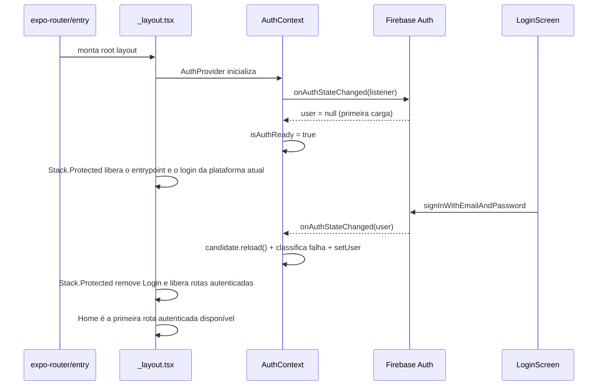

# Autenticação

<!-- spark-progress:start -->
## Progresso Spark — 19/10/2026

**U01 — Auth, sessão, perfil e privacidade visual: 85% implementado / 15% restante.** Notas P/I/D/E: **100/75/75/75**; cálculo e evidências em [[Status da Implementação Spark]].

O percentual corresponde ao módulo completo, incluindo integração e dados, e não somente ao serviço descrito nesta página. **Próxima entrega:** Homologar login/perfil/sessão, App Check e limpeza de cache no ambiente Spark instalado.

Esta revisão prevalece sobre listas de pendências datadas das entregas anteriores abaixo. Implementação local e logs não aprovam publicação nem migração real.
<!-- spark-progress:end -->

> Segurança e privacidade (2026-10-11): o logout explícito remove o token push e limpa cache financeiro e anotações antes de encerrar a sessão. A exclusão direta somente de `users/{uid}` foi retirada; `requestAccountDeletion` registra uma solicitação pendente de política de retenção e **não** conclui a exclusão da conta. Ver [[Remediação da Auditoria de Segurança]].

Gerencia o estado de autenticação do usuário via Firebase Auth, expondo o contexto para toda a aplicação e controlando o redirecionamento de rotas com base no estado de login.

## Como funciona



1. `AuthContext.tsx` registra um listener `onAuthStateChanged` do Firebase ao montar. A validação principal não roda em `onIdTokenChanged`, pois chamar `candidate.reload()` dentro de um listener de token pode disparar um novo evento e criar um loop de renovação
2. Quando um usuário é detectado por uma mudança de autenticação, lê `getIdTokenResult().claims.auth_time`, confere os prazos e chama `candidate.reload()` + `getIdToken(true)` antes de propagar. Cada callback recebe uma versão monotônica; somente a resolução mais recente e cujo UID ainda coincide com `auth.currentUser` pode atualizar o contexto. Erros de token expirado/inválido, usuário desabilitado ou inexistente limpam a sessão; falhas transitórias de rede/serviço preservam somente a sessão cujo `auth_time` já foi validado; se esse horário não puder ser lido na restauração, o acesso é recusado
3. Atualiza `user` (Firebase User completo) e marca `isAuthReady = true`
4. `_layout.tsx` (Expo Router 6) consome `useAuth()` e mantém um único `Stack` com guards declarativos:
   - `Stack.Protected guard={!isAuthenticated}` contém `index` (`/`) e o login da plataforma atual (`/web` ou `/mobile`)
   - `Stack.Protected guard={isAuthenticated}` contém as rotas da plataforma atual registradas em `APP_ROUTE_PATHS`, com `home` primeiro
   - Quando o guard muda, rotas agora protegidas são retiradas do histórico pelo próprio Router; não há `Redirect` ou ação imperativa concorrendo com a desmontagem
5. Durante a inicialização (`!isAuthReady || isLoadingTheme`), exibe o `AuthBootstrapScreen` com `<Loader />`
6. `LoginScreen.tsx` chama `signInWithEmailAndPassword` com proteção de throttle via [[Segurança de Login]]
7. A tela de login aceita pull-to-refresh para limpar erros locais e reconsultar o cooldown de tentativas do email digitado
8. A interface tem implementações por plataforma: a partir de 768px, o navegador preenche toda a coluna esquerda com o painel de identidade em gradiente e o texto SVG animado **Finances**, na fonte padrão do sistema, centralizado sobre ele, enquanto centraliza verticalmente o conteúdo de acesso na coluna direita. Nessa composição desktop, a rolagem permanece disponível quando o formulário excede a altura útil; abaixo disso, os blocos se empilham e conservam a rolagem e o comportamento de teclado do mobile. Android e iOS preservam a composição mobile histórica com wallpaper, logo adaptado ao tema e cartão sobreposto, sem remover a proteção do teclado

## Acesso, cadastro e recuperação no mesmo painel

`LoginScreen.web.tsx` e `LoginScreen.tsx` alternam entre `login`, `register` e `reset` por estado local, compartilhado pelo hook `useAccountAccess`. Nenhuma rota ou tela nova é criada. `HomeScreen.web.tsx` e `HomeTabsScreen.tsx` continuam sendo o dashboard e seu contêiner autenticado, sem campos de acesso.

- **Criar conta** substitui o formulário de login por nome, email e senha. Exige nome, email válido e senha com pelo menos seis caracteres; políticas adicionais são validadas pelo Firebase. A conta pública sempre recebe `adminUser: false`.
- O cadastro usa `secondaryAuth` e salva `users/{uid}` via `secondaryDb`, autenticado pelo mesmo app secundário. Assim a regra de criação pelo próprio UID é respeitada sem autenticar a sessão primária. Se o perfil não puder ser confirmado, preserva a conta Auth e permite repetir o cadastro com os mesmos dados; a transação cria o perfil somente quando ausente, sem sobrescrever um perfil já existente. O `finally` encerra a sessão secundária.
- Após o cadastro, o painel volta ao login, limpa a senha e mantém o email e a confirmação de sucesso. Apenas **Entrar** autentica a sessão primária e libera a Home.
- **Esqueci minha senha** mostra somente o campo de email e envia `sendPasswordResetEmail` em português. A resposta é neutra, inclusive para `auth/user-not-found`; a nova senha é definida no link hospedado pelo Firebase. A solicitação permanece nesta tela.
- Um envio concluído desabilita nova solicitação para o mesmo email enquanto esse for o último endereço enviado na instância montada; mudar de modo preserva esse estado. Isso evita repetições acidentais e não substitui os limites de abuso do Firebase.
- **Voltar para entrar** retorna ao login localmente. Trocar de modo limpa senha/erros; pedidos pendentes bloqueiam troca e submissão concorrente. O throttle existente aplica-se somente ao login.
- Web usa `UnstyledButton` do Mantine para as ações secundárias, labels HTML associados, nomes acessíveis explícitos no `InputField`, descrições de erro, título focado ao alternar e feedback anunciado. Mobile usa `Pressable`, mantém o teclado/rolagem e intercepta o voltar físico nos modos de cadastro/recuperação.
- O tema e a identidade atuais permanecem; ações amarelas destes formulários usam texto escuro `lumus-on-accent`. A Web permite rolar em alturas pequenas e zoom para manter cadastro, erros e retorno acessíveis.

## AuthContext API

```typescript
type AuthContextValue = {
  user: User | null;       // Firebase User completo ou null
  isAuthReady: boolean;    // true após primeira resolução do auth
  isAuthenticated: boolean; // Boolean(user)
  sessionExpired: boolean; // Exibe aviso de novo login após expiração/invalidação
  registerActivity: () => boolean; // Interação nativa, sem estender login absoluto
};
```

- `useAuth()` — hook para consumir o contexto (lança erro se fora do `AuthProvider`)

## Arquivos principais

- `contexts/AuthContext.tsx` — Provider e hook `useAuth()`
- `app/_layout.tsx` — Root layout com `Stack.Protected` e `AuthBootstrapScreen`
- `screens/mobile/LoginScreen.tsx` — Interface mobile histórica para Android e iOS, com wallpaper, logo adaptado ao tema e cartão de formulário sobreposto
- `screens/web/LoginScreen.web.tsx` — Interface de login e painel de identidade responsivo do navegador
- `app/index.tsx` — Entry `/` que redireciona para o login da plataforma atual
- `app/web/index.web.tsx` / `app/mobile/index.native.tsx` — Login Web e Android/iOS
- `hooks/useAccountAccess.ts` — Estado local, validação e envio de cadastro/recuperação
- `design-system/auth.ts` — Contratos visuais das ações e feedback
- `functions/RegisterUserFirebase.ts` — Cadastro e solicitação de recuperação
- `utils/authSession.ts` — Classifica os códigos definitivos do Firebase Auth que exigem encerrar a sessão local
- `utils/firebaseAuthStorage.ts` — Persistência segura para o app secundário

## Integrações

- [[Firebase Config]] — `auth` instance usada para `onAuthStateChanged` e `signInWithEmailAndPassword`; o navegador compartilha a sessão entre abas da mesma origem
- [[Segurança de Login]] — Throttle de tentativas antes de chamar Firebase
- [[Navegação]] — `_layout.tsx` usa `useAuth()` para controlar a disponibilidade das rotas via `Stack.Protected`
- [[Gerenciamento de Usuários]] — `user.uid` é o `personId` usado em todas as queries
- [[Notificações]] — Ativa/reconcilia a agenda do UID autenticado; troca de conta e logout explícito limpam o UID anterior

## Configuração

- Firebase Auth configurado em `FirebaseConfig.ts`
- Antes de o `AuthProvider` montar, [[Firebase Config]] resolve o alvo a partir de variáveis `EXPO_PUBLIC_*` incorporadas diretamente pelo Metro. Development usa o Emulator, preview usa o projeto isolado de homologação e releases de produção usam `finances-app-e8685`. Uma release local com credenciais completas também infere produção, evitando exceção de bootstrap antes da Login e permanência na splash nativa.
- **App primário nativo usa persistência memory-only** — ao fechar o app Android/iOS, a sessão é encerrada e o usuário volta para a tela de login
- **App primário Web usa `browserLocalPersistence`** — outra aba ou recarregamento da mesma origem restaura o usuário; fechar o navegador também preserva a autenticação até **Sair**, 15 minutos sem atividade, 8 horas desde o login ou invalidação pelo Firebase
- O `user=null` inicial de uma abertura fria não é tratado como logout explícito pelo motor de notificações; isso preserva os alarmes locais do último UID enquanto a sessão precisa ser refeita
- Antes de executar o logout pelo botão **Sair**, os navigators Web (desktop e compacto) e Android/iOS abrem `LogoutConfirmation`, com o título **Sair do Lumus?** e as ações **Cancelar** e **Sair**. O foco inicial fica em Cancelar; cancelar, fechar pelo backdrop, Escape ou voltar apenas descarta a confirmação, sem limpar dados nem encerrar a sessão.
- `useLogoutConfirmation()` mantém a confirmação ligada ao UID original e a descarta quando a conta muda. Somente confirmar chama `logoutCurrentUser`; durante a operação, exibe **Saindo…**, desabilita os botões e ignora fechamento/toques concorrentes. Se a rotina segura preservar a sessão por falha, seu feedback existente é exibido e uma nova tentativa exige outra confirmação. O logout conversacional do [[Assistente Lumus]] continua com sua autorização própria.
- O botão **Sair** bloqueia toques concorrentes, confirma que o UID originador ainda é o usuário do Firebase e chama `clearMandatoryReminderAccount(uid)` antes de `signOut(auth)`. A limpeza é recusada se outra conta já tiver assumido a sessão; ao entrar com outro UID, a ponte de `_layout.tsx` também limpa qualquer agenda anterior
- A limpeza é preparada em duas fases: `clearMandatoryReminderAccount(uid)` cancela alarmes nativos, mas conserva configurações locais sem IDs como snapshot de rollback; somente depois do `signOut` bem-sucedido `finalizeMandatoryReminderAccountCleanup(uid)` apaga esse mapa
- Se a limpeza nativa falhar, o logout não prossegue e a agenda do UID ainda autenticado é reconciliada novamente. Se o `signOut` falhar depois da limpeza, o snapshot local reconstitui a agenda imediatamente, inclusive offline, antes da tentativa complementar de sincronização com Firestore e da mensagem de erro
- Ao autenticar, `_layout.tsx` ativa o UID e chama `loadMandatoryReminderSyncItems()` para restaurar despesas e receitas do Firestore sem depender de abrir as telas recorrentes
- App secundário usa `firebaseAuthStorage` (SecureStore com fallback AsyncStorage) — usado exclusivamente para criação de contas
- Dual app Firebase: app primário para sessão atual, app secundário para criação de usuários sem afetar sessão

## Observações importantes

- A versão Web da tela usa classes Tailwind/NativeWind para a composição estrutural; cores de tema e dimensões responsivas medidas permanecem tokens/valores de runtime.

- `isAuthReady` é false durante a inicialização — telas não devem renderizar dados antes disso
- O guard em `_layout.tsx` também aguarda `isLoadingTheme` do [[Sistema de Temas|ThemeContext]] para evitar flash de tema
- O `user` retornado é o objeto Firebase User completo
- O `reload()` na resolução de uma mudança de autenticação garante que sessões expiradas, revogadas ou inválidas sejam detectadas sem descartar uma sessão por uma falha transitória
- Eventos de renovação de token da instância atual não executam `reload()`. O observador de recuperação descrito abaixo só reage a nova instância User depois de expiração e falha de saída, evitando ciclos de renovação
- Uma resposta atrasada de `reload()` nunca pode republicar um usuário depois de um evento mais novo de logout ou troca de conta
- Login e logout atualizam os guards automaticamente via `onAuthStateChanged`, mantendo o mesmo Stack raiz montado
- Cada plataforma concentra sua interface completa em `LoginScreen.tsx` ou `LoginScreen.web.tsx`. A Web usa o painel de identidade em gradiente; Android/iOS preservam wallpaper e logos claro/escuro. Inputs, teclado, validação, throttle e Firebase Auth permanecem nativos, sem WebGL, canvas, `ogl` ou WebView.
- Todo novo arquivo de rota autenticada deve entrar primeiro em `APP_ROUTE_PATHS`; o layout deriva desse registro os nomes protegidos, e o teste de navegação verifica a paridade com os arquivos planos em `app/`
- A sessão Android/iOS **não persiste** entre reinicializações do app — isso é intencional (memory-only); a sessão Web pode ser restaurada somente dentro dos limites de 15 minutos sem atividade e 8 horas desde o login
- Os lembretes locais podem persistir entre reinicializações mesmo sem sessão persistida; eles são isolados pelo último UID ativo e nunca são mesclados com uma conta diferente
- O serviço de notificações mantém um epoch/UID síncrono em memória; callbacks assíncronos de telas antigas são ignorados depois que logout ou troca de conta invalidam a sessão
- A limpeza explícita recebe o UID esperado, varre inclusive alarmes nativos órfãos e não pode apagar a agenda de uma conta que se tornou ativa enquanto o logout anterior aguardava I/O
- A finalização do mapa local só acontece após confirmação do Firebase; nunca antecipar a exclusão do snapshot de rollback

## Sessão com prazo obrigatório — 2026-10-15

A política escolhida é **15 minutos sem atividade e máximo de 8 horas desde a autenticação por credenciais**. `utils/authSessionPolicy.ts` centraliza os prazos do cliente e das callables. A renovação automática de ID token não muda `auth_time` e não reinicia as oito horas.

- O provider verifica a sessão antes de liberar o usuário, a cada 15 segundos e antes de registrar qualquer interação. Ao retornar do segundo plano, de uma aba oculta ou do foco de outra janela, confere os prazos antes de revalidar o Firebase. Voltar ao foreground não conta como atividade.
- Toques no contêiner do Stack contam como atividade nativa. Na Web, ponteiro, teclado e rolagem usam listeners globais; apenas metadados de última atividade, separados por UID e `auth_time`, são compartilhados em localStorage. Credenciais/tokens permanecem exclusivamente no SDK Firebase existente. Recarregar ou abrir outra aba não cria um novo prazo. Sem metadados, usa-se o instante do login como limite conservador; storage indisponível usa memória.
- Sessões com horário inválido/futuro são recusadas. `reload()` + renovação forçada de token também rodam ao retornar e a cada cinco minutos em primeiro plano, fora de `onIdTokenChanged`. Erros definitivos invalidam o acesso; falhas transitórias preservam somente um prazo já validado e nunca o estendem. Se nem o horário do login puder ser lido, o acesso é recusado.
- Na expiração, o contexto retira imediatamente o usuário, limpa cache/preferência financeira, anotações e lembretes via `cleanupExpiredSession`, tenta remover o push com espera máxima de dois segundos e chama `auth.signOut()`. A espera pela limpeza completa tem teto de três segundos, inclusive se um storage local não responder. Falhas de limpeza não restauram acesso expirado. Falha no signOut mantém as rotas bloqueadas e é repetida a cada 15 segundos. O retorno ao login anuncia **Sua sessão expirou. Entre novamente com email e senha.**
- A saída automática não abre a confirmação manual de Sair nem usa o rollback dessa ação. A limpeza pode perder rascunhos locais conforme a política já aplicada ao logout explícito. Abertura fria nativa sem sessão continua preservando lembretes; expiração de uma sessão aberta solicita sua limpeza.
- O Firestore exige `request.time` anterior a `auth_time + 8h` em `signedIn()`. Todas as callables de negócio passam por `assertCallableSession()` antes do handler. O tempo do login vem do token validado pelo Firebase, nunca de campos enviados pelo usuário. Inatividade é um bloqueio do aplicativo; o limite absoluto é imposto também no servidor após publicar regras e backend. Revogação global de todos os dispositivos não é parte deste fluxo.
- No limite absoluto, a remoção remota de push pode ser recusada pelas regras; offline também pode ficar pendente. Isso não mantém o acesso aberto. A limpeza local é tentada e falhas são registradas sem credenciais.

Validação: `tests/authContextSession.test.ts`, `tests/authSessionPolicy.test.ts`, `tests/authSessionActivity.test.ts`, `tests/secureLogout.test.ts`, `backend/tests/authSession.test.ts`, `backend/tests/authSession.rules.test.ts` e `backend/tests/authSession.emulator.test.ts`. Regras e backend preparados localmente; produção exige publicação coordenada com o cliente. AI Logic, Remote Config e os apps secundários de cadastro mantêm seu fluxo atual.

Se o signOut falhar, o formulário de login continua interativo e o token antigo permanece bloqueado. Um observador de token restrito à recuperação reconhece nova instância de User após um novo login, inclusive no mesmo UID; não revalida eventos de refresh da instância expirada, evitando ciclos de reload. A primeira interação que detecta expiração é interceptada antes de alcançar ações de tela protegida.

Validação final local de 2026-10-15: `npm run check` aprovado (80 suítes e 728 testes; quatro suítes/88 cenários de integração são ignorados pelo Jest sem Emulator), build do backend aprovado e testes das Rules de sessão, legado, perfil, razão e assistente aprovados em Firestore Emulator isolado. Auth + Functions em portas alternativas confirmaram senha incorreta rejeitada, email/senha corretos aceitos, login expirado recusado com401 e login recente chegando à validação de negócio. As revisões Standards e Spec terminaram sem pendências após as correções. Nenhum deploy ou smoke test em navegador/aparelho foi realizado; isso permanece necessário antes da publicação.

## Continuidade no navegador — 2026-10-15

Recarregar a página (F5), abrir diretamente outra tela do Lumus na mesma origem, abrir uma nova aba ou visitar outra aba/janela não são ações de logout. O Firebase restaura a sessão persistida e o provider a libera após validar seus prazos. O tempo de inatividade é contado desde a última interação registrada, e não desde o início do login; por exemplo, um login feito há uma hora continua válido ao recarregar se houve atividade há dois minutos.

Voltar de outra aba dentro de 15 minutos preserva a sessão e reconsulta o Firebase. Passar 15 minutos sem atividade em nenhuma aba do Lumus, completar oito horas desde o login, sair explicitamente ou receber invalidação definitiva exige novo login. Recarregar/abrir outra tela não reinicia o prazo absoluto. A política não encerra a sessão no unload nem ao ocultar a aba.

Validação adicional: 35 testes focados de contexto, atividade compartilhada, persistência/configuração Web e navegação passaram. Os novos casos reproduzem remount/restauração com login antigo e atividade recente, retorno de aba/janela dentro do prazo e preservação do limite absoluto após restauração. São testes automatizados com Firebase/DOM simulados, sem smoke test em navegador real nesta etapa.


### Diagnóstico de conta antes da migração — 27/10/2026

`inspect-account` analisa um snapshot local validado e um UID, identificando perfil desconhecido, grupo do razão/Spark ou fontes legadas observadas por coleção. Documentos financeiros sem `personId` inequívoco, com identidade malformada ou divergente, são listados como ambíguos; a contagem não infere saldos ou titularidade de dados duvidosos. O relatório fica vinculado ao hash do snapshot e não altera a origem.

Um snapshot sem documentos financeiros não comprova que uma conta seja nova: ele não inclui Auth e usa duas varreduras que não garantem instante único. Por isso `canInitialize`, `canMigrate` e `readyForCutover` permanecem falsos em todos os resultados. O diagnóstico não cria grupos, importa dados, concede permissões ou altera o banco oficial. Ainda faltam bootstrap seguro, preservação dos formatos legados, consentimentos, corte e recuperação. Ver [[Importação Financeira Local Spark]] e [[Status da Implementação Spark]].

```sh
npm run spark:snapshot -- inspect-account --input spark-backups/demo.json --uid UID_FICTICIO --output spark-backups/account-report.json
```

O comando usa exclusivamente os snapshots `demo-*` validados pelo formato local; a saída é criada de forma exclusiva e privada. Não é captura ou migração de produção.


### Recuperação do perfil no cadastro — 27/10/2026

A criação pública de acesso usa a sessão Firebase secundária. O perfil é criado por transação que verifica primeiro sua ausência, sem sobrescrever um perfil existente. Se a gravação falhar ou a resposta for incerta, a conta Auth é preservada; uma nova tentativa com o mesmo nome, e-mail e senha reautentica na sessão secundária, confere o UID e retoma a transação. Se a primeira gravação já tiver sido confirmada, o perfil não é reescrito. Nenhuma senha é armazenada nessa recuperação, e a sessão principal não é substituída.

Depois que o UID é recebido, a intenção de perfil é preservada localmente, sem senha ou token, e pode ser retomada após reinício com as mesmas credenciais. Se a resposta de criação Auth for perdida ou o processo encerrar antes da gravação local do UID, a recuperação ainda não é automática. O cadastro continua sem preparar o grupo financeiro Spark; a mensagem informa essa limitação. Não houve migração legada, alteração de Rules, escrita real nem deploy. Ver [[Autenticação]] e [[Status da Implementação Spark]].

Validação desta etapa: 15 testes focados de cadastro e fluxo de acesso aprovados com Firebase simulado; tipagem do aplicativo e diff-check aprovados. Não houve ensaio real de Auth/Firestore, teste em aparelho ou publicação.

Continuação da recuperação do cadastro — 27/10/2026: intenção local versionada preserva UID, e-mail, nome e data após confirmação do UID, sem senha ou token; usa o armazenamento de autenticação existente. Na mesma instância, acesso ao registro é serializado e conteúdo inválido não é apagado. A retomada exige autenticar novamente e confirmar o mesmo UID; criação transacional não sobrescreve perfil. Se criação Auth tiver resultado incerto antes de receber/salvar o UID, não há retomada automática; concorrência entre abas não foi homologada. 25 testes focados passaram com serviços simulados, tipagem e diff-check aprovados. Grupo financeiro Spark, Auth/Firestore reais e deploy continuam pendentes.


### Primeiro uso Spark com autorização protegida — 27/10/2026

O cadastro de perfil novo marca `sparkFirstUseRequested`. Na primeira leitura de contexto, `initializeSparkFirstUseFirebase` consulta a autorização protegida do mesmo UID. Quando disponível, perfil, grupo `first_{uid}`, Caixa zero e operação `first_use_cash` são criados na mesma transação. O grupo recebe somente o titular como administrador e o protocolo vigente. A transação recusa perfil já vinculado e preserva o histórico existente; um reenvio após commit reconhece o grupo e o Caixa sem repetir gravações.

As Rules exigem autorização prévia em `sparkFirstUseLocks/{uid}`, emitida por autoridade confiável, vinculada ao UID, grupo determinístico, `createdAt` do perfil, ciclo do calendário protegido e expiração, e negam sua alteração pelo cliente. O documento começa em revisão e só se torna autorizado após a verificação. O calendário protegido precisa existir e cobrir o instante do servidor. As quatro escritas são verificadas conjuntamente; saldo inicial deve ser zero e a sessão atual precisa pertencer ao titular. A autorização não é uma prova gerada pelo cliente nem deve ser emitida somente por ausência de documentos.

**Ainda não há emissor confiável automático dessa autorização.** Verificação de criação real do Auth, inventário completo, ausência de legado e corte de escritores precisam ser implementados antes de conceder a autorização a contas reais. Sem autorização, o cadastro financeiro continua pendente. Esta etapa não migra contas legadas e não publica Rules ou cliente. Os testes em Emulator não constituem ativação de produção. Ver [[Status da Implementação Spark]] e [[Importação Financeira Local Spark]].

Validação local: 32 testes focados de serviço/contexto/cadastro passaram com SDK simulado; tipagens do aplicativo e das ferramentas aprovadas. Firestore Emulator aceitou o commit completo e recusou tentativas adversas, mas algumas recusas exibiram erros de avaliação das Rules: elas não são evidência conclusiva da regra específica até investigar a causa. A regressão isolada de perfil passou. Não houve teste integrado Auth/SDK, aparelho, emissor de autorização, migração real ou deploy.
