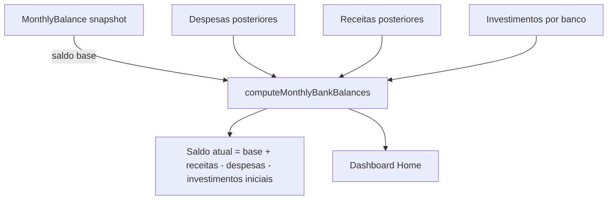

# Balanço Mensal

## Saldo inicial e abertura mensal — 23/10/2026

O primeiro fluxo de [[Versão Usável por Telas]] permite declarar o saldo atual ao criar um banco Spark, atomicamente. Esse valor não é receita e não é automaticamente saldo do primeiro dia do mês. Esta tela continua sendo a conferência mensal com preparação e confirmação; usar a data/mês correto evita tratar o saldo atual como abertura retroativa. Editar o cadastro bancário não altera nenhum desses saldos.

<!-- spark-progress:start -->
## Progresso Spark — 22/10/2026

**F03 — Abertura mensal e saldos: 75% implementado / 25% restante.** Notas P/I/D/E: **100/75/25/75**; cálculo e evidências em [[Status da Implementação Spark]].

O percentual corresponde ao módulo completo, incluindo integração e dados, e não somente ao serviço descrito nesta página. **Próxima entrega:** Restaurar campos e prova da nova contagem após reload, conectar assistente e converter contas existentes. Valor negativo e ativação vencida na entrada do app já estão conectados.

Esta revisão prevalece sobre listas de pendências datadas das entregas anteriores abaixo. Implementação local e logs não aprovam publicação nem migração real.
<!-- spark-progress:end -->

## Entrada negativa e ativação acessível — 22/10/2026

Após selecionar/preparar o contexto Spark, os dois formulários oferecem alternar sinal do saldo. Alterar sinal/valor invalida a confirmação; alvo ou saldo projetado negativo exige motivo. Não aceitar mero estado visual como justificativa financeira.

`SparkActivationQueueFirebase` e `spark-activation-notice` também descobrem fronteiras vencidas na entrada/retorno do app. O usuário pode preparar, continuar e pausar sem entrar no cadastro mensal. A descoberta de prova privada usa ator, conta, finalidade e a mesma cabeça; reiniciar a página pode recuperar o ID/data no Firestore. Novo índice composto em `sparkHistoryProofs` é necessário fora do emulador. Isso materializa uma contagem já autorizada e não cria receita/despesa. Novas contagens e demais intenções ainda não têm recuperação persistente completa.


## Abertura mensal e ajustes nas telas — 21/10/2026

`SparkBalanceFormFirebase` conecta as duas telas de abertura mensal e o formulário compartilhado de ajuste Web/mobile aos serviços existentes. Contexto Spark é selecionado antes de consultas/escritores antigos; erro, ausência de contexto depois de preparar intenção ou acesso revogado não autorizam fallback. O papel é conferido no grupo protegido e as Rules/serviços continuam exigindo administrador para a conferência. As fachadas antigas recusam mutação/consulta genérica de ajustes Spark, em vez de chamar Functions ou apresentar uma lista antiga vazia.

A abertura mensal usa a identidade canônica banco/ciclo, o início do mês no calendário protegido e o ponteiro da abertura existente. O primeiro envio prepara o histórico; somente outro envio explícito com o mesmo banco/mês/valor confirma. Alterar o material exige reapresentar a preparação. O estado mostra preparação parcial e oferece continuar/pausar; cada chamada trabalha no máximo vinte páginas. As cotas e os limites anteriores permanecem. Pausar não confirma saldo. Se há abertura vencida, a preparação do formulário materializa primeiro a abertura previamente autorizada usando `refreshSparkMonthlyOpeningFirebase`, e só então prepara a nova contagem. A ativação não usa o valor ainda digitado como novo saldo.

`MonthlyBalanceFirebase` lê `sparkMonthlyOpenings` e preserva o ID da operação vigente. A gravação direta antiga é recusada no Spark: somente a ponte com revisão, prova completa e ponteiro esperado pode confirmar. Abertura futura registra o prazo e mantém o saldo atual; a passada/atual conserva movimentos posteriores à referência. Uma segunda confirmação com prévia concorrente fica desatualizada, sem sobrescrever o novo saldo.

O ajuste de hoje sem alvo de edição usa `countSparkAccountFirebase` com revisão esperada e commit do servidor. Retroativos usam o fim do dia civil protegido e uma projeção completa. Edição prepara a base sem o efeito do ajuste anterior e chama `replaceSparkBalanceAdjustmentFirebase`, mantendo o banco, o autor, a data original do inverso e a nova data do substituto. Na edição de hoje, a projeção usa o maior instante entre o início civil e o último commit certificado da posição, preservando nanossegundos e exigindo a mesma revisão; não depende de um relógio do navegador adiantado. Saldo negativo exige motivo de 3–500 caracteres. O campo Motivo da conferência aparece após a primeira preparação Spark e permite justificar saldo atual negativo decorrente da abertura histórica. O campo de valor mensal mantém a entrada não negativa anterior; abrir diretamente um valor negativo ainda precisa de controle de sinal nas telas. A interface conserva o rascunho quando a revisão muda e exige atualizar a prévia.

O extrato oferece editar/estornar somente para ajustes nativos vigentes do autor, sujeitos ao papel administrativo revalidado pelo serviço. O ID visual do componente não vira ID executável: o adaptador fornece `sparkAdjustmentOperationId` separado e marca originais resolvidos. Estorno usa claim único, conserva a data efetiva e não altera uma contagem posterior que já cobriu o ajuste. Mensais, referências, inversos e ajustes importados não recebem ações genéricas. Ajustes/estornos permanecem fora dos totais econômicos.

Resposta incerta conserva a intenção e o mesmo ID/material; mudar os argumentos é recusado. Falha ao atualizar as consultas depois do commit não é tratada como falha financeira. Troca de UID impede feedback/navegação da sessão anterior. O progresso no servidor é conservado, mas a interface mantém o identificador da preparação/intenção somente em memória: retomada automática após reload/desmontagem continua pendente. Não declarar ativação/consentimento/corte de contas reais, nem integração do assistente, como concluídos por esta entrega.

Evidências: `.expo/spark-balances-closed-check.log` (estilos/tipos, 104 testes de ferramentas e 966 comuns; 89 condicionais ignorados); `.expo/spark-balances-sdk-rules-ordered.log` (13 cenários Auth/Firestore/Rules, zero ignorados); exports finais em `.expo/spark-balances-web-final.log` e `spark-balances-android-final.log`, com resultado registrado no fechamento abaixo. Os cenários cobrem revisão concorrente, reenvio, mensal atual/futuro, preparação parcial/pausa/retomada, ativação vencida, edição/estorno retroativos e atuais, tipo de papel, revogação, motivo negativo e dia impossível. A edição de hoje com alvo negativo expôs esgotamento de 1.000 expressões; `validSparkOperation` agora seleciona `adjustment_replacement` logo depois dos contratos ordinários, com o mesmo papel, schema e validador. A justificativa é enviada somente quando o alvo ou saldo atual projetado fica negativo. Treze cenários dirigidos, 1.037 cenários Spark e cinco suítes anteriores de Rules passaram nesta continuação, em projetos de teste distintos da demonstração aberta. Logs de falha preservados em `.expo/spark-balances-sdk-closed.log`/`spark-balances-sdk-budget.log`; resultado corrigido em `.expo/spark-balances-sdk-rules-ordered.log` e regressão em `.expo/spark-balances-rules-regression.log`. A ferramenta de navegador bloqueou a aquisição da aba por política de segurança; esta continuação não possui ensaio visual novo nem aparelho instalado. Sem dados reais, cobrança, migração ou publicação.

Prova Spark v0.4 em desenvolvimento: [[Protocolo Financeiro Spark]] implementa abertura zero única, contagem atual/retroativa e upsert mensal canônico por conta/ciclo. Abertura futura mantém saldo/checkpoint atuais e registra `nextActivationAt`; após vencer, as Rules bloqueiam movimentação com saldo antigo. Qualquer membro pode atualizar a posição com projeção certificada, preservando a data/ID da abertura original, inclusive após meses sem acesso. A leitura guardada confere atualidade no servidor. A projeção preserva a fronteira inclusiva do mês, a revisão da prévia e contagens posteriores. [[Reconciliação de Dados Spark]] analisa snapshots locais; importação futura, bootstrap e integração desta tela continuam pendentes. O fluxo publicado abaixo permanece no contrato atual até o corte validado.

Sistema de snapshots mensais do saldo de cada banco. Funciona como um "marco" de reconciliação — o saldo real de um banco é calculado a partir do último snapshot + movimentos posteriores a ele.

> **Após o corte do grupo financeiro**, esta rota é uma tela de reconciliação: registra data/hora efetiva, saldo contado e diferença auditável. O saldo passa a ser última reconciliação mais eventos posteriores, não apenas o conjunto de movimentos do mês atual.

## Como funciona



1. `AddRegisterMonthlyBalanceScreen.tsx` registra ou atualiza o **saldo de abertura** de um banco para um mês; o banco é selecionado pelo ActionSheet compartilhado com ícone. Depois da seleção, um painel conectado mostra o saldo atual calculado do banco, independentemente do mês de referência. O campo **Novo saldo disponível** fica vazio ao trocar banco ou mês e recebe somente o novo valor que será registrado; encontrar um snapshot existente altera o modo para atualização sem preencher esse campo.
2. `MonthlyBalanceFirebase.ts` salva o snapshot no Firestore com: `bankId`, `year`, `month` e `valueInCents`
3. Após salvar um snapshot novo ou existente, `AddRegisterMonthlyBalanceScreen.tsx` aplica [[Comportamento Pós-Registro]] depois do feedback de sucesso
4. O [[Dashboard Home]] usa `HomeFirebase.ts` para:
   - Buscar o `MonthlyBalance` mais recente de cada banco
   - Usar `calculateLegacyBankBalanceInCents()` com despesas, receitas, saques e investimentos posteriores ao snapshot
   - Resultado = saldo atual estimado do banco
   - Avisar por modal quando algum banco registrado não tem snapshot do mês corrente

## Por que snapshots?

Sem snapshots, calcular o saldo exato exigiria buscar **todos** os movimentos desde o início. Com snapshots mensais, o cálculo busca apenas o snapshot recente + movimentos do período posterior — muito mais eficiente.

## `calculateLegacyBankBalanceInCents()`

Função única para o saldo legado em `utils/monthlyBalance.ts`. Ela seleciona o último snapshot mensal elegível e calcula:

`saldo = snapshot + ganhos - despesas - saques em dinheiro - aplicações iniciais`

O rendimento ou valor sincronizado do investimento **não** altera o saldo do banco; apenas aplicação, aporte e resgate movimentam a conta.

```typescript
calculateLegacyBankBalanceInCents({
  bankId,
  snapshots,
  expenses,
  gains,
  cashRescues,
  investments,
  asOfDate,
}): number | null
```

Retorna `null` sem snapshot válido e, caso contrário, um inteiro em centavos. A data de corte do snapshot é o primeiro dia civil de seu `year`/`month` em São Paulo. `asOfDate` inclui o fim do dia civil solicitado: um registro datado de hoje ao meio-dia já entra no saldo consultado pela manhã. Movimentos do dia seguinte são excluídos. O leitor em lote conserva snapshots anteriores quando já existe uma abertura futura; `tests/ledgerProjectionReads.test.ts` verifica esses efeitos nos leitores públicos e na Home.

## `shouldIncludeMovementInGainExpenseTotals()`

Filtra movimentos que **não** devem entrar nos totais de ganhos/despesas reais:

| Flag | Exclui | Motivo |
|---|---|---|
| `isFinanceInvestment` | Sim | Movimento de investimento |
| `isInvestmentDeposit` | Sim | Depósito em investimento |
| `isInvestmentRedemption` | Sim | Resgate de investimento |
| `isFinanceInvestmentSync` | Sim | Sincronização de saldo do investimento |
| `isBankTransfer` | Sim | Transferência muda os saldos das contas, mas não é ganho nem gasto |

> **Nota importante:** A versão anterior da documentação mencionava apenas `transfer_in/out`. O código real verifica flags booleanas nos documentos, não tipos string. Transferências e investimentos usam essas flags para serem excluídos dos totais.

## Arquivos principais

- `screens/mobile/AddRegisterMonthlyBalanceScreen.tsx` / `screens/web/AddRegisterMonthlyBalanceScreen.web.tsx` — Formulário de registro de snapshot por plataforma, com labels, popovers e campos alinhados ao padrão Web de despesas
- `components/uiverse/banks/bank-actionsheet-selector.tsx` — Seletor de banco do snapshot mensal
- `components/uiverse/banks/bank-current-balance-attached-panel.tsx` — Leitura do saldo atual pela função centralizada de bancos, com estados de carregamento, indisponibilidade e erro com nova tentativa, exibida sob o seletor nas duas plataformas e atualizada ao voltar à tela
- `functions/MonthlyBalanceFirebase.ts` — CRUD de snapshots no Firestore
- `utils/monthlyBalance.ts` — `calculateLegacyBankBalanceInCents()`, `shouldIncludeMovementInGainExpenseTotals()` e types
- `functions/BankFirebase.ts` — leitura centralizada do saldo legado para Home, transferência, saque, investimento e Assistente Lumus
- `app/mobile/register-monthly-balance.tsx` — Rota
- `utils/navigation.ts` — Saída explícita para Home pelo voltar físico/navigator
- `hooks/usePostSubmitBehavior.ts` — Aplica retorno/limpeza após salvar

## Types exportados

```typescript
export type LegacyMonthlyBalanceSnapshot = {
  bankId?: string | null;
  year?: number;
  month?: number;
  valueInCents?: number;
};
```

## Integrações

- [[Gerenciamento de Bancos]] — Cada snapshot é vinculado a um banco específico
- [[Dashboard Home]] — Saldo dos bancos calculado via `calculateLegacyBankBalanceInCents()`
- [[Previsão de Fluxo de Caixa]] — Usa o último snapshot não futuro de cada banco como saldo-base do cenário; contas sem snapshot permanecem explicitamente incompletas
- [[Transações de Despesas]] e [[Transações de Receitas]] — Movimentos posteriores ao snapshot são somados
- [[Investimentos]] — Investimentos por banco são considerados no cálculo de saldo
- [[Comportamento Pós-Registro]] — Define retorno/limpeza após salvar snapshots

## Configuração

- Sem configuração especial — operação manual pelo usuário
- Registrar o saldo de abertura no início de cada mês; o formulário não representa uma reconciliação com data/hora dentro do mês

## Observações importantes

- No legado, snapshots são a base disponível. No razão, a reconciliação é a referência auditável e o lançamento de ajuste correspondente é imutável.
- Snapshots legados são migrados com origem legacyMonthStart e aproximação explícita, pois não possuem horário exato.
- No legado, o snapshot representa sempre o início do mês. Uma reconciliação com data/hora pertence ao razão financeiro pós-corte.
- O saldo exibido junto ao banco é o saldo atual informativo, calculado pelo leitor centralizado para legado ou razão; ele não substitui o valor de abertura que a pessoa digita para o mês escolhido. Após salvar, o painel recarrega. A preferência de ocultar valores também mascara esse saldo.

- Snapshots são a única fonte de verdade para saldo — sem snapshot, saldo parte de zero (`initialBalanceInCents = null` → `currentBalanceInCents = null`)
- Ao cadastrar um banco, deve-se registrar o saldo inicial como um `MonthlyBalance`
- Após salvar um saldo mensal, banco, mês, valor e estado de saldo existente só são limpos quando a preferência da tela manda permanecer e limpar; o submit usa trava síncrona para impedir toques repetidos durante o upsert
- A [[Dashboard Home]] usa o último snapshot disponível; o lembrete mensal continua incentivando o registro do saldo de abertura atual
- Para manter o resumo utilizável em redes móveis, a Home consulta os snapshots indexados em lotes pequenos e mantém a leitura compatível escopada pelos usuários autorizados quando o índice composto estiver ausente ou em criação.
- Bancos sem movimentação no período ainda aparecem no resumo com saldo base preservado
- A resolução do valor de investimento segue prioridade: `currentValueInCents` → `lastManualSyncValueInCents` → `valueInCents` → `initialValueInCents` → 0
- A [[Previsão de Fluxo de Caixa]] não deve supor saldo zero como dado real para banco sem snapshot. Ela pode calcular compromissos futuros, mas precisa sinalizar que o saldo de abertura global está incompleto.

## Integração com o Assistente Lumus

- [[Assistente Lumus]] usa `upsert_monthly_balance` com banco, ciclo `YYYY-MM` e centavos; somente bancos do UID autenticado podem ser atualizados.
- O saldo inicial solicitado junto à criação de banco é atômico com o novo documento do banco.

## Diferenças conferidas — 2026-09-30

[[Ajuste de Saldo]] não sobrescreve `MonthlyBalance`. A fórmula legada soma `differenceInCents` dos ajustes posteriores ao início do snapshot e anteriores/iguais ao instante consultado. Originais e inversos são somados independentemente do status; o estorno na mesma data efetiva cancela a contribuição histórica. Um snapshot posterior continua prevalecendo como abertura. A callable usa o início do mês em São Paulo para não incluir movimentos do mês anterior por diferença de fuso.
