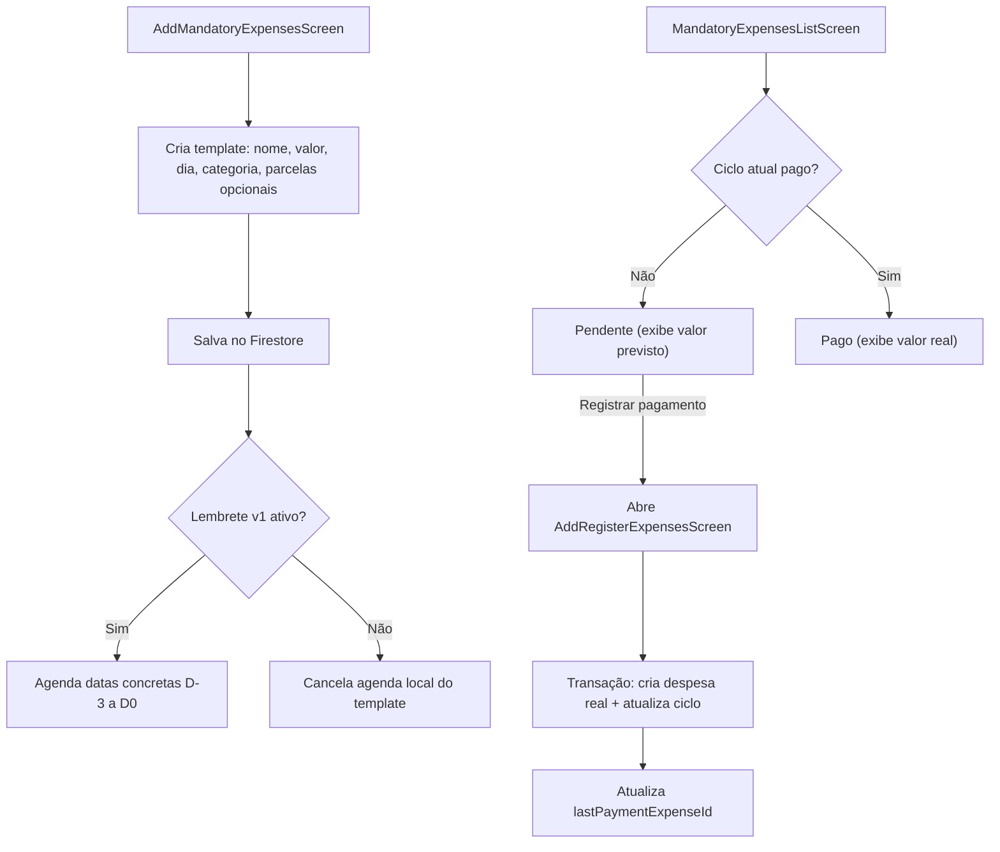

# Despesas Fixas

<!-- spark-progress:start -->
## Progresso Spark — 23/10/2026

**F07 — Recorrências e parcelas: 80% implementado / 20% restante.** Notas P/I/D/E: **100/75/50/75**; cálculo e evidências em [[Status da Implementação Spark]].

O percentual corresponde ao módulo completo, incluindo integração e dados, e não somente ao serviço descrito nesta página. **Próxima entrega:** Concluir restauração integral das intenções, compatibilidade restante, assistente e homologação. Replanejamento com sucessor/configuração atômicos, desfazimento ordenado e liquidação de parcelas após o prazo já possuem serviço/Rules e entradas Web/mobile.

Esta revisão prevalece sobre listas de pendências datadas das entregas anteriores abaixo. Implementação local e logs não aprovam publicação nem migração real.
<!-- spark-progress:end -->

## Despesas recorrentes utilizáveis — 23/10/2026

Cadastro/edição Web/mobile aguardam `useMovementFormEntry` confirmar contexto ou registro. Erro mantém a entrada bloqueada com **Tentar novamente**; leitura Spark que falha não consulta o cadastro legado e uma edição sem dados não vira criação. UID/rota substituídos descartam leituras e feedback tardios. `useSparkRecurringForm` oferece inicialização explícita, identifica contexto pelo UID/escopo e conserva a guarda Spark ao limpar o formulário.

Categorias usam `getTagsWithUsersByPersonFirebase`, que já delimita o acesso autorizado, e depois o filtro de uso obrigatório de despesa. Não se aplica outro filtro local de proprietário que descartava categorias de membros do mesmo grupo. Carga/erro têm estados persistentes e recarga; falha não libera envio com categoria antiga. Retorno do cadastro inline continua selecionando a nova categoria elegível.

Resultado incerto ou definição já confirmada com metadados pendentes bloqueia nome, valor, vencimento, categoria, observações, parcelamento e lembrete. **Confirmar cadastro anterior** repete o mesmo material/receipts; reset não descarta uma fase pendente. Contrato Spark existente mantém total/quantidade/prazo pela edição comum; a interface orienta usar Renegociar na lista. Parcelas concluídas continuam explícitas, sem avanço por calendário. Cadastro e configuração não debitam banco; somente efetivar o pagamento produz o evento financeiro existente.

A lista compartilha o guard de consultas de `useBankMovementsRequest`: UID, geração de recarga, foco e desmontagem invalidam respostas antigas. Recarga limpa dados/expansões e exibe carregamento; falha oculta resumo/calendário e bloqueia PDF, com nova tentativa. **Atualizar despesas recorrentes** está disponível nas duas plataformas. Falha ao reconciliar a agenda é exibida separadamente, conservando os dados financeiros carregados; não exige outro cadastro/pagamento.

Arquivamento/desfazimento têm trava síncrona e confirmação vinculada ao UID. Ação incerta conserva o modal e **Confirmar ação anterior**, sem fechar para perder o material pendente. Sucesso seguido de falha de recarga não repete a ação. Retorno de outra sessão não publica feedback. Lembretes nativos e guardas financeiros permanecem nos serviços existentes; não se promete agenda no navegador ou push com todos os aplicativos fechados.

A revisão `recurring-expenses-2026-10-23` habilita apenas a chave compartilhada `addMandatoryExpenses`, que já protege cadastro/lista Web/mobile. Não cria chave independente para a lista nem libera receitas recorrentes. Outras preferências e desligamentos posteriores permanecem. F07 mantém 80% (100/75/50/75), financeiro 78% e geral 56%; recuperação material após reload, compatibilidade restante, assistente e homologação seguem pendentes. 65 testes focados distintos, tipagem do aplicativo, estilos e diff-check aprovados. Evidências, limites e roteiro manual em [[Versão Usável por Telas]]. Sem novo Emulator, inspeção visual autenticada, export/build, aparelho ou deploy nesta revisão.

## Renegociação e parcelas após o prazo — 22/10/2026

`SparkRecurringReplanFirebase` cria sucessor finito para o **saldo negociado restante**, arquiva o predecessor e grava metadados/receipt/cota atomicamente. Nome, tipo, categoria e configuração são preservados pela ponte; a tela pede total, quantidade, primeiro ciclo e motivo, mostra a revisão do acordo e confirma uma vez. Não soma o novo valor aos pagamentos antigos nem inventa quitação pelo calendário. O primeiro ciclo deve ser atual/futuro e não pode já ter pagamento no predecessor. Total inteiro, divisão e resto são validados no cliente e nas Rules. Despesa e receita usam o mesmo protocolo.

O predecessor guarda sucessor/origem e não pode ser pago, restaurado ou ter pagamentos desfeitos isoladamente. O sucessor conserva o vínculo de origem. Desfazer replanejamento exige revisões atuais, ausência de pagamentos pendentes de desfazimento no sucessor e resolução de sucessores posteriores; reativa o anterior e marca o novo contrato como cancelado, preservando ambos. Contratos cancelados não ganham restauração comum. O fluxo está nas listas Web/mobile; falha de agenda posterior não repete o commit.

`lateSettlement:true` permite liquidar **parcelas finitas restantes** depois de `endCycle`, com motivo e ciclo/data compatíveis. Sem essa marca o prazo continua obrigatório; recorrências ilimitadas não a aceitam. Receipt/ciclo têm a mesma marca, quantidade e faixa originais; quitação negociada continua exclusiva de despesa finita. Home mostra o saldo vencido no vencimento original e a previsão o inclui uma única vez no primeiro mês, inclusive após uma liquidação parcial no mês. Leitura valida a marca antes de aceitar ciclo posterior ao prazo. O prazo original e os lembretes contratados não são prorrogados silenciosamente; um novo calendário exige renegociação.

Intenções incertas ainda precisam do formulário montado e dos mesmos dados/IDs. Após recarga, os vínculos permitem consultar/desfazer um acordo confirmado, mas não há journal geral para recuperar qualquer rascunho financeiro.

## Fluxo Spark conectado — 22/10/2026

Datas de início/fim e do pagamento são adaptadas como campos civis para a interface; o serviço mantém instantes reais nos ciclos. As listas conferem o mês de São Paulo, inclusive quando o aparelho já está no dia/mês seguinte. O ensaio de Tóquio reproduziu e eliminou o avanço indevido do fim do contrato para o mês seguinte.

No Spark, cadastro/edição de metadados, pagamento, quitação, desfazimento e arquivo/restauração usam a ponte compartilhada de [[Recorrências Spark]]. Não se cria despesa comum antes de marcar o ciclo. A sugestão nos formulários ordinários consulta os planos canônicos e respeita pagamento/vigência/contador explícito. Reivindicar cria compensação financeira; arquivar conserva pagamentos e oferece Restaurar. Os controles nomeiam essas ações sem prometer exclusão irreversível. A descrição do fluxo legado nas seções abaixo permanece aplicável somente ao transporte legado.

Quitação com desconto/acréscimo mantém nominal da faixa e caixa pago distintos, exige observação do motivo e admite estorno exato. Contrato 333+333+334 continua somando 1.000 nominalmente; pagar 900 pela quitação das três parcelas reduz o banco em 900, não em 1.000. Desfazer retorna 900 e recua três parcelas. Não existe quitação por tempo transcorrido. Replanejamento do contrato e parcelas após a vigência permanecem no inventário aberto.

## Núcleo Spark em preparação

[[Recorrências Spark]] acrescenta cadastro financeiro, edição/arquivamento da definição e pagamento/desfazimento atômicos com ciclo, conta, evento, revisão e cota. Parcelas usam soma exata do contrato; desfazimento de faixa finita exige remover primeiro as faixas efetivadas depois. Arquivar preserva histórico e permite desfazer pagamento. Esse módulo ainda não substitui as telas/listas, os templates antigos, seus lembretes ou os comandos do assistente; conversão de dados e adaptação de metadados continuam pendentes.

[[Conversão de Recorrências Spark]] v0.10 converte os formatos compatíveis de templates/ciclos do razão em candidato bloqueado, preservando pagamentos/contadores comprovados e gerando pendências para ambiguidades. Acrescenta serviço para vencimento, dias úteis, descrição e configuração de lembrete, sem agendamento automático. Integração com esta lista/formulário, legado sem evidência suficiente e ativação real continuam pendentes.

Gerencia despesas recorrentes mensais (ex: aluguel, streaming, academia) com rastreamento de pagamento por ciclo, lembretes locais de vencimento e aviso remoto aos usuários vinculados quando o template muda.

## Como funciona

1. `AddMandatoryExpensesScreen.tsx` cria a despesa fixa com nome, valor, dia do vencimento, categoria obrigatória e parcelamento opcional; quando parcelada, recebe o valor total e a quantidade, calcula o valor mensal e bloqueia sua edição. O seletor de categoria usa o ActionSheet customizado das telas de registro, com ícone, nome e ação interna para abrir `AddRegisterTagScreen.tsx` sem perder o contexto
2. Cada despesa fixa tem um controle de ciclo (`YYYY-MM`) para rastrear se já foi paga no mês atual
3. `MandatoryExpensesListScreen.tsx` exibe todas as despesas fixas com status: paga / pendente no ciclo atual
4. Após criar ou editar o template obrigatório, `AddMandatoryExpensesScreen.tsx` aplica [[Comportamento Pós-Registro]] depois do feedback de sucesso
5. Ao registrar o pagamento do mês, o app abre o fluxo de [[Transações de Despesas|despesa]] real; nesse momento o banco e a data do ciclo atual são definidos. O submit cria a despesa e atualiza o ciclo em uma única transação Firestore, seguindo depois a preferência da tela de despesas
6. O card **Lembrete do vencimento** permite escolher quando começar a lembrar (um, dois ou três dias antes), adicionar um aviso no próprio vencimento e definir o horário preferido; os avisos locais são agendados via [[Notificações]]
7. Ao registrar o pagamento real, o app suprime imediatamente os avisos restantes do mesmo ciclo `YYYY-MM`, evitando cobrar um item já pago
8. Enquanto a despesa fixa estiver pendente no ciclo atual, o calendário e a timeline exibem o valor previsto do template; após o registro do mês, passam a mostrar o valor efetivamente salvo na despesa real vinculada via `lastPaymentExpenseId`
9. Quando o parcelamento está ativo, o template mantém `installmentTotal`, `installmentsCompleted`, `installmentStartDate` e `installmentEndDate`; cada pagamento mensal registrado avança uma parcela e a listagem exibe `Parcela X de Y`
10. `MandatoryExpensesListScreen.tsx` exibe um resumo do mês corrente com total do ciclo, valores pagos, valores pendentes, parcelamentos concluídos fora do ciclo e botão para baixar o resumo em PDF via `expo-print`/`expo-sharing`; as ações de baixar PDF e adicionar gasto ficam lado a lado em um `HStack`
11. A lista pode ser recarregada manualmente por pull-to-refresh ou pelo botão Atualizar despesas recorrentes nas duas plataformas. Esse recarregamento também reconcilia os lembretes locais com os templates do UID autenticado
12. Quando um usuário tenta registrar uma despesa comum do ciclo atual que parece corresponder a um template obrigatório pendente, `AddRegisterExpensesScreen.tsx` mostra um modal conservador. Ao aceitar, a navegação abre `MandatoryExpensesListScreen.tsx` já na confirmação de registro do template identificado
13. Depois de cada criação, edição ou exclusão confirmada no Firestore, a Function confiável de [[Notificações]] envia um push aos aparelhos registrados do dono e de seus usuários relacionados. A lista continua responsável apenas pela reconciliação de seus lembretes locais.
14. O navegador possui composições independentes em `AddMandatoryExpensesScreen.web.tsx` e `MandatoryExpensesListScreen.web.tsx`: o cadastro usa o calendário modal customizado para início/fim das parcelas, um seletor visual rolável de hora/minuto no padrão dos selects e não expõe controle de pagamento durante a edição; a lista usa calendário mensal, resumo, timeline expansível, confirmação em modal com quantidade de parcelas a quitar, recarregamento por pull-to-refresh e impressão do resumo em PDF. Os modais de confirmação e resumo diário da lista Web usam superfície responsiva `lg`, com margem de viewport e rolagem contida; no resumo diário, o corpo e o card expandido mantêm crescimento flexível desabilitado, ajustam-se ao conteúdo e só rolam quando necessário, evitando espaços verticais artificiais entre itens. Cada movimento Web reutiliza a mesma linha compacta de Android/iOS — ícone, nome/categoria à esquerda, valor/data e seta à direita — sem trilho ou marcador próprio. O hero da lista preserva a mesma altura visual das telas Web com sheet sobreposto, ocultando os 64 px finais do `heroHeight` e mantendo 16 px até o calendário. A lógica Firebase e as regras em centavos permanecem as mesmas das telas nativas.
15. Abaixo do resumo mensal, `MandatoryExpensesListScreen.web.tsx` exibe um bullet de progresso dos pagamentos: o limite do trilho é o `totalReferenceInCents` do ciclo e o preenchimento é o `paidTotalInCents`, portanto R$ 2.000 pagos em um total de R$ 5.000 ocupam 40% do gráfico. O componente Web recebe apenas props serializáveis e troca a escala por valores neutros quando a privacidade está ativa.
16. Abaixo do bullet, a Web exibe dois gráficos lado a lado em cards responsivos: `RadarChart` soma os valores exibidos por categoria para mostrar a concentração dos gastos obrigatórios, convertendo cents para reais na camada visual e sem escala numérica radial; `ScatterChart` usa o `resolvedDueDate` do ciclo atual no eixo X (dia da semana) e no eixo Y (dia do mês), mantendo a distribuição do calendário e separando pendentes de pagos/concluídos. Ambos recebem somente dados serializáveis; o Radar usa valores neutros quando a privacidade está ativa e não revela proporções.
17. No resumo diário de `date-calendar.tsx`, cada movimento mostra o nome da despesa obrigatória ao lado do ícone, a categoria como subtítulo e o valor/data em uma coluna independente nas plataformas. O nome é normalizado para suportar truncamento sem deslocar o valor e possui fallback acessível somente quando o dado vier vazio.
18. No resumo diário Web, os itens do mesmo dia aparecem com pendentes antes dos concluídos e, dentro de cada estado, em ordem alfabética pelo nome. O detalhe é compacto, usa uma borda lateral para indicar o tom do item e preserva as ações de registrar, quitar parcelas, editar, reivindicar e excluir sem alterar a confirmação da listagem. A timeline geral da listagem reutiliza a disposição da Home, com pendentes em gradiente laranja/âmbar, pagos/concluídos em verde, entrada por deslocamento/opacidade e fundo `Grainient` contextual. Na grade mensal, quando um feriado coincide com um gasto, o recorte circular do Web mantém a divisão colorida inteira dentro da bolinha.
19. Em 2026-08-27, `AddMandatoryExpensesScreen.web.tsx` refinou a mesma composição Web de `AddRegisterExpensesScreen.web.tsx`: hero com wallpaper/`Grainient`/`StrokeText`, sheet sobreposto, largura máxima, grid responsivo, labels, inputs com foco amarelo, espaçamento e `Navigator`. Nome, valor e o input de vencimento ficam visíveis; **Mais opções do vencimento** expande apenas o switch **Contar por dia útil**. Observações e categoria seguem no formulário principal; parcelamento e lembrete são opções recolhíveis em **Mais opções**, expandido automaticamente quando uma delas já está ativa. Os campos de antecedência e horário usam menus Web próprios no fluxo vertical, com valor escolhido visível, seta, hover, seleção, foco de teclado, padding e listas roláveis; Android/iOS preservam os seletores nativos. O registro de pagamento é feito exclusivamente pela lista. A lógica Firebase, os valores em centavos e a variante nativa não foram alterados.

## Chave de Ciclo

- `getCycleKeyFromDate()` em `utils/mandatoryExpenses.ts` retorna `YYYY-MM` para o mês atual
- `isCycleKeyCurrent()` verifica se a chave salva corresponde ao mês vigente
- Ao virar o mês, todas as despesas fixas ficam automaticamente como pendentes

## Lembretes de pagamento

- TimePickerField abre o seletor de hora nativo no Android/iOS e devolve HH:MM; no Web, abre um menu próprio com colunas roláveis de hora e minuto, estados de seleção/hover, seta e padding alinhados ao `web-select-field.tsx`. No Android, o cabeçalho, o marcador e as ações usam o amarelo padrão do sistema configurado no build. A tela converte o valor escolhido para os campos numéricos já persistidos, sem alterar a agenda ou as regras de entrega.
- Um template novo começa com `reminderEnabled: false`, `reminderConfigVersion: 1`, `reminderDaysBefore: 1` e `reminderOnDueDate: false`.
- O seletor **Começar a lembrar** é cumulativo: `1` cria D-1; `2` cria D-2 e D-1; `3` cria D-3, D-2 e D-1.
- O switch **Avisar também no vencimento** acrescenta D0 sem remover os avisos anteriores. Assim, a configuração máxima gera D-3, D-2, D-1 e D0.
- O horário continua salvo em `reminderHour`/`reminderMinute`, mas é um horário preferido no Android: Doze, economia de bateria ou o fabricante podem atrasar a entrega.
- Templates sem `reminderConfigVersion: 1` são legado opt-out. Mesmo que possuam um `reminderEnabled` antigo, a listagem os trata como desativados até o usuário revisar, reativar e salvar o novo card.
- `MandatoryExpensesListScreen.tsx` apresenta `reminderSummary` com antecedência cumulativa, D0 opcional e horário; ausência de configuração nunca deve ser exibida como lembrete ativo.
- A agenda usa datas concretas depois de resolver o vencimento mensal. Isso preserva dia 29/30/31, dias úteis e avisos que caem no mês/ano anterior ao vencimento.
- O serviço mantém horizonte móvel, escopo por UID e período de parcelamento. Ciclos com `lastPaymentCycle` concluído e parcelamentos encerrados não recebem avisos.
- Salvar com o switch desligado ou excluir o template cancela todas as datas locais correspondentes àquela conta e despesa.

## Parcelamento

- Parcelamento é opcional. Sem `installmentTotal`, a despesa continua sendo uma recorrência mensal sem prazo final.
- Com `installmentTotal`, o template passa a representar uma despesa parcelada finita. `installmentTotalValueInCents` guarda o valor contratual total; `valueInCents` é o valor mensal derivado por divisão inteira e deixa de ser editável enquanto o parcelamento estiver ativo. A diferença de centavos fica na última parcela para que a soma seja sempre exata.
- Ao ativar o parcelamento, o valor que já estava informado passa a ser o valor total contratado; escolher ou alterar a quantidade somente recalcula o valor mensal. O total nunca é multiplicado pela quantidade.
- Ao ativar o parcelamento, `AddMandatoryExpensesScreen.tsx` mostra calendário de início preenchido com hoje e calendário final bloqueado até haver uma quantidade válida de parcelas.
- A quantidade e a data final ficam sincronizadas: alterar a quantidade recalcula `installmentEndDate`; alterar a data final recalcula `installmentTotal` pelos meses inclusivos entre início e fim.
- `installmentStartDate` permite backfill de templates antigos: ao editar/salvar ou listar, o app calcula quantas parcelas mensais já transcorreram antes do ciclo atual e mantém o ciclo atual dependente do pagamento real registrado.
- `installmentsCompleted` guarda quantas parcelas já foram efetivadas. Ao registrar o pagamento via [[Transações de Despesas]], `registerMandatoryExpensePaymentFirebase()` cria a despesa real e incrementa esse contador uma vez por ciclo na mesma transação.
- Ao reivindicar/desfazer o pagamento do ciclo, `clearMandatoryExpensePaymentFirebase()` remove o vínculo com a despesa real e recua a mesma quantidade de parcelas registrada em `lastPaymentInstallmentsCount` (um para templates legados).
- Quando `installmentsCompleted >= installmentTotal`, a listagem trata o parcelamento como concluído e bloqueia novos registros para o template.
- A UI usa `formatMandatoryInstallmentLabel()` em `utils/mandatoryInstallments.ts` para exibir `Parcela X de Y` no calendário e na timeline.
- Enquanto houver parcelas restantes, a lista oferece **Quitar parcelas**. O usuário informa de uma até a quantidade restante; o fluxo calcula em centavos a soma exata da seleção, abre o lançamento de despesa para escolha do banco e registra uma única despesa real.
- A quitação antecipada usa `settleMandatoryExpenseFirebase()` em uma transação Firestore: a despesa real é criada, `installmentsCompleted` avança pela quantidade escolhida e o template só é removido ao concluir a última parcela. O valor do lançamento continua ajustável para descontos ou outros acertos, enquanto a transação valida o saldo de parcelas.
- A sincronização de lembretes trata parcelamentos concluídos como `reminderEnabled: false`, cancelando notificações futuras ao recarregar a lista.

## Arquivos principais

- `screens/mobile/AddMandatoryExpensesScreen.tsx` — Formulário de criação/edição
- `screens/mobile/MandatoryExpensesListScreen.tsx` — Lista, timeline e controle de pagamento
- `screens/web/AddMandatoryExpensesScreen.web.tsx` — Composição Web responsiva do cadastro, com calendário/modal e controle mensal
- `screens/web/MandatoryExpensesListScreen.web.tsx` — Composição Web responsiva da lista, calendário, timeline, modais e resumo imprimível
- `components/uiverse/recurring/mandatory-expense-payment-bullet-chart.tsx` — `BulletChart` oficial de Mantine em Expo DOM, Web-only, com escala pelo total do ciclo e preenchimento pelo valor pago
- `components/uiverse/recurring/mandatory-expenses-radar-chart.tsx` — `RadarChart` oficial de Mantine em Expo DOM para concentração de gastos por categoria
- `components/uiverse/recurring/mandatory-expenses-scatter-chart.tsx` — `ScatterChart` oficial de Mantine em Expo DOM para concentração dos dias de vencimento do ciclo atual
- `functions/MandatoryExpenseFirebase.ts` — CRUD, validação do vínculo com despesa real e transação atômica de pagamento no Firestore
- `utils/mandatoryExpenses.ts` — Lógica de chave de ciclo
- `utils/mandatoryExpenseSuggestions.ts` — Detecção conservadora de templates obrigatórios em registros comuns
- `utils/mandatoryInstallments.ts` — Normalização e rótulos de parcelamento
- `utils/mandatoryPeriodSummaryPdf.ts` — HTML compartilhado para PDF de resumo mensal de recorrências
- `utils/mandatoryReminderNotifications.ts` — Serviço compartilhado de lembretes obrigatórios
- `utils/mandatoryReminderConfig.ts` — Schema v1, offsets cumulativos e resumo do lembrete
- `utils/mandatoryExpenseNotifications.ts` — Agendamento de notificações (wrapper fino)
- `app/mobile/add-mandatory-expenses.tsx` — Rota de criação
- `app/mobile/mandatory-expenses.tsx` — Rota da lista
- `utils/navigation.ts` — Saída explícita para Home pelo voltar físico/navigator
- `hooks/usePostSubmitBehavior.ts` — Aplica retorno/limpeza após salvar templates
- `components/uiverse/categories/tag-actionsheet-selector.tsx` — Seletor de categoria obrigatória em ActionSheet
- `components/mobile/recurring/time-picker-field.native.tsx` / `components/web/recurring/time-picker-field.web.tsx` — Seletor reutilizável de horário do lembrete
- `components/mobile/shared/date-picker.native.tsx` / `components/web/shared/date-picker.web.tsx` e `components/mobile/recurring/date-calendar.native.tsx` / `components/web/recurring/date-calendar.web.tsx` — Calendários customizados separados por plataforma, usados pelo cadastro e pela listagem com o mesmo contrato de data e valores

## Integrações

- [[Transações de Despesas]] — Marcar como paga cria despesa real no Firestore
- [[Gerenciamento de Bancos]] — Banco é escolhido no lançamento mensal da despesa real
- [[Notificações]] — Agendamento de lembretes de vencimento via `mandatoryReminderNotifications.ts`
- [[Receitas Fixas]] — Módulo paralelo que compartilha o motor de agenda, com regra de momento própria
- [[Gerenciamento de Tags]] — Categoria obrigatória pode ser criada inline
- [[Privacidade de Valores]] — Resumo e PDF respeitam a preferência de ocultar valores
- [[Previsão de Fluxo de Caixa]] — Template pendente é projetado no ciclo correspondente; pagamento real vinculado e parcelas concluídas não são projetados novamente
- [[Comportamento Pós-Registro]] — Define retorno/limpeza após salvar templates

## Configuração

- Notificações requerem permissão do usuário e usam exclusivamente `expo-notifications`
- Expo Go serve para smoke test local; validar canais, segundo plano e comportamento real em development build e produção
- Alterar plugin, manifesto ou dependência nativa exige novo build; detalhes em [[Notificações]]

## Observações importantes

- Despesas fixas **não debitam automaticamente** — o usuário precisa marcar como paga
- No navegador, lembretes continuam sendo salvos no template, mas não são agendados; a própria composição Web informa que a entrega ocorre somente no aplicativo instalado. O calendário e os modais são componentes da aplicação, sem depender do date picker nativo do sistema.
- A [[Previsão de Fluxo de Caixa]] apenas lê os templates pendentes como compromissos estimados; ela nunca efetiva o pagamento nem altera `lastPaymentCycle`
- A lista de gastos obrigatórios é o fluxo correto para efetivar o ciclo. Lançamentos comuns do ciclo atual que batem com qualquer template pendente podem ser interceptados antes de salvar; um nome principal canônico e único (como `Fatura do Aluguel`/`Aluguel`, `Pagamento da Internet Residencial`/`Internet Residencial` ou `Mensalidade da Academia`/`Academia`) basta mesmo quando a categoria e o valor variam. `Luz`, `Conta de Luz` e `Energia Elétrica` são apenas outro exemplo. Para nome apenas parecido, a sugestão exige valor compatível com o template/último pagamento mais categoria igual ou vencimento em até sete dias
- Nomes de marca ou serviço semanticamente distintos, sem palavras em comum com o template, não são inferidos por suposição para não abrir o modal no gasto errado
- Templates já pagos no ciclo, parcelamentos concluídos, parcelas fora de sua vigência e candidatos ambíguos nunca abrem a sugestão. Um vínculo cujo documento de despesa não exista é tratado como pendente para permitir correção pelo fluxo oficial
- O parâmetro de navegação `focusMandatoryExpenseId` abre a confirmação de registro apenas se o template continuar pendente depois da recarga da lista; assim uma atualização concorrente não cria duplicidade
- O ciclo é verificado no momento da listagem — sem jobs background. O formulário de pagamento obrigatório aceita somente datas do ciclo atual, porque o template mantém o vínculo do ciclo vigente
- Se o app for reinstalado, notificações agendadas são perdidas
- A lista reconcilia os lembretes salvos, corrigindo datas ausentes, expiradas ou defasadas na agenda Expo do UID atual
- A autenticação também executa a reconciliação global via `mandatoryReminderAccountSync.ts`, portanto um relogin restaura os lembretes sem exigir que esta lista seja aberta
- O texto da notificação é personalizado com o nome do gasto e orienta que o pagamento deve ser efetuado
- O formulário libera campos progressivamente; se houver alterações pendentes em um template salvo, é preciso salvá-las antes de registrar o ciclo
- Todos os inputs textuais do formulário, incluindo quantidade de parcelas e observações, devem usar a rotina de foco que mantém o campo visível acima do teclado. O horário do lembrete usa o seletor nativo e não abre o teclado.
- Em formulários novos, o switch de lembrete começa desligado e fica desabilitado até nome, valor, dia e categoria serem preenchidos
- Quando a categoria é criada inline, a tela de tags abre com tipo `expense` e obrigatoriedade pré-selecionados, mas editáveis; ao salvar uma categoria compatível, ela retorna já selecionada
- O seletor de categoria obrigatória deve permanecer no ActionSheet compartilhado com `<TagIcon />` e ação interna de criação, sem regressão para o menu padrão do Android ou botão externo ao campo
- O valor no ciclo atual usa `displayValueInCents` do `date-calendar.tsx`: antes da efetivação mostra o template, após mostra o `valueInCents` da despesa real apontada por `lastPaymentExpenseId`
- Salvar ou editar um template obrigatório deve passar por [[Comportamento Pós-Registro]]
- Ao criar um novo template obrigatório, a limpeza dos campos é controlada pela preferência da tela quando o retorno automático está desligado; o submit usa trava síncrona enquanto salva e agenda/cancela lembrete para impedir duplo registro
- Despesas parceladas permanecem no calendário/lista até a conclusão ou quitação antecipada; deixam de aceitar novos registros depois da última parcela
- A quitação de todas as parcelas encerra o template e mantém no razão as parcelas já pagas e uma despesa real com o valor agregado selecionado; a quitação parcial preserva o template com o saldo atualizado. Nenhuma delas exclui silenciosamente o histórico financeiro
- Templates parcelados criados antes de `installmentStartDate` continuam compatíveis; ao editar, o formulário sugere hoje como início e recalcula o fim pela quantidade atual até o usuário salvar a nova configuração
- O resumo mensal inclui itens pagos no ciclo atual e pendentes do mês; parcelamentos concluídos em ciclos anteriores aparecem como contagem separada e não entram no total financeiro do mês
- Na Web, o bullet de progresso aparece sozinho abaixo do resumo mensal: usa o total mensal de referência como limite real e o total efetivamente pago como valor avançado, sem repetir título, contagem ou soma paga/total já exibidos acima. Ele não cria consulta ou persistência própria e desaparece quando o total do ciclo é zero
- Na Web, os gráficos de categoria e vencimento aparecem abaixo do bullet quando há templates cadastrados. O Radar agrega `displayValueInCents` por categoria, converte para reais apenas na camada visual e neutraliza todos os valores para a mesma escala quando **Ocultar valores** está ativo; o Scatter usa `resolvedDueDate` do ciclo atual para refletir os mesmos dias distribuídos no calendário
- O PDF é gerado localmente no dispositivo, compartilhado com nome contextual `Lumus-Financas-Despesas-Fixas-[mes]-[data].pdf` e usa os mesmos valores exibidos na tela, incluindo valores ocultos quando a privacidade está ativa

## Integração com o Assistente Lumus

- [[Assistente Lumus]] cria/edita/exclui templates e registra/desfaz o ciclo por comandos próprios.
- Pagamento e lançamento real são escritos na mesma transação; `lastPaymentExpenseId`, `lastPaymentCycle` e parcelas não podem ficar parcialmente atualizados.
- A agenda local é suprimida ou recalculada somente depois do commit e uma falha de notificação vira aviso sem desfazer o pagamento.

- O pedido, banco, data, quantidade de parcelas, confirmação e cancelamento são resolvidos no chat. No razão, `manageFinancialMetadata` gerencia somente templates próprios e `completeFinancialRecurring` efetiva/desfaz o ciclo; no legado, a transação SDK conserva os vínculos e um recibo privado por pedido.
- Templates criados pelo assistente mantêm `assistantCycleHistoryComplete: true` e `completedCycles[YYYY-MM]` com ID do lançamento, quantidade e valor efetivado. A última indicação de ciclo de um template antigo não comprova a situação de meses anteriores: sem histórico suficiente, uma consulta/efetivação histórica retorna `history-unavailable` em vez de inventar pendência. Não há backfill financeiro automático.
- Parcelas somam o contrato inteiro em centavos: três parcelas de um contrato de 1.000 centavos produzem 333 + 333 + 334. Quitar várias parcelas cria um único lançamento com a soma exata; desfazer restaura a quantidade efetivada e remove a entrada daquele ciclo. Início/fim são revalidados por mês civil de São Paulo no executor e servidor, além da quantidade restante.
- Recibo é consultado antes de revalidar o snapshot alterado pelo próprio commit; reenvio após resposta perdida retorna o resultado persistido. Notificações são posteriores ao commit e falha local não repete o lançamento. Ver [[Comandos Financeiros Conversacionais]].

### Relatório conversacional e histórico — 2026-10-04

O PDF pode ser solicitado diretamente na conversa, com escolha por nome/ordinal quando necessária. Usa leitores completos próprios/relacionados/grupo e os builders existentes. Lançamentos, último ciclo e `completedCycles` são evidências de conclusão; migração para o razão sem histórico não prova ciclo pago ou pendente. Criação/início exclui ciclos anteriores ao contrato, e valores/quantidades sem evidência não entram em total confirmado. Troca de UID/sessão/privacidade durante a geração cancela a abertura e o transporte nativo limpa temporários próprios. Testes de efeitos de relatório, relação paginada e sessão/privacidade estão em `lumusAssistantExport`, `lumusAssistantTargetedReport`, `mandatoryRelationsCompleteness` e `reportExportSession`; transporte instalado permanece dependente de aparelho. Ver [[Validação Conversacional Lumus]].

## Pagamento pelo chat Spark - 26/10/2026

O [[Assistente Lumus]] efetiva ciclos pelo mesmo `settleSparkRecurringFirebase` das listas, após resumo/confirmação de valor, conta/direção, parcelas e mês civil. Contrato finito usa nominal exato e resto final; plano sem fim admite valor informado e um ciclo por lançamento. Plano/revisão e material são capturados antes da autorização; retry conserva o mesmo comando sem reler o ciclo já alterado. Liquidação finita após vigência é indicada explicitamente, com motivo; negociação de valor e banco negativo continuam na tela própria.

Falha local de lembrete conserva o lançamento confirmado e oferece retry somente da agenda, sem outro efeito financeiro. Plano de outro titular, inativo, substituído/cancelado, ciclo concluído ou histórico desconhecido não autoriza pagamento/recebimento. Demais operações recorrentes pelo chat permanecem parciais. F07 permanece 80%; validação com serviços simulados, limites e roteiro em [[Versão Usável por Telas]]. Sem alteração do protocolo/Rules, deploy ou dados reais.

## Desfazer ciclo pelo chat Spark - 26/10/2026

O [[Assistente Lumus]] desfaz a efetivação do ciclo atual de São Paulo por `undoSparkRecurringFirebase`, após resumo/confirmação de valor real, conta original, direção e quantidade. Confere plano e receipt original (live/importado), replanejamento e última faixa de parcelas; plano arquivado pode ser desfeito sem reativação. Original/inverso são preservados, com data original e contador restaurado pelo protocolo existente. Retry conserva comando/ID, mesmo depois de alteração do ciclo pelo próprio commit; não há fallback legado ou autorização automática de saldo negativo.

A agenda é atualizada somente depois do sucesso, com configuração Spark atual. Pode reagendar sem pedir permissão, manter supressão se houve nova efetivação ou cancelar se plano/configuração já não permitem lembrete. Falha de agenda não repete estorno; retry somente local é vinculado ao grupo/titular original. Mês histórico não é selecionável neste schema. F07 permanece 80%; evidências e limitações em [[Versão Usável por Telas]]. Sem mudança de Rules, deploy ou dado real.

## Cadastro e edição pelo chat Spark - 26/10/2026

O [[Assistente Lumus]] cria/edita definição e metadados pelos serviços Spark existentes, com resumo e confirmação do material completo antes do envio. Contrato finito conserva total/quantidade/vigência e resto exato; edição mantém parcelas concluídas, estado ativo/arquivado e campos omitidos. Alteração de contrato usa replanejamento na tela própria. Categorias são resolvidas no grupo autorizado; editar plano de outro titular é recusado.

Definição e configuração são etapas separadas com receipts/IDs estáveis. Falha após definição confirmada informa parcial e atualiza leituras; retry retoma os mesmos comandos, sem criar outro plano. Argumentos ficam bloqueados após início da tentativa. Cancelamento comprovado de configuração orienta editar o registro já salvo. Cadastro/edição não geram movimento financeiro; agenda é posterior, sem pedir permissão, com retry exclusivo quando falha. F07 permanece 80%; evidências e limites em [[Versão Usável por Telas]]. Arquivamento, replanejamento conversacional, retomada após reload e homologação continuam pendentes. Sem Rules, deploy ou dado real.

## Arquivamento pelo chat Spark - 26/10/2026

O [[Assistente Lumus]] arquiva planos próprios ativos por `updateSparkRecurringPlanFirebase`, após conferir revisão e apresentar resumo/confirmação. Mantém contrato, contador, pagamentos/recebimentos, ciclos e metadados; não quita pendências nem movimenta saldo. Contrato substituído/cancelado ou de outro titular é recusado. Pedido explícito de arquivar não é encaminhado a exclusão legada quando Spark está ausente.

Reenvio usa o mesmo ID/comando sem exigir plano ainda ativo. Agenda é posterior e falha separadamente, com retry somente do lembrete e leitura da configuração atual; restauração posterior pela lista é respeitada. Plano arquivado com ciclo atual efetivado continua disponível para desfazimento. Restauração pelo chat e replanejamento conversacional permanecem pendentes. F07 mantido em 80%; evidências e limites em [[Versão Usável por Telas]]. Sem novo protocolo/Rules, deploy ou dados reais.

## Restauração de recorrências pelo chat Spark - 26/10/2026

A conversa aceita pedidos para restaurar ou reativar despesas e receitas recorrentes arquivadas. O catálogo inclui planos inativos e oferece, para restauração, somente os elegíveis. O comando Spark `updateSparkRecurringPlanFirebase` é preparado com `active:true`, revisão, titular, categoria, nominal e identidade preservados. O resumo exige confirmação e informa preservação do contrato, ciclos, contador e histórico; não movimenta saldo. Contratos substituídos/cancelados, planos já ativos, outro titular e grupos indisponíveis são recusados; alterações adicionais devem ser solicitadas separadamente.

O mesmo comando e ID são reenviados após resposta incerta, sem reler o plano já alterado pelo commit. A agenda é reconciliada separadamente com o estado atual; sua falha permite retry somente do lembrete. A intenção de restauração permanece vinculada ao rascunho, inclusive em correções; não há fallback para edição legada. Lotes filtram planos inativos elegíveis e preservam a quantidade informada. Sem novo writer monetário, Rules ou deploy; a intenção continua em memória. Ver [[Assistente Lumus]], [[Despesas Fixas]], [[Receitas Fixas]] e [[Status da Implementação Spark]].

### Replanejamento pelo Assistente — 27/10/2026

O chat prepara replanejamento individual de contrato finito Spark ativo, de titular autorizado, pedindo o total negociado em centavos, quantidade de parcelas, primeiro ciclo e motivo. Após resumo e confirmação, usa `replanSparkRecurringFirebase` com revisões e IDs capturados: o contrato anterior é preservado e substituído atomicamente, sem movimentação de saldo nem quitação implícita. Uma tentativa já enviada conserva o mesmo comando para recuperação; alteração do material exige nova intenção após resolução. Atualização dos lembretes do predecessor e sucessor é posterior e pode ser repetida sem reenviar o replanejamento. Contas legadas não recebem substituição alternativa.

O desfazimento conversacional do replanejamento, a recuperação da intenção após reload e a homologação em aparelho permanecem pendentes. Os serviços simulados não comprovam Rules ou operação em produção. Sem deploy. Ver [[Assistente Lumus]] e [[Recorrências Spark]].

### Desfazimento de replanejamento pelo Assistente — 27/10/2026

O chat prepara o desfazimento individual de replanejamento Spark usando a referência ao contrato anterior ou ao sucessor. Pede o motivo, confere titular, grupo, vínculos e receipt original, e apresenta os dois contratos e o efeito para confirmação. O sucessor não pode ter parcelas efetivadas nem replanejamento posterior; o serviço `undoSparkRecurringReplanFirebase` volta a validar as revisões e dependências na transação. A operação reativa o anterior, cancela o sucessor e preserva o histórico sem movimentar saldo.

A tentativa conserva o comando e ID após envio; os lembretes dos dois planos são reconciliados depois do commit e podem ser repetidos separadamente. Não há fallback para alteração legada. Intenção após reload, validação em aparelho, Rules implantadas e operação em dados reais não foram verificadas nesta entrega. Sem deploy. Ver [[Assistente Lumus]] e [[Recorrências Spark]].
