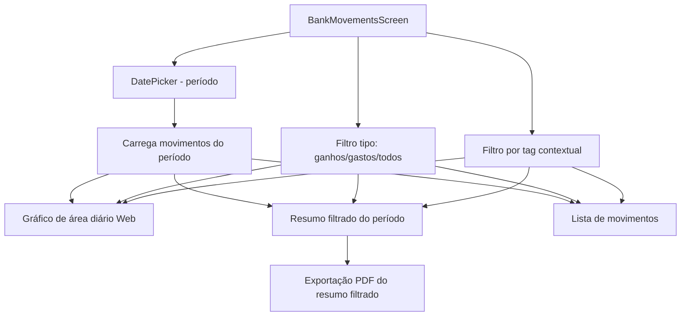

# Gerenciamento de Bancos

## Timeline compartilhada com a Home — 26/10/2026

`BankMovementsScreen` Web/mobile oferece o modo `recentMovements` para [[Dashboard Home]], reutilizando timeline, metadados, restrições, ações e diálogos. O modo recebe itens/contas/loading/erro/reload da Home; não consulta novamente o extrato, o catálogo de bancos ou as categorias. `MovementRecord` fica em `types/bankMovements.ts`. Chaves de expansão incluem tipo e ID, preservando o ID original enviado ao executor. O extrato completo mantém filtros, período, resumo, gráfico Web e PDF. Edição de investimento recarrega a composição após salvar; o valor anterior da sincronização Web usa formatação monetária com privacidade.

## Primeiro fluxo: banco e saldo inicial — 23/10/2026

As telas Web/mobile de cadastro Spark agora coletam o saldo disponível no momento da criação. Abertura zero continua válida; saldo negativo exige justificativa. Banco, catálogo, posição, checkpoint, receipt e cota usam a transação existente de abertura declarada. Não registrar esse patrimônio como receita nem criar um segundo saldo mensal automaticamente. A referência é o instante do commit: saldo de início de mês continua no fluxo específico de [[Balanço Mensal]], que preserva lançamentos posteriores.

Nome/ícone/cor continuam editáveis por revisão canônica sem alterar dinheiro. O valor inicial e o motivo integram a assinatura da intenção: reenvio incerto exige os mesmos argumentos e conserva conta/ID. Contexto inválido não cai no escritor legado; a abertura com saldo não é ignorada caso o contexto deixe de ser Spark.

Novo cadastro confere o contexto antes de liberar o formulário. Carregamento e falha são visíveis, com **Tentar carregar novamente** e salvamento bloqueado enquanto a conferência estiver incompleta. O campo de saldo aparece somente no cadastro Spark; o fluxo legado confirmado conserva cadastro e saldo mensal separados. Não há ativação automática de grupo real nem alteração das preferências de telas já escolhidas pelo usuário.

Arquivos: SparkBankFormFirebase, useSparkBankForm, BankOpeningBalanceFields e AddRegisterBankScreen Web/mobile. [[Versão Usável por Telas]] acompanha o aceite. Testes de serviço/hook/controles e tipos verificam a entrega; aceite visual autenticado e execução instalada permanecem pendentes.

<!-- spark-progress:start -->
## Progresso Spark — 22/10/2026

**F02 — Bancos, cadastro e ciclo de vida: 75% implementado / 25% restante.** Notas P/I/D/E: **100/75/25/75**; cálculo e evidências em [[Status da Implementação Spark]].

O percentual corresponde ao módulo completo, incluindo integração e dados, e não somente ao serviço descrito nesta página. **Próxima entrega:** Converter cadastros antigos e homologar aparelhos. Criação, edição, arquivamento, restauração e atividade já possuem entradas Web/mobile.

Esta revisão prevalece sobre listas de pendências datadas das entregas anteriores abaixo. Implementação local e logs não aprovam publicação nem migração real.
<!-- spark-progress:end -->

## Ciclo de vida Spark nas configurações — 22/10/2026

As configurações Web/mobile incluem contas inativas/arquivadas na leitura administrativa. `SparkAccountLifecycleFormFirebase` preserva a intenção, posição e revisão de estado; arquivo/restauração/atividade usam a transação protegida, sem alterar saldo, cabeça financeira ou identidade. Restaurar conserva o indicador de atividade anterior; se a conta também estava desativada, ativá-la é uma ação separada. Seletores de novos lançamentos continuam excluindo essas contas por padrão. Nenhuma escrita legada é usada para uma conta Spark.

Atualização de 20/10/2026: criação/edição de bancos conectadas ao Spark nas telas Web/mobile via `useSparkBankForm` e `SparkBankFormFirebase`. Na entrega de 20/10, a criação abria com zero e catálogo/checkpoint/receipt/cota atômicos; a coleta do saldo declarado foi conectada em 23/10, conforme o primeiro fluxo acima. Edição lê catálogo/revisão do servidor e só altera dados descritivos; concorrência exige recarregar. Reenvio incerto conserva identidade/material e bloqueia campos diferentes. UID/papel/grupo continuam obrigatórios; sucesso invalida as consultas financeiras, sem transformar erro de atualização da tela em erro do commit. Ciclo de vida nas telas, conversão legada e recuperação após desmontar/reabrir continuam pendentes. Roteiro reproduzível em [[Guia de Testes Locais]].

> **Integração Spark em 19/10/2026:** [[Integração Financeira Spark]] conecta o extrato de bancos/Caixa à projeção semântica nativa/importada, com componentes, datas civis, saldo corrente guardado no servidor e consulta histórica de arquivados. Web/mobile evitam juntar novamente as fontes anteriores de ajustes/investimentos e leem a abertura mensal canônica. [[Cadastros de Contas Spark]] e [[Ciclo de Vida de Contas Spark]] oferecem abertura com saldo declarado, catálogo e ciclo de atividade; sua ligação integral aos formulários continua pendente. Os eventos Spark no extrato permanecem somente leitura até essa adaptação de mutações. Nenhum grupo real foi ativado.

> **Prova Spark em 18/10/2026:** [[Cadastros de Contas Spark]] implementa nome/aparência com revisão própria e abertura zero com cadastro atômico, administrados por Rules e transações cliente. Os formulários descritos abaixo continuam nos serviços publicados; desativação/reativação, conversão dos cadastros e integração ainda precisam de adaptação específica.

Permite criar e gerenciar contas bancárias, visualizar movimentos por período e acompanhar o saldo de cada conta. É o núcleo financeiro do app.

> **Transição do razão (2026-10-11):** o fluxo abaixo continua sendo o legado para grupos ainda não migrados. Após o corte confirmado, bancos passam a ser financialAccounts do tipo bank, Caixa é uma conta do tipo cash e os saldos vêm de eventos imutáveis e reconciliações. Nenhum documento legado é removido; a ligação é preservada pelo legacyBankId. Cada membro adicional precisa aprovar, na própria sessão, o ID do administrador e o `clientActionId` do corte por `financialMigrationConsent`; a aprovação dura 24 horas e pode ser revogada. `migrateFinancialGroup` valida as aprovações antes de consultar dados, depois do plano e na transação de gravação. São aceitos no máximo cinco membros. O `execute` é recusado enquanto o dry-run registrar qualquer `issue`; veja [[Processo de Release]] e [[Remediação da Auditoria de Segurança]].

## Como funciona

Continuação de 20/10/2026: o extrato Web/mobile já oferece editar/estornar referências ordinárias Spark não resolvidas. IDs de componentes não são usados como alvo: a rota conserva fonte e operação, e o carregador consulta documento/claim/conta protegidos. O estorno exige confirmação e conserva o histórico com compensação na data atual. Categorias/contas/data/fingerprint são revalidados pelo comando; pares, ajustes e investimentos não foram liberados genericamente. `getBankDataFirebase` também lê o catálogo canônico para apresentar um banco selecionado fora da lista ativa, sem inventar titularidade pelo editor. Ver [[Operações Ordinárias Spark]].

Continuação Spark de 19/10/2026: `getAllBanksFirebase`, `getBanksByPersonFirebase` e `getBanksWithUsersByPersonFirebase` resolvem o contexto protegido antes das consultas anteriores e usam `SparkBankSelectionFirebase`. Para Spark, o parâmetro de pessoa identifica a sessão solicitante; a seleção é do grupo autorizado, não uma inferência de dono individual. A seleção padrão contém bancos ativos não arquivados com catálogo conferido; `getAllBanksFirebase(true)` inclui inativos/arquivados para administração. Não retorna Caixa/investimentos nem usa `catalogActorId` como titular. Revogação, rede/contexto inválidos ou cadastro ausente retornam falha, sem consultar coleções antigas. A consulta de catálogo não certifica saldo corrente. Os seletores de despesas/receitas já usam essa ponte; escrita, ações administrativas e conversão dos cadastros continuam pendentes.

Na migração, o fingerprint aprovado inclui o conteúdo financeiro e a lista de membros. A confirmação física do Caixa exige `confirmedAt` (ISO) igual na prévia e execução. Cada coleção aceita no máximo 2.000 documentos; excesso é recusado, sem migração parcial por truncamento. Revogação entre lotes mantém o grupo `migrating`; a própria pessoa pode renovar a mesma aprovação e permitir retomada. Reenvio de uma migração concluída recupera o recibo somente para os mesmos argumentos. Ajustes legados verificam também o corte do dono do banco, impedindo que um vínculo antigo reabra escritas. [[Remediação da Auditoria de Segurança]] registra os testes e limites.

### Cadastro de Banco
1. `screens/mobile/AddRegisterBankScreen.tsx` e `screens/web/AddRegisterBankScreen.web.tsx` coletam nome, cor visual e ícone do banco em composições próprias para cada plataforma; a Web reaproveita `BankActionsheetSelector` para listar as instituições com seus ícones, sem um modal dedicado
2. O seletor de cor aparece abaixo do ícone e somente quando **Outro Banco** está selecionado; escolher uma instituição limpa uma cor personalizada anterior
3. Ambas chamam `BankFirebase.ts` para criar ou atualizar o cadastro no Firestore
4. O banco fica disponível como destino/origem de despesas, receitas, investimentos, saques, saldos mensais e transferências via ActionSheet com ícone
5. Após criar ou editar um banco, as duas telas aplicam [[Comportamento Pós-Registro]] depois do feedback de sucesso

### Desativação reversível
1. A tabela de bancos em `ConfigurationsScreen.tsx` exibe bancos ativos e desativados, mantendo o registro e o histórico financeiro no Firestore
2. A ação **Desativar banco** grava `isActive: false` no documento existente; a ação muda para **Reativar banco** enquanto o banco estiver desativado
3. Bancos desativados não são retornados por `getAllBanksFirebase()`, `getBanksByPersonFirebase()` ou `getBanksWithUsersByPersonFirebase()`, portanto deixam de aparecer nos seletores de despesas, ganhos, investimentos, saques, transferências e saldos. `getAllBanksFirebase()` mantém o nome legado, mas consulta somente o UID autenticado e seus relacionados; consultas Firestore sem `where('personId', ...)` são rejeitadas pelas Rules, que não funcionam como filtros
4. A alteração é confirmada em modal e o feedback informa que o cadastro/histórico foram preservados; excluir o documento continua sendo uma ação separada e destrutiva

### Visualização de Movimentos

1. `BankMovementsScreen.tsx` exibe os movimentos de um banco no período selecionado; a composição Web equivalente fica em `screens/web/BankMovementsScreen.web.tsx`. As duas variantes permitem escolher ou trocar o banco diretamente no início dos filtros, inclusive ao abrir a rota sem `bankId`; a tela nativa reutiliza `BankActionsheetSelector` e recarrega o extrato do banco escolhido mantendo o período. A visão de Caixa continua sendo uma rota própria e não mostra esse seletor.
2. Filtra por data via `DatePicker` customizado
3. Permite refinar a listagem por tipo (`ganhos`, `gastos` ou `todos`) e por categoria, usando apenas as categorias presentes nas movimentações carregadas para aquele banco/período. O dado persistido continua usando `tagId`.
4. O card colorido com banco/carteira, período, saldo e totais gerais foi removido das telas nativa e Web para reduzir informação redundante; o resumo filtrado do período continua visível, e os dados gerais permanecem no PDF exportado. Na tela nativa, os filtros continuam agrupados na superfície compartilhada; na Web, cada input mantém seu próprio contorno sem um card externo
5. Um resumo separado do período exibe sempre um card de saldo antes dos cards de ganhos e despesas, com o mesmo padrão visual dos demais indicadores. Para bancos, o card mostra o saldo atual da conta, independente do período e dos filtros, usando `getBankCurrentBalanceInCentsFirebase`; na visão de dinheiro em espécie, reutiliza o saldo do período já definido para esse resumo. Abaixo, o resumo apresenta ganhos, despesas, saldo líquido e quantidade de movimentações de acordo com os filtros ativos. Na Web, acima da timeline, um `AreaChart` Mantine agrega ganhos e despesas por dia no intervalo selecionado, inclui os dias sem lançamentos com valor zero e acompanha os filtros de tipo/categoria.
6. O resumo filtrado permite baixar um PDF estilizado do período ativo, incluindo dados do banco/dinheiro, totais gerais, totais filtrados e a lista de movimentações visíveis
7. A lista pode ser recarregada manualmente por pull-to-refresh, preservando o período, o banco/dinheiro e os filtros locais
8. Cada movimento exibe: data, descrição, categoria com ícone (via `<TagIcon />`), valor (entrada/saída colorido); despesas obrigatórias usam a paleta visual vermelha de despesa também no ícone, linha, card expandido e valor monetário. Na Web, a timeline reaproveita o contrato `WEB_DASHBOARD_CLASS_NAMES`, o cabeçalho expansível, `AnimatedContent` e `Grainient` usados nas listas Web de despesas obrigatórias e investimentos; a tela nativa mantém sua composição própria.
9. Edições acionadas pela timeline devem permanecer na tela atual após sucesso; movimentos comuns abrem `AddRegisterGainScreen.tsx`/`AddRegisterExpensesScreen.tsx`, e edição de investimento no modal local segue a mesma regra de permanência
10. O grupo Home do `components/uiverse/navigation/navigator.tsx` e do navigator Web oferece permanentemente a opção **Movimentos do banco**, permitindo abrir o extrato sem passar pelo cartão da Home; quando `BankMovementsScreen.tsx` está aberta, essa opção fica marcada e **Início** continua levando ao Dashboard
11. Transferências bancárias são incluídas no extrato tanto pela associação direta `bankId` quanto pelos metadados `bankTransferSourceBankId`/`bankTransferTargetBankId`, garantindo que o banco de origem veja a saída e o banco de destino veja a entrada

### Saldo Calculado
- Saldo atual = saldo do último `MonthlyBalance` + movimentos posteriores a esse snapshot
- A função `computeMonthlyBankBalances()` em `utils/monthlyBalance.ts` agrega despesas, receitas e investimentos por banco
- `shouldIncludeMovementInGainExpenseTotals()` filtra movimentos internos para evitar dupla contagem
- A [[Análise por Categoria]] usa os bancos como dimensão de distribuição mensal da tag selecionada; movimentos sem `bankId` aparecem como **Dinheiro**
- Na Home, a leitura indexada dos snapshots é processada em grupos de até três bancos. O cálculo escolhe o último snapshot elegível e ignora aberturas futuras, preservando o snapshot anterior; mantém fallback escopado aos `personId` autorizados se o índice estiver indisponível. O corte inclui o fim do dia civil solicitado em São Paulo: registros de hoje ao meio-dia entram no saldo mesmo antes desse horário, e movimentos do dia seguinte não entram.
- Os leitores centralizados de saldo legado dividem `personId` autorizado em consultas de até dez identidades, preservando todas as relações quando o conjunto ultrapassa o limite de `in` do Firestore. O caminho individual e o caminho em lote usam o mesmo calculador em centavos.

## Arquivos principais

### Razão após o corte do grupo

- O saldo materializado é verificável: última reconciliação com data/hora exata mais as partidas posteriores.
- Cada evento é balanceado em duas pernas. Despesa/receita usa contrapartida externa; transferência, saque e fluxo de investimento movem duas contas.
- Membros lançam e estornam apenas seus próprios eventos. Administradores também administram contas, reconciliações e migração.
- Banco pode ficar negativo com justificativa; Caixa nunca pode ficar negativo.

- `screens/mobile/AddRegisterBankScreen.tsx` / `screens/web/AddRegisterBankScreen.web.tsx` — Formulários mobile e Web de cadastro/edição; compartilham CRUD, parâmetros de edição e comportamento pós-registro
- `screens/mobile/ConfigurationsScreen.tsx` — Tabela administrativa com edição, exclusão e ativação/desativação reversível
- `components/uiverse/banks/bank-actionsheet-selector.tsx` — Seletor de banco em ActionSheet com ícone e estado selecionado
- `hooks/useBankIcons.tsx` — Catálogo de ícones/monogramas para bancos brasileiros
- `screens/mobile/BankMovementsScreen.tsx` — Listagem de movimentos por período
- `screens/web/BankMovementsScreen.web.tsx` — Composição Web completa do extrato, com hero animado, seletor de banco, gráfico diário e resoluções Web dos componentes compartilhados
- `components/uiverse/banks/bank-movements-daily-area-chart.tsx` — `AreaChart` Mantine em Expo DOM para comparar ganhos e despesas por dia
- `functions/BankFirebase.ts` — CRUD de bancos e busca de movimentos
- `utils/monthlyBalance.ts` — `computeMonthlyBankBalances()` + filtros de movimentos
- `app/mobile/add-register-bank.tsx` — Fallback da rota mobile de cadastro
- `app/web/add-register-bank.web.tsx` — Adaptador Web de `/web/add-register-bank`; `app/web/add-register-bank.tsx` permanece como fallback
- `app/mobile/bank-movements.tsx` / `app/web/bank-movements.tsx` — Rotas de movimentos por plataforma
- `app/mobile/bank-summary.tsx` — Redirect para `/home?tab=0` (rota legada)
- `components/uiverse/navigation/navigator.tsx` / `components/web/navigation/navigator.web.tsx` — Oferecem **Movimentos do banco** no grupo Home e marcam a opção quando `/bank-movements` está aberta
- `utils/navigation.ts` — Saída explícita para Home pelo voltar físico/navigator
- `hooks/usePostSubmitBehavior.ts` — Aplica retorno/limpeza após salvar nos formulários de bancos, transferências, saques e saldos

## Integrações

- [[Transações de Despesas]] — Despesas vinculadas a bancos
- [[Transações de Receitas]] — Receitas vinculadas a bancos
- [[Transferências]] — Movimentos de transferência entre bancos
- [[Resgate de Caixa]] — Resgate debita de banco específico
- [[Balanço Mensal]] — Snapshot usado como base do saldo
- [[Gerenciamento de Tags]] — Tags exibidas nos movimentos e disponíveis como filtro
- [[Dashboard Home]] — Bancos aparecem no carrossel e gráficos
- [[Análise por Categoria]] — Exibe quanto da categoria selecionada ocorreu em cada banco/dinheiro no mês atual
- [[Hooks Customizados]] — `useTagIcons` renderiza ícones nos movimentos
- [[Comportamento Pós-Registro]] — Define retorno/limpeza após salvar formulários bancários

## Configuração

- Cada banco tem `colorHex` (hex string) para personalização visual e `iconKey` opcional para exibir ícone/monograma
- Cada banco possui `isActive`; documentos legados sem o campo são tratados como ativos por compatibilidade
- Saldo inicial registrado como `MonthlyBalance` do mês de criação
- A exportação do resumo usa `expo-print` para gerar o PDF local, copia o arquivo para o cache com nome contextual `Lumus-Financas-Movimentos-[Banco|Dinheiro]-[conta]-[periodo]-[data].pdf` e usa `expo-sharing` para abrir o fluxo de download/compartilhamento do dispositivo

## Observações importantes

- Transferências entre bancos geram dois movimentos (débito em um, crédito em outro) — ambos do tipo especial para não duplicar totais
- A busca de movimentos bancários reforça transferências por metadados de origem/destino para exibir a saída no banco remetente e a entrada no banco recebedor, mesmo quando um registro antigo não é retornado apenas pelo `bankId`
- As duas composições de `BankMovementsScreen` aceitam o banco por parâmetro de rota, mas permitem escolher outra conta ativa no `bank-actionsheet-selector.tsx` ou selecionar uma ao entrar sem `bankId`; a escolha recarrega automaticamente o período e limpa apenas filtros/expansões locais. A visão de Caixa não mostra esse seletor. Na ausência de banco, a consulta aguarda a seleção sem exibir um card de erro. Até selecionar um banco, os campos de data, filtros de tipo/categoria e a exportação PDF ficam desativados, enquanto o seletor permanece disponível. A rota dedicada de Caixa já fornece o contexto da conta e mantém esses controles habilitados.
- Cores dos bancos são misturadas com gradiente em `bank-card-surface.tsx`
- O catálogo de ícones usa monogramas estilizados, não imagens oficiais externas; bancos sem `iconKey` caem no ícone genérico com iniciais do nome
- Seletores de banco em telas de criação devem usar `bank-actionsheet-selector.tsx`, não o `Select` padrão, para manter ícone, busca visual por instituição e consistência com o seletor de categorias
- Cadastros de banco, saques, transferências e saldos mensais seguem [[Comportamento Pós-Registro]] para retorno/limpeza e mantêm uma trava síncrona de submit enquanto o Firestore responde, evitando registros duplicados por toques repetidos
- O filtro de categorias é contextual: as opções exibidas dependem do tipo selecionado e das movimentações já carregadas no período; na Web, `TagsInput` do Mantine apresenta essas opções em um input pesquisável, permite múltiplas seleções, mantém o filtro por IDs e usa a altura base de 48px alinhada aos demais inputs Web. O label segue `fieldLabel`; o placeholder `#505D74` fica à esquerda, centralizado verticalmente e com recuo interno. Ele some ao selecionar uma categoria. As categorias selecionadas também ficam recuadas e centralizadas verticalmente, com nome e X brancos; o botão para limpar tudo mostra somente um X branco, sem fundo. O menu usa `#FACC15` com texto, contagens e ícones brancos. A variante nativa usa opções em rolagem horizontal.
- O gráfico diário Web agrega apenas ganhos/despesas incluídos nos totais financeiros, em centavos, usando a data civil local do movimento. A série contém cada dia do período selecionado e aplica os mesmos filtros de tipo e categoria do resumo; transferências e movimentos de investimento são excluídos pela regra compartilhada. **Ocultar valores** substitui os pontos por valores neutros e desativa eixo numérico e tooltip. Android/iOS não exibem esse gráfico.
- As opções de tipo selecionadas exibem ícone e texto brancos sobre `#FACC15`; a tab Web não tem sombra abaixo. No mobile, os três controles dividem igualmente toda a largura do card com um pequeno espaçamento horizontal entre eles.
- Textos de uma linha da timeline e do seletor de banco Web usam `isTruncated` no `Text` Gluestack; `numberOfLines` permanece reservado aos elementos nativos que aceitam essa prop, evitando o warning React no DOM.
- A consulta ocorre ao entrar na tela e ao mudar banco ou período; não há botão separado de busca. O resumo filtrado muda com os filtros locais e os totais gerais continuam disponíveis no PDF.
- O PDF segue o mesmo escopo do resumo filtrado: tipo/categoria ativos, período selecionado e valores mascarados quando a [[Privacidade de Valores]] está ativa
- `BankMovementsScreen.tsx` intercepta o retorno físico pelo `Navigator` para cair em `/home?tab=0` sem depender de `router.back()`
- A opção **Movimentos do banco** permanece visível no grupo Home para abrir o extrato diretamente; ela só recebe estado ativo quando a rota de movimentos está aberta

## Integração com o Assistente Lumus

- Criar banco pelo [[Assistente Lumus]] exige nome, ciclo e saldo inicial, resolvidos por conversa. No legado, banco e `MonthlyBalance` são criados na mesma transação; no razão, `manageAccount` cria conta, evento de abertura, reconciliação, resumo mensal e recibo atomicamente.
- Editar nome, cor, ícone e `isActive` usa o mesmo pedido versionado. Banco inativo permanece localizável para reativação, mas não aceita novos movimentos; a persistência revalida o estado depois do catálogo. Antes de editar/excluir, o aplicativo recarrega o documento e compara o fingerprint vinculado ao resumo confirmado no chat.
- No razão, criar/gerir/arquivar contas exige administrador e excluir arquiva sem apagar o histórico. No legado, as permissões existentes de propriedade continuam válidas. O modelo recebe handles opacos. Ver [[Comandos Financeiros Conversacionais]].

## Ajuste de saldo — 2026-09-30

[[Ajuste de Saldo]] registra somente a diferença conferida pelo usuário no banco, em uma coleção própria. O saldo legado centralizado e a Home incorporam diferenças após o snapshot; elas não entram em ganhos/despesas. Os extratos Web/mobile mostram originais, substituições e estornos em magenta, com edição/reversão pelo autor. O card de saldo no resumo do período é sempre exibido; na visão de banco, **Saldo atual** usa `getBankCurrentBalanceInCentsFirebase`, independentemente do período selecionado. Após cutover, o seletor e o extrato leem contas/lançamentos do grupo e não oferecem alterações legadas aos eventos imutáveis.

## Extrato utilizável — 23/10/2026

Web/mobile usam `useBankMovementsRequest` para vincular cada resposta ao UID autenticado, banco/Caixa e datas da consulta. Início de nova consulta limpa movimentos, saldo atual, abertura e expansões; saída de foco/desmontagem invalida respostas pendentes. Uma resposta antiga não substitui dados, erro nem loading da consulta mais recente. Mudança de UID também limpa categorias, opções de banco e ações locais. O leitor Spark não ganha fallback legado.

Falha na leitura do saldo corrente falha o carregamento do extrato com retry, em vez de misturar histórico confirmado com saldo desconhecido. Falhas/datas inválidas mostram **Tentar novamente**, saldos/totais indisponíveis não aparecem como zero e o PDF fica bloqueado. A consulta de um período vazio concluída com sucesso continua mostrando zero nos indicadores econômicos.

`SparkStatementFirebase` conserva `sparkEconomicKind`/`sparkDeltaInCents`; `bankMovementTotals` mantém o inverso na família original e soma centavos inteiros com BigInt. Exemplo: abertura 100.000 + ganho 20.000 + despesa -5.000 + inverso 5.000 + substituto -7.000 resulta em saldo 113.000, ganhos 20.000 e despesas 7.000. A abertura e pares continuam fora dos indicadores. A timeline preserva direção real/crédito do estorno e todos os componentes, com nome **Estorno:**. Filtro por ganhos/despesas considera a família econômica Spark, incluindo seus inversos; o PDF e gráfico usam a mesma seleção. O gráfico Web agrupa eventos Spark pelo dia civil de São Paulo. Totais fora do intervalo inteiro seguro são recusados.

Revisão de liberação `statement-dashboard-2026-10-23`: extrato e dashboard habilitados uma vez, com escolhas alheias e desligamentos posteriores preservados. Aceite autenticado Web/mobile e integração Emulator desta revisão ainda pendentes. Ver [[Versão Usável por Telas]].
