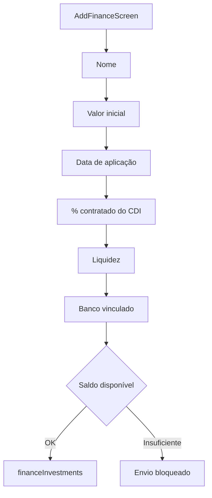
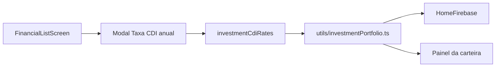

# Investimentos

<!-- spark-progress:start -->
## Progresso Spark — 22/10/2026

**F08 — Investimentos e carteira completa: 75% implementado / 25% restante.** Notas P/I/D/E: **100/75/25/75**; cálculo e evidências em [[Status da Implementação Spark]].

O percentual corresponde ao módulo completo, incluindo integração e dados, e não somente ao serviço descrito nesta página. **Próxima entrega:** Concluir restauração integral após reload, capital/catálogo importados, assistente e homologação. Principal/financiamento com avaliação no mesmo commit e desfazimento da avaliação vigente já estão conectados; avaliações anteriores não têm estorno genérico.

Esta revisão prevalece sobre listas de pendências datadas das entregas anteriores abaixo. Implementação local e logs não aprovam publicação nem migração real.
<!-- spark-progress:end -->

## Relógio cliente e recuperação — 22/10/2026

[[Recuperação de Operações Spark]] protege a identificação e a conferência/cancelamento após reload, sem guardar rascunhos ou restaurar automaticamente todas as fases. Uma etapa descritiva cancelada renova somente seu ID e preserva o principal já confirmado na sessão.

A carteira é uma fotografia de posições atuais: o horizonte de atividade inclui a referência protegida e o evento da cabeça confirmada, mesmo quando o relógio cliente está atrasado. Isso mantém as avaliações e aportes/resgates que já compõem a posição. Na sincronização de hoje, o instante material não fica antes da referência confirmada do mesmo dia e conserva seus nanossegundos; sincronização retroativa mantém a data escolhida. Revisão, prova e efeitos continuam conferidos no servidor. Casos determinísticos e SDK em [[Status da Implementação Spark]].

## Edição composta e desfazimento de avaliação vigente — 22/10/2026

`SparkInvestmentPrincipalFirebase` e `SparkInvestmentFundingFirebase` aceitam `valuation` com identidade própria e valor observado não negativo. Capital e banco(s) continuam corrigidos na data original da aplicação. `sparkInvestmentEditValuation` prepara o segundo nó e confirma a nova referência no instante do servidor, dentro da mesma transação, sem fase financeira intermediária. A posição do investimento avança duas revisões; capital e bancos avançam uma. O filho aponta ao pai, que aponta à cabeça anterior. Rules exigem os dois nós, efeitos, capital, checkpoint, cota e revisões exatos. Catálogo continua sendo fase não monetária com identidade estável. A ponte das quatro telas de cadastro/carteira usa o comando composto quando o valor observado muda.

`SparkInvestmentValuationReversalFirebase` desfaz a **avaliação vigente** por uma preparação exclusiva `valuation_undo`. Ignora somente essa referência na seleção do checkpoint, conserva os movimentos na mesma fronteira e soma a cauda posterior. O commit escreve uma referência corretiva na data da avaliação, a posição e um claim único; banco(s), principal e observação original permanecem. Não subtrai uma diferença antiga do saldo atual nem limita silenciosamente resultado negativo a zero. Saldo/valor histórico negativos recusam o comando inteiro. Avaliações cobertas por outra referência não possuem estorno genérico; a interface só oferece a vigente, com ID/revisão apresentados, motivo e confirmação. A referência corretiva não oferece um novo desfazimento que reativaria a observação cancelada.

Preparação trabalha em até vinte páginas por chamada; Pausar/Continuar conserva a prova no servidor, mas a identidade da intenção ainda depende do estado do formulário. Se a resposta de uma sincronização/desfazimento se perder, a ponte consulta primeiro o receipt e usa o replay do serviço; não tenta preparar novamente uma prova invalidada pelo próprio commit. Carteira, Home e histórico reconhecem os novos nós como referências de avaliação, excluídas de receitas/despesas. O titular CDI continua sendo o autor da abertura.

Marcador vigente `financial-proof-v17`, sem habilitar grupos reais. Compatibilidade de capital/cadastro importados, recuperação geral, assistente e homologação continuam pendentes.

## Carteira e operações Spark — 22/10/2026

`SparkInvestmentFormFirebase` e `useSparkInvestmentForm` conectam AddFinance e FinancialList Web/mobile. Abertura datada financia o principal pelo banco e conserva valor observado distinto; editar principal e trocar banco usam a origem financeira imutável e as revisões de cada conta/capital. Catálogo é uma segunda fase não monetária retomável. Sincronizar prepara histórico em chamadas limitadas, conserva data/ID e só confirma depois da prova completa. Aporte/resgate usa um único par com confirmação da revisão do investimento dentro da transação. Origem de investimento nos formulários de despesa/receita encaminha esse mesmo par, sem duplicar despesa/ganho.

Arquivo/restauração preserva conta, capital e histórico; atividade e arquivo são independentes. A lista mostra investimentos fora da carteira ativa mesmo quando não há ativos. Estorno de aporte/resgate está disponível no extrato do banco/Caixa para par vigente e autorizado, compensando ambas as contas com claim único. Abertura, principal e avaliação não recebem ação genérica de par. O autor vem da abertura imutável; o último editor do catálogo não vira titular de CDI. Posição, avaliação observada e principal são grandezas distintas.

Os novos comandos compostos e de desfazimento vigente estão descritos acima; referências anteriores não recebem estorno genérico. Capital/cadastro importados incompletos exigem reconciliação. As demais intenções ainda dependem do formulário montado. As seções históricas abaixo descrevem também os caminhos legados, sem liberá-los para um grupo Spark.

> **Prova Spark em 19/10/2026:** [[Cadastros de Contas Spark]] permite abertura zero com catálogo; [[Financiamento Inicial de Investimentos Spark]] cria investimento com principal e valor observado distintos no commit; [[Criação Retroativa de Investimentos Spark]] acrescenta aplicação/referência inicial datadas, com correções futuras ancoradas nessa data financeira. [[Sincronização de Investimentos Spark]] mantém referência separada do saldo atual; [[Movimentos Datados em Par Spark]] permite data própria para aporte/resgate/estorno. [[Edição do Principal Spark]] corrige capital canônico; [[Troca do Banco de Financiamento Spark]] troca a origem e pode corrigir também o principal, devolvendo ao banco anterior e debitando o novo banco atomicamente, com histórico das três contas. Integração aos leitores/formulários abaixo, edição com avaliação simultânea e montagem do fluxo com duas datas continuam pendentes.

Módulo de gestão da carteira de investimentos. Hoje o fluxo operacional suporta renda fixa atrelada ao CDI, com aportes, resgates, sincronização manual e acompanhamento por rentabilidade. O modelo de dados já reserva classes para Tesouro Direto, ações e fundos sem aplicar uma precificação automática indevida a esses ativos.

Na carteira Web, o label **Rentabilidade por período** usa o mesmo contrato tipográfico de **Calendário de Vencimentos**, preservando a hierarquia visual entre as telas sem alterar as tabs ou os cálculos.

## Como funciona

### Criação de investimento

1. `AddFinanceScreen.tsx` registra renda fixa CDI e persiste tanto o campo legado `cdiPercentage` quanto `cdiPercentageInBasisPoints`, que preserva duas casas decimais sem depender de float no cálculo monetário.
2. Novos documentos recebem `assetType: 'fixed_income'` e `valuationMethod: 'cdi'`. Os tipos futuros possíveis são `treasury`, `stock` e `fund`; enquanto não houver fonte de precificação específica, eles devem usar `valuationMethod: 'manual'` e manter o valor sincronizado.
3. A data da aplicação é a origem da curva de acompanhamento. O `createdAt` só é fallback para documentos legados.
4. A criação continua bloqueada quando o banco selecionado não tem saldo suficiente e aplica [[Comportamento Pós-Registro]] após o feedback de sucesso.
5. No navegador, `/web/add-finance` resolve `AddFinanceScreen.web.tsx`: mantém a mesma validação em centavos, consulta de bancos/saldo, Firebase e pós-registro, mas aplica o shell Web com wallpaper, `Grainient`, título `StrokeText`, ilustração animada e grade responsiva dos cadastros financeiros.

### Taxa CDI configurável e histórico

[[Categorias e CDI Spark]] acrescenta o transporte direto protegido para grupos Spark. Zero é uma taxa válida e interrompe a projeção da vigência anterior. O leitor nativo conserva o dia de São Paulo em outros fusos; Web/mobile mantêm a identidade ao repetir o mesmo salvamento. O histórico une membros do grupo sem exigir vínculo legado bilateral. Projeção não altera saldo confirmado. As demais operações da carteira e seus leitores ainda exigem a integração descrita em [[Integração Financeira Spark]].

- A coleção `investmentCdiRates` guarda `personId`, `annualRateInBasisPoints`, `effectiveFrom`, `createdAt` e `updatedAt`.
- Há um registro por pessoa e dia de vigência. Salvar novamente a mesma data corrige aquela vigência; adicionar outra data preserva o histórico anterior.
- A tela de investimentos permite cadastrar a taxa anual e consultar o histórico da pessoa autenticada. Taxas de usuários relacionados são lidas para calcular seus investimentos compartilhados, sem abrir a configuração deles para edição.
- Sem taxa vigente, a projeção não inventa um CDI padrão: conserva o último valor confirmado e explica o motivo na interface.
- As Firestore Rules permitem leitura para a pessoa e usuários relacionados, mas criação/edição/exclusão somente para o proprietário antes do cutover; a Home trata a leitura da taxa como opcional e mantém o valor-base se ela estiver indisponível.

### Cálculo de projeção e rentabilidade

`utils/investmentPortfolio.ts` é a única fonte para projeções CDI. Todos os valores de moeda entram e saem em centavos inteiros; o cálculo interno usa ponto fixo com `BigInt` para não acumular arredondamento de moeda por `float`.

1. A base operacional é o último valor sincronizado (`currentValueInCents`/`lastManualSyncValueInCents`) e sua data; sem sincronização, a base é o valor e a data inicial do investimento.
2. A taxa aplicável é escolhida por `personId` e `effectiveFrom`. Alterações no histórico dividem a projeção em intervalos, cada qual com sua própria taxa.
3. O modelo é uma estimativa diária proporcional de 365 dias, apropriada para acompanhamento e não para IR, extrato oficial ou apuração de um produto específico.
4. A curva histórica combina aporte inicial, aportes, resgates e sincronizações reais. Uma sincronização substitui a estimativa daquele dia; os movimentos posteriores continuam alterando a base normalmente.
5. Os indicadores da carteira usam:

| Indicador | Regra em centavos |
|---|---|
| Aportes totais | valor inicial + aportes |
| Aplicado líquido | aportes totais − resgates |
| Patrimônio estimado | valor no último snapshot/sincronização + projeção CDI posterior |
| Rendimento acumulado | patrimônio estimado + resgates − aportes totais |
| Resultado do período | patrimônio final + resgates do período − valor inicial do período − aportes do período |

### Painel de carteira

`FinancialListScreen.tsx` mantém a timeline expansível de cada investimento e adiciona uma visão consolidada acima da lista. No navegador, `FinancialListScreen.web.tsx` preserva os mesmos dados e ações, mas usa o shell Web, controles com foco explícito e a transição de abertura/fechamento `AnimatedContent` sobre a superfície `Grainient`, como as listas Web recorrentes. A composição mantém os indicadores e as tabs de rentabilidade no bloco superior e apresenta o gráfico de evolução em uma linha exclusiva abaixo, sem card, título ou subtítulo externo e sem dividir a coluna lateral no desktop:

1. Taxa CDI anual vigente, atalho de configuração e histórico por vigência.
2. Patrimônio estimado, rendimento acumulado, aplicado líquido e rendimento do próximo dia.
3. Tabs controladas de 30 dias, 6 meses, 12 meses ou todo o histórico para rentabilidade do período. Os quatro gatilhos dividem igualmente a largura disponível, centralizam os rótulos e ficam dentro de um card `notTintedCardClassName`; o indicador amarelo marca o período ativo sem alterar o cálculo e a visualização locais.
4. O gráfico Mantine `AreaChart`, em Expo DOM, compara capital líquido aplicado contra patrimônio estimado somente pelas linhas e pontos, sem preenchimento de área ao fundo. Na Web, ele usa apenas o label utilitário em caixa alta de `MandatoryExpensesListScreen.web.tsx`, sem card, título descritivo ou subtítulo externo. Ele segue o padrão visual do gráfico de previsão — pontos sempre visíveis com o mesmo tamanho, linha de 3px, grade vertical, tipografia padrão dos eixos, fundo transparente nos dois temas, sem contorno de foco ao toque e largura/rolagem horizontal apenas para séries com mais de sete pontos — preservando as duas curvas e a legenda da carteira.
5. Resumo de alocação por banco e ganho correspondente.
6. Em cada card expandido: produto, percentual contratado do CDI, patrimônio estimado, próximo dia, liquidez, sincronização e ações existentes. Na Web, a grade e as ações usam as mesmas classes da timeline de [[Despesas Fixas]]: os dados ficam em duas colunas quando houver espaço e as ações fluem em uma única linha com quebra responsiva.

O gráfico é explicitamente estimado. A sincronização manual continua sendo o caminho para alinhar a carteira ao extrato/corretora.

### Aportes, resgates e sincronização

1. `Aportar` exige sincronização prévia e cria uma [[Transações de Despesas|despesa]] com `isInvestmentDeposit`.
2. `Resgatar` exige sincronização prévia e cria uma [[Transações de Receitas|receita]] com `isInvestmentRedemption`.
3. Os dois tipos de movimentação e `financeInvestmentSyncs` alimentam a rentabilidade, mas permanecem excluídos dos totais comuns por `shouldIncludeMovementInGainExpenseTotals()`.
4. Nenhuma taxa, gráfico, histórico ou previsão cria aporte, resgate, receita ou despesa automaticamente.

Cada operação permite informar duas datas civis independentes, no formato `DD/MM/AAAA`:

- **Data da sincronização:** registra em `financeInvestmentSyncs.date` o dia em que o valor confirmado foi observado antes do aporte/resgate.
- **Data do aporte/resgate:** registra em `expenses.date` ou `gains.date` o dia efetivo da movimentação financeira.

As duas datas começam preenchidas com o dia atual, mas o usuário deve confirmar ou alterar cada uma antes de salvar. Hoje e qualquer data anterior são válidos; amanhã e qualquer data futura são rejeitados. A sincronização manual comum segue a mesma regra de data. Ao persistir, a tela mantém o dia escolhido e combina-o com o horário atual; valores continuam sendo enviados em centavos inteiros. A data da sincronização nunca substitui a data efetiva do aporte ou resgate.

Após o cutover do grupo, a tela continua identificando investimentos legados por `legacyInvestmentId`, mas usa o saldo confirmado de `financialAccounts`. Sincronizar é uma reconciliação do razão com a data informada; aportar/resgatar resolve a conta pelo ID legado e transfere entre investimento e banco no mesmo grupo. A movimentação recente da carteira é lida de `ledgerTransactions`, sem criar ou atualizar documentos financeiros legados no cliente. A projeção mantém o último valor sincronizado ligado à data dele, separado do saldo atual após movimentos posteriores.

## Arquivos principais

- `screens/mobile/AddFinanceScreen.tsx` / `screens/web/AddFinanceScreen.web.tsx` — Cadastro de renda fixa CDI por plataforma, com percentual em pontos-base
- `screens/mobile/FinancialListScreen.tsx` / `screens/web/FinancialListScreen.web.tsx` — Painel, taxa CDI, timeline e ações operacionais por plataforma
- `functions/FinancesFirebase.ts` — CRUD, sincronizações e leitura de aportes/resgates/sincronizações da carteira
- `functions/InvestmentCdiRateFirebase.ts` — Persistência e leitura compartilhada do histórico de CDI
- `utils/investmentPortfolio.ts` — Tipos de ativos, projeção em ponto fixo, indicadores e série do gráfico
- `functions/HomeFirebase.ts` — Portfólio reduzido da Home usando o histórico CDI configurado
- `components/uiverse/investments/investment-evolution-chart.tsx` — `AreaChart` Mantine isolado em Expo DOM
- `tests/investmentPortfolio.test.ts` — Cobertura de vigências, falta de taxa, ativos futuros e fluxos de aporte/resgate

## Integrações

- [[Dashboard Home]] — Usa a mesma taxa histórica, sem CDI anual fixo no código
- [[Transações de Despesas]] — Aportes reais, excluídos do total de despesas
- [[Transações de Receitas]] — Resgates reais, excluídos do total de receitas
- [[Balanço Mensal]] — Valor confirmado do investimento continua afetando o saldo de banco conforme as regras do módulo
- [[Previsão de Fluxo de Caixa]] — Vencimento/liquidez segue sendo apenas aviso; nunca vira resgate automático
- [[Privacidade de Valores]] — Cards, indicadores e eixo/tooltip do gráfico mascaram valores quando ativada
- [[Componentes UI]] — Gráfico Mantine permanece em fronteira Expo DOM; as Tabs do período, a tela e os modais seguem Gluestack/NativeWind

## Observações importantes

- Em grupos migrados, a Home lê contas `financialAccounts` com `kind: 'investment'` e conserva `currentBalanceInCents` como base confirmada. O valor estimado CDI é separado dessa base e exige proprietário, data-base, percentual em pontos-base, ativo com valoração CDI e vigência disponível em `investmentCdiRates`. A data-base é o último evento materializado que toca a conta, ou a data da aplicação quando não há evento; aportes, resgates e reconciliações já estão no saldo e não são reaplicados. Sem metadados, taxa ou para ativo manual, o estimado permanece igual ao confirmado. O cálculo usa dias civis de São Paulo e não persiste rendimento.
- A [[Previsão de Fluxo de Caixa]] usa metadados migrados de prazo/data e saldo confirmado para avisos de liquidez; dinheiro aplicado não entra na abertura líquida nem vira resgate automático. Sem data válida, não se inventa vencimento.

- Ao verificar referências de aportes, resgates e sincronizações, as consultas incluem o `personId` do usuário autenticado ou relacionado junto ao `investmentId`, mantendo a leitura compatível com as Firestore Rules e os índices versionados.

- CDI anual de referência não é uma cotação oficial em tempo real. O usuário informa a taxa e a vigência conforme sua fonte de confiança.
- O cálculo é para acompanhamento. Impostos, IOF, feriados bancários, marcação a mercado, índices de preço e eventos corporativos não são simulados.
- A arquitetura futura não deve reutilizar o cálculo CDI para Tesouro, ações ou fundos. Cada `valuationMethod` precisa de uma fonte e regras próprias antes de ser habilitado na criação.
- Um valor sincronizado prevalece sobre estimativas anteriores e deixa a visualização mais próxima do extrato real.
- Na Web, os modais de taxa CDI, edição, aporte, resgate, sincronização e exclusão usam `Modal size="md"`, ocupando cerca de 80% da viewport até o limite compartilhado de 510px; formulários extensos preservam área rolável e proteção contra o teclado. Android/iOS mantêm os diálogos compactos da variante nativa.
- O leitor de atividade consolida movimentos relacionados no dispositivo. Se o volume crescer muito, a próxima evolução deve criar agregados mensais por investimento sem alterar as fórmulas acima.

## Integração com o Assistente Lumus

- [[Assistente Lumus]] oferece criação, edição, exclusão, aporte, resgate, sincronização e desfazimento por ações separadas; movimentos vinculados não entram no editor genérico.
- Aporte/resgate atualiza o investimento e cria a saída/entrada correspondente na mesma transação. Sincronização guarda valor anterior, novo valor e delta para permitir desfazer com validação de estado.
- O relatório de carteira é calculado pelos agregadores do aplicativo; o modelo recebe somente métricas compactas para explicar e nunca escolhe fórmulas ou configuração arbitrária de gráfico.
- Após o corte, criar investimento usa `manageFinancialAccount` com a conta de financiamento: débito no banco, criação da conta de investimento e evento `investment_deposit` são atômicos. Um valor atual diferente gera também a reconciliação auditável. Nome, CDI em pontos-base, tipo/valoração, prazo e banco vinculado são metadados editáveis pelo papel autorizado; alterar o saldo atual gera reconciliação. Corrigir o valor inicial estorna e substitui o aporte original atomicamente, preservando o histórico; original ausente ou já estornado, falta de permissão e saldo final inválido impedem o commit. Aporte/resgate usa transferência atômica entre contas e impede saldo de investimento negativo.
- `tests/ledgerProjectionReads.test.ts` verifica a carteira da Home após reconciliação (saldo confirmado 80.000, estimado 80.800), ausência de taxa/proprietário e ativo manual, com Firestore simulado na fronteira e sem gravação financeira.
- [[Validação de Lotes Conversacionais]] registra 211 aportes, 211 resgates, 211 sincronizações e 211 desfazimentos com SDK/callables reais locais, conferindo posições, banco, movimentos e recibos. Reutilizar uma categoria “Investimento” exige uso compatível com a saída/entrada; uma categoria apenas de despesa não pode ser escolhida para resgate. CDI registra 211 vigências em onze partes de até vinte propostas, com uma confirmação final; interpretação e notificações são simuladas, os efeitos financeiros não.

### Apresentação do gráfico da carteira (2026-09-28)

O gráfico de evolução da carteira usa título de seção sem ícone ou borda externa nas duas plataformas. No mobile, o componente DOM seleciona `react-native-webview` pela mesma compatibilidade de [[Previsão de Fluxo de Caixa]], e o contêiner Mantine recebe largura mínima mensurável para evitar gráfico vazio. A série, a legenda e os cálculos seguem inalterados.

### Padrão do título do gráfico (2026-09-28)

O título "Evolução da carteira" usa nas versões mobile e Web o mesmo tratamento de rótulo da Home: caixa alta, peso forte e espaçamento ampliado entre letras. O texto continua sem ícone decorativo e sem card externo.

### Estorno de aporte legado — 2026-10-04

`undo_investment_deposit` compartilha a callable confiável com a conversa e o formulário, revalidando movimento/posição, fingerprint, ator, saldo e recibo na mesma transação. A posição atual precisa cobrir o aporte devolvido: valor já resgatado impede o estorno inteiro, sem crédito inventado no banco. Retry do mesmo pedido consulta recibo antes de um alvo removido; versão stale não grava. Os 68 testes SDK locais incluem recusa de aporte já resgatado, concorrência de retry e fingerprint stale. [[Comandos Financeiros Conversacionais]] registra a integração no legado/razão.

### Integridade da sincronização legada — 2026-10-12

As Rules de `financeInvestmentSyncs` conferem o investimento antes e depois da escrita atômica: proprietário, saldo anterior real, saldo final, delta em centavos e banco original. Não se aceita saldo anterior inventado nem vínculo com outro banco. Movimentos compostos de aporte/resgate são exclusivos da callable. Históricos anteriores permanecem legíveis, mas não devem ser recriados pelo cliente como se fossem novas sincronizações. A compatibilidade dos documentos reais ainda requer cópia isolada, conforme [[Remediação da Auditoria de Segurança]].
