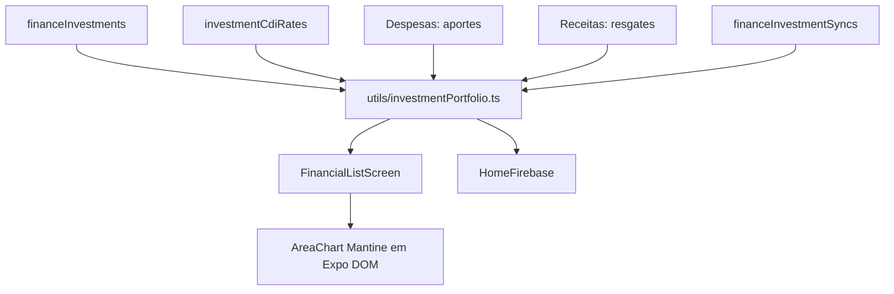

# Monitoramento de Investimentos

<!-- spark-progress:start -->
## Progresso Spark — 22/10/2026

**F08 — Investimentos e carteira completa: 75% implementado / 25% restante.** Notas P/I/D/E: **100/75/25/75**; cálculo e evidências em [[Status da Implementação Spark]].

O percentual corresponde ao módulo completo, incluindo integração e dados, e não somente ao serviço descrito nesta página. **Próxima entrega:** Concluir restauração integral após reload, capital/catálogo importados, assistente e homologação. Principal/financiamento com avaliação no mesmo commit e desfazimento da avaliação vigente já estão conectados; avaliações anteriores não têm estorno genérico.

Esta revisão prevalece sobre listas de pendências datadas das entregas anteriores abaixo. Implementação local e logs não aprovam publicação nem migração real.
<!-- spark-progress:end -->

## Edição composta e desfazimento de avaliação vigente — 22/10/2026

`SparkInvestmentPrincipalFirebase` e `SparkInvestmentFundingFirebase` aceitam `valuation` com identidade própria e valor observado não negativo. Capital e banco(s) continuam corrigidos na data original da aplicação. `sparkInvestmentEditValuation` prepara o segundo nó e confirma a nova referência no instante do servidor, dentro da mesma transação, sem fase financeira intermediária. A posição do investimento avança duas revisões; capital e bancos avançam uma. O filho aponta ao pai, que aponta à cabeça anterior. Rules exigem os dois nós, efeitos, capital, checkpoint, cota e revisões exatos. Catálogo continua sendo fase não monetária com identidade estável. A ponte das quatro telas de cadastro/carteira usa o comando composto quando o valor observado muda.

`SparkInvestmentValuationReversalFirebase` desfaz a **avaliação vigente** por uma preparação exclusiva `valuation_undo`. Ignora somente essa referência na seleção do checkpoint, conserva os movimentos na mesma fronteira e soma a cauda posterior. O commit escreve uma referência corretiva na data da avaliação, a posição e um claim único; banco(s), principal e observação original permanecem. Não subtrai uma diferença antiga do saldo atual nem limita silenciosamente resultado negativo a zero. Saldo/valor histórico negativos recusam o comando inteiro. Avaliações cobertas por outra referência não possuem estorno genérico; a interface só oferece a vigente, com ID/revisão apresentados, motivo e confirmação. A referência corretiva não oferece um novo desfazimento que reativaria a observação cancelada.

Preparação trabalha em até vinte páginas por chamada; Pausar/Continuar conserva a prova no servidor, mas a identidade da intenção ainda depende do estado do formulário. Se a resposta de uma sincronização/desfazimento se perder, a ponte consulta primeiro o receipt e usa o replay do serviço; não tenta preparar novamente uma prova invalidada pelo próprio commit. Carteira, Home e histórico reconhecem os novos nós como referências de avaliação, excluídas de receitas/despesas. O titular CDI continua sendo o autor da abertura.

Marcador vigente `financial-proof-v17`, sem habilitar grupos reais. Compatibilidade de capital/cadastro importados, recuperação geral, assistente e homologação continuam pendentes.

## Leitura Spark e precisão intradiária — 22/10/2026

Taxas ausentes do titular (inclusive consulta bem-sucedida vazia ou com taxa somente do editor) mantêm a Home em valor Confirmado. Carteira exclusivamente manual também não recebe rótulo de projeção CDI. Nenhuma taxa de outro membro é usada como substituta.

`SparkInvestmentReadFirebase` produz carteira e atividade a partir de posições, capital, catálogo, abertura e journal canônicos, com revalidação da fotografia. Identifica titular pela abertura imutável. `timelinePrecision:'instant'` conserva horários e revisões; empates seguem a ordem certificada da conta. Uma avaliação às 10h seguida de aporte às 11h não pode descartar o aporte por agrupar ambos no mesmo dia. O fechamento civil inclui todos os eventos do dia e não duplica a referência manual já fornecida como evento. O modo legado por dia continua disponível somente ao transporte anterior.

A Home projeta CDI quando todos os investimentos ativos possuem proveniência necessária e as taxas do grupo podem ser lidas. Concluída a simulação, confere novamente as contas. Origem insuficiente conserva valor confirmado/erro parcial, sem consultar dinheiro antigo como substituto. Rendimento simulado não grava avaliação ou receita. Recorrências, carteira e cenários financeiros do assistente ainda exigem a integração própria descrita no quadro geral.

Camada de observabilidade da carteira. Organiza taxas CDI por vigência, fluxos de aporte/resgate, sincronizações e valores projetados para que o usuário acompanhe patrimônio, rendimento e concentração sem alterar os lançamentos financeiros.

## Como funciona

1. A lista carrega investimentos, bancos, taxa CDI de usuários relacionados e eventos da carteira em paralelo.
2. A utilidade pura normaliza datas, aplica cada taxa no intervalo correspondente e monta os indicadores e a série de evolução.
3. A tela usa Tabs controladas para escolher 30 dias, 6 meses, 12 meses ou histórico total. Os quatro gatilhos ocupam igualmente a largura disponível dentro de um card `notTintedCardClassName`, centralizam seus rótulos e recebem um indicador amarelo quando ativos; o período só altera cálculo e visualização local.
4. O modal de CDI grava somente a taxa de referência e a vigência; não toca nos investimentos, bancos ou transações.
5. O gráfico compara `netAppliedInCents` com `projectedValueInCents`, mostrando a diferença entre capital líquido e patrimônio estimado pelas linhas, sem preenchimento de área ao fundo. Mantém pontos sempre visíveis e o mesmo padrão de tamanho, grade e eixos do gráfico de previsão, preservando a legenda das duas séries. Segue a superfície transparente e o comportamento sem foco do gráfico de previsão; em séries com mais de sete pontos, o usuário pode arrastá-lo horizontalmente para consultar os períodos sem comprimir os rótulos.
6. A data de cada sincronização é a data civil escolhida no fluxo operacional, e não necessariamente o dia em que o formulário foi aberto. A data dos aportes e resgates segue a escolha própria da movimentação; ambas entram na linha do tempo em `financeInvestmentSyncs.date`, `expenses.date` ou `gains.date`. Hoje e datas anteriores são aceitos; datas futuras são rejeitadas.

## Dados persistidos

| Coleção | Uso no monitoramento |
|---|---|
| `investmentCdiRates` | Taxa anual em pontos-base e início de vigência por pessoa |
| `financeInvestments` | Ativo, base atual, data de aplicação, produto e método de valorização |
| `financeInvestmentSyncs` | Pontos reais que substituem a projeção no dia sincronizado |
| `expenses` | Aportes com `isInvestmentDeposit` |
| `gains` | Resgates com `isInvestmentRedemption` |

## Arquivos principais

- `functions/InvestmentCdiRateFirebase.ts`
- `functions/FinancesFirebase.ts`
- `utils/investmentPortfolio.ts`
- `screens/mobile/FinancialListScreen.tsx`
- `components/ui/tabs/index.tsx`
- `components/uiverse/investments/investment-evolution-chart.tsx`

## Integrações

- [[Investimentos]] — Fluxo operacional, ações e regras de produto
- [[Dashboard Home]] — Resumo compacto reaproveita a taxa persistida
- [[Transações de Despesas]] e [[Transações de Receitas]] — Fluxos de capital sem dupla contagem no resultado mensal
- [[Privacidade de Valores]] — Máscara visual de indicadores, gráfico e tooltip
- [[Componentes UI]] — Mantine restrito a uma fronteira Expo DOM com props serializáveis; Tabs controladas definem o período local

## Observações importantes

- Valores de dinheiro são calculados em centavos. Pontos-base são inteiros e representam duas casas percentuais: `1375` equivale a `13,75%`.
- Sem uma taxa CDI vigente, o sistema não aplica fallback escondido; a projeção fica no valor sincronizado.
- Classes de ativo futuras ficam no esquema, mas não recebem uma curva CDI genérica. Isso evita apresentar rentabilidade enganosa para Tesouro, ações ou fundos.
