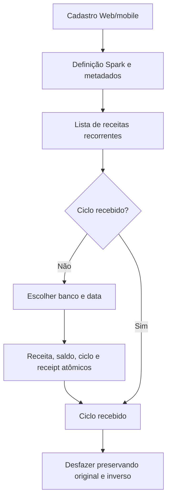

# Receitas Fixas

<!-- spark-progress:start -->
## Progresso Spark — 23/10/2026

**F07 — Recorrências e parcelas: 80% implementado / 20% restante.** Notas P/I/D/E: **100/75/50/75**; cálculo e evidências em [[Status da Implementação Spark]].

O percentual corresponde ao módulo completo, incluindo integração e dados, e não somente ao serviço descrito nesta página. **Próxima entrega:** Concluir restauração integral das intenções, compatibilidade restante, assistente e homologação. Replanejamento com sucessor/configuração atômicos, desfazimento ordenado e liquidação de parcelas após o prazo já possuem serviço/Rules e entradas Web/mobile.

Esta revisão prevalece sobre listas de pendências datadas das entregas anteriores abaixo. Implementação local e logs não aprovam publicação nem migração real.
<!-- spark-progress:end -->

## Receitas recorrentes utilizáveis - 23/10/2026

Cadastro e lista Web/mobile reutilizam `useMovementFormEntry`, `useSparkRecurringForm` e `useBankMovementsRequest`. A entrada aguarda contexto e registro confirmado antes de editar; falhas persistem com nova tentativa, sem consultar legado depois de erro Spark. Categorias vêm do adaptador autorizado do grupo, preservando categorias de outros membros. UID/rota/foco/geração invalidam respostas antigas e retornos tardios. Duplo envio é bloqueado.

Material incerto fica bloqueado com **Confirmar cadastro anterior** ou **Confirmar ação anterior**, conservando a mesma tentativa em memória. Definição confirmada com metadados pendentes não é recriada. Contrato Spark existente mantém total/quantidade/vigência bloqueados; mudança de acordo usa Renegociar na lista. Receitas parceladas recebem o nominal exato, inclusive o resto final; quitação negociada continua exclusiva de despesas finitas. Criar o plano não credita banco; somente efetivar um recebimento movimenta dinheiro.

As listas oferecem **Atualizar receitas recorrentes**, limpam dados anteriores ao recarregar e ocultam resumo/calendário/PDF em erro, com retry persistente. Falha parcial ou total da agenda avisa separadamente e preserva dados financeiros confirmados. Arquivar/desfazer conserva a confirmação incerta, sem repetir operação por falha posterior de agenda/cache. A revisão `recurring-gains-2026-10-23` libera uma vez a chave compartilhada `addMandatoryGains`, preservando outras preferências e desligamentos posteriores.

Evidências e roteiro manual desta revisão em [[Versão Usável por Telas]]. F07 permanece 80% (P/I/D/E 100/75/50/75); não há nova homologação visual/Emulator/aparelho nem ativação real. Journal integral após reload, compatibilidade e assistente continuam pendentes.

## Renegociação e parcelas após o prazo — 22/10/2026

`SparkRecurringReplanFirebase` cria sucessor finito para o **saldo negociado restante**, arquiva o predecessor e grava metadados/receipt/cota atomicamente. Nome, tipo, categoria e configuração são preservados pela ponte; a tela pede total, quantidade, primeiro ciclo e motivo, mostra a revisão do acordo e confirma uma vez. Não soma o novo valor aos pagamentos antigos nem inventa quitação pelo calendário. O primeiro ciclo deve ser atual/futuro e não pode já ter pagamento no predecessor. Total inteiro, divisão e resto são validados no cliente e nas Rules. Despesa e receita usam o mesmo protocolo.

O predecessor guarda sucessor/origem e não pode ser pago, restaurado ou ter pagamentos desfeitos isoladamente. O sucessor conserva o vínculo de origem. Desfazer replanejamento exige revisões atuais, ausência de pagamentos pendentes de desfazimento no sucessor e resolução de sucessores posteriores; reativa o anterior e marca o novo contrato como cancelado, preservando ambos. Contratos cancelados não ganham restauração comum. O fluxo está nas listas Web/mobile; falha de agenda posterior não repete o commit.

`lateSettlement:true` permite liquidar **parcelas finitas restantes** depois de `endCycle`, com motivo e ciclo/data compatíveis. Sem essa marca o prazo continua obrigatório; recorrências ilimitadas não a aceitam. Receipt/ciclo têm a mesma marca, quantidade e faixa originais; quitação negociada continua exclusiva de despesa finita. Home mostra o saldo vencido no vencimento original e a previsão o inclui uma única vez no primeiro mês, inclusive após uma liquidação parcial no mês. Leitura valida a marca antes de aceitar ciclo posterior ao prazo. O prazo original e os lembretes contratados não são prorrogados silenciosamente; um novo calendário exige renegociação.

Intenções incertas ainda precisam do formulário montado e dos mesmos dados/IDs. Após recarga, os vínculos permitem consultar/desfazer um acordo confirmado, mas não há journal geral para recuperar qualquer rascunho financeiro.

## Fluxo Spark conectado — 22/10/2026

Datas de início/fim e do pagamento são adaptadas como campos civis para a interface; o serviço mantém instantes reais nos ciclos. As listas conferem o mês de São Paulo, inclusive quando o aparelho já está no dia/mês seguinte. O ensaio de Tóquio reproduziu e eliminou o avanço indevido do fim do contrato para o mês seguinte.

Cadastro/configuração e listas nas duas plataformas leem planos/ciclos canônicos. Registrar cria recebimento real, ciclo e contador em uma operação; desfazer compensa o valor efetivado na data original e recua a mesma faixa, sem remover documentos do histórico. O ramo Spark não grava ganho comum e marcação em duas etapas. Arquivo/restauração conserva identidade e ciclos. Metadados de D0/dias úteis/horário alimentam o agendador local após login e retorno.

Parcelas finitas de receitas continuam exigindo o nominal exato, inclusive o resto final. Negociação de quitação é exclusiva da despesa finita; não foi liberada para recebimentos. O contrato permanece imutável na edição; replanejamento e recebimentos vencidos após a vigência ainda exigem o fluxo específico pendente. O comportamento legado abaixo não deve ser aplicado a dados Spark.

## Núcleo Spark em preparação (registro histórico)

[[Recorrências Spark]] acrescenta cadastro financeiro, edição/arquivamento da definição e recebimento/desfazimento atômicos com ciclo, conta, evento, revisão e cota. Parcelas usam soma exata do contrato; desfazimento de faixa finita exige remover primeiro as faixas efetivadas depois. Arquivar preserva histórico e permite desfazer recebimento. Esse módulo ainda não substitui as telas/listas, os templates antigos, seus lembretes ou os comandos do assistente; conversão de dados e adaptação de metadados continuam pendentes.

[[Conversão de Recorrências Spark]] v0.10 converte os formatos compatíveis de templates/ciclos do razão em candidato bloqueado, preservando pagamentos/contadores comprovados e gerando pendências para ambiguidades. Acrescenta serviço para vencimento, dias úteis, descrição e configuração de lembrete, sem agendamento automático. Integração com esta lista/formulário, legado sem evidência suficiente e ativação real continuam pendentes.

Gerencia receitas recorrentes mensais (ex: salário, aluguel recebido, pensão) com rastreamento de recebimento por ciclo e lembretes locais configuráveis antes e/ou no dia esperado. No Spark, os avisos aos membros são consultados ao abrir/retornar; push com todos os aplicativos fechados não é garantido.

## Como funciona

O diagrama descreve o caminho Spark. O ramo legado só é escolhido para contexto anterior ao corte confirmado, nunca por falha de leitura ou escrita Spark. Cadastrar/configurar o plano não credita o banco.

1. `screens/mobile/AddMandatoryGainsScreen.tsx` cria a receita fixa com nome, valor, dia esperado de recebimento, categoria obrigatória e parcelamento opcional; quando parcelada, recebe o valor total e a quantidade, calcula o valor mensal e bloqueia sua edição. O seletor de categoria usa o ActionSheet customizado das telas de registro, com ícone, nome e ação interna para abrir `AddRegisterTagScreen.tsx` sem perder o contexto
2. Cada receita fixa tem um controle de ciclo (`YYYY-MM`) para rastrear se já foi recebida no mês atual
3. `MandatoryGainsListScreen.tsx` exibe todas as receitas fixas com status: recebida / pendente no ciclo atual
4. Após criar ou editar o template obrigatório, `AddMandatoryGainsScreen.tsx` aplica [[Comportamento Pós-Registro]] depois do feedback de sucesso
5. Ao registrar o recebimento do mês, o app abre o fluxo de [[Transações de Receitas|receita]] real; nesse momento o banco e a data exata são definidos, o ciclo é atualizado e o submit da receita segue a preferência da tela de receitas
6. O card **Lembrete do recebimento** agenda avisos cumulativos nos dias escolhidos antes do recebimento e, opcionalmente, um aviso no próprio dia, via [[Notificações]]
7. Ao registrar o recebimento real, o app suprime imediatamente qualquer aviso restante do mesmo ciclo `YYYY-MM`
8. Enquanto a receita fixa estiver pendente no ciclo atual, o calendário e a timeline exibem o valor previsto do template; após o registro do mês, passam a mostrar o valor efetivamente salvo na receita real vinculada via `lastReceiptGainId`
9. Quando o parcelamento está ativo, o template mantém `installmentTotal`, `installmentsCompleted`, `installmentStartDate` e `installmentEndDate`; cada recebimento mensal registrado avança uma parcela e a listagem exibe `Parcela X de Y`
10. `screens/mobile/MandatoryGainsListScreen.tsx` exibe um resumo do mês corrente com total do ciclo, valores recebidos, valores pendentes, parcelamentos concluídos fora do ciclo e botão para baixar o resumo em PDF via `expo-print`/`expo-sharing`; as ações de baixar PDF e adicionar ganho ficam lado a lado em um `HStack`
11. A lista reconcilia a agenda local com os templates do UID autenticado ao carregar ou pelo botão de atualização nas duas plataformas; a versão Web também conserva o pull-to-refresh
12. No Spark, cadastro e ações usam SDK/Rules e avisos ao abrir/retornar, sem depender de Functions. O envio por Function aos aparelhos do dono e de seus `relatedIdUsers` pertence ao ramo legado; a lista reconcilia a agenda local separadamente.
13. No resumo diário Web, os itens do mesmo dia aparecem com pendentes antes dos recebidos e, dentro de cada estado, em ordem alfabética pelo nome. O detalhe é compacto e preserva registrar, receber parcelas, editar, reivindicar e excluir. Na grade mensal, quando um feriado coincide com um ganho, o recorte circular do Web mantém a divisão colorida inteira dentro da bolinha.
14. `screens/web/MandatoryGainsListScreen.web.tsx` mantém a mesma composição Web da lista de despesas — calendário mensal, atualização por pull-to-refresh, resumo, timeline expansível, confirmação de ações e impressão — e permite informar quantas parcelas ativas devem ser recebidas em um único lançamento real.
15. `screens/web/AddMandatoryGainsScreen.web.tsx` mantém a composição hero/sheet responsiva de `AddMandatoryExpensesScreen.web.tsx`, com grid de nome/valor, recebimento por dia útil, calendário customizado de parcelas, ActionSheet de categorias obrigatórias, lembrete com antecedência de 1/2/3 dias e aviso opcional no recebimento. O registro de recebimento ocorre exclusivamente pela lista. A variante usa entrada e comandos Spark primeiro; os adaptadores `getMandatoryGainFirebase`, `addMandatoryGainFirebase` e `updateMandatoryGainFirebase` permanecem somente no ramo legado confirmado, sem fallback por erro. No navegador, persiste a configuração do lembrete e informa que a entrega acontece no aplicativo instalado.
16. `screens/web/MandatoryGainsListScreen.web.tsx` exibe os mesmos três indicadores Web da lista de despesas: barra de progresso do ciclo, radar de ganhos por categoria e scatter dos dias de recebimento. A barra e o radar usam o total efetivamente exibido em centavos, substituem os dados por valores neutros quando a privacidade está ativa e os rótulos acessíveis identificam recebimentos/ganhos, sem alterar o loader ou a lógica de `lastReceipt*`.

## Chave de Ciclo

Usa a mesma lógica de `utils/mandatoryExpenses.ts`:
- `getCycleKeyFromDate()` → `YYYY-MM`
- `isCycleKeyCurrent()` → verifica se o ciclo salvo é o mês vigente
- Ao virar o mês, todas as receitas fixas ficam automaticamente como pendentes

## Lembretes de recebimento

- TimePickerField abre o seletor de hora nativo no Android/iOS e devolve HH:MM; no Web, abre um menu próprio com colunas roláveis de hora e minuto, estados de seleção/hover, seta e padding alinhados ao `web-select-field.tsx`. No Android, o cabeçalho, o marcador e as ações usam o amarelo padrão do sistema configurado no build. A tela converte o valor escolhido para os campos numéricos já persistidos, sem alterar a agenda ou as regras de entrega.
- Receitas usam o mesmo schema versionado de [[Notificações]]: `reminderConfigVersion: 1`, `reminderDaysBefore` entre 1 e 3 e `reminderOnDueDate` opcional. A antecedência é cumulativa: 3 dias agenda avisos em D-3, D-2 e D-1.
- A UI de receitas oferece as opções de 1/2/3 dias antes e um switch para incluir o aviso final no próprio dia do recebimento, mantendo a mesma regra de [[Despesas Fixas]].
- O horário salvo em `reminderHour`/`reminderMinute` é preferido, não uma garantia de minuto exato no Android; economia de bateria e políticas do fabricante podem atrasar a entrega.
- Templates sem `reminderConfigVersion: 1` ficam opt-out mesmo que possuam flags antigas. O usuário precisa revisar, reativar e salvar o card para criar uma agenda nova.
- A data mensal é concreta e resolvida antes do agendamento, preservando dias 29/30/31 e dias úteis.
- A agenda é escopada pelo UID, limitada ao período de parcelamento e renovada por horizonte móvel/reconciliação.
- `lastReceiptCycle` impede avisos do ciclo já recebido. Salvar com o switch desligado, concluir o parcelamento ou excluir o template cancela suas datas futuras.

## Parcelamento

- Parcelamento é opcional. Sem `installmentTotal`, a receita continua sendo uma recorrência mensal sem prazo final.
- Com `installmentTotal`, o template passa a representar uma receita parcelada finita. `installmentTotalValueInCents` guarda o valor contratual total; `valueInCents` é o valor mensal derivado por divisão inteira e deixa de ser editável enquanto o parcelamento estiver ativo. A diferença de centavos fica na última parcela para que a soma seja sempre exata.
- Ao ativar o parcelamento, o valor que já estava informado passa a ser o valor total contratado; escolher ou alterar a quantidade somente recalcula o valor mensal. O total nunca é multiplicado pela quantidade.
- Ao ativar o parcelamento, `AddMandatoryGainsScreen.tsx` mostra calendário de início preenchido com hoje e calendário final bloqueado até haver uma quantidade válida de parcelas.
- A quantidade e a data final ficam sincronizadas: alterar a quantidade recalcula `installmentEndDate`; alterar a data final recalcula `installmentTotal` pelos meses inclusivos entre início e fim.
- No Spark, `installmentsCompleted` avança somente por recebimentos confirmados; passagem do tempo não quita parcelas. O cálculo por `installmentStartDate` para preencher meses anteriores pertence apenas ao tratamento legado, não ao contador canônico.
- `installmentsCompleted` guarda quantas parcelas já foram efetivadas. Ao registrar o recebimento via [[Transações de Receitas]], `markMandatoryGainReceiptFirebase()` incrementa esse contador pela quantidade escolhida em uma mesma transação.
- Ao reivindicar/desfazer o recebimento do ciclo, `clearMandatoryGainReceiptFirebase()` remove o vínculo com a receita real e recua a mesma quantidade registrada em `lastReceiptInstallmentsCount` (uma para templates legados).
- Quando `installmentsCompleted >= installmentTotal`, a listagem trata o parcelamento como concluído e bloqueia novos registros para o template.
- A UI usa `formatMandatoryInstallmentLabel()` em `utils/mandatoryInstallments.ts` para exibir `Parcela X de Y` no calendário e na timeline.
- Enquanto houver parcelas restantes, a lista oferece **Receber parcelas**. O usuário informa de uma até a quantidade restante; o fluxo calcula em centavos a soma exata, abre o lançamento de receita e avança o saldo do template pela quantidade confirmada.
- A sincronização de lembretes trata parcelamentos concluídos como `reminderEnabled: false`, cancelando notificações futuras ao recarregar a lista.

## Arquivos principais

- `screens/mobile/AddMandatoryGainsScreen.tsx` — Formulário de criação/edição
- `screens/web/AddMandatoryGainsScreen.web.tsx` — Composição Web do formulário, parcelamento, lembrete com antecedência configurável e controle mensal
- `screens/mobile/MandatoryGainsListScreen.tsx` — Lista, timeline e controle de recebimento
- `screens/web/MandatoryGainsListScreen.web.tsx` — Composição Web da lista, calendário, timeline, modais e resumo imprimível
- `functions/MandatoryGainFirebase.ts` — CRUD no Firestore + enriquecimento com valor real
- `utils/mandatoryExpenses.ts` — Lógica de chave de ciclo (compartilhada)
- `utils/mandatoryInstallments.ts` — Normalização e rótulos de parcelamento
- `utils/mandatoryPeriodSummaryPdf.ts` — HTML compartilhado para PDF de resumo mensal de recorrências
- `utils/mandatoryReminderNotifications.ts` — Serviço compartilhado de lembretes obrigatórios
- `utils/mandatoryReminderConfig.ts` — Schema v1 e validação opt-out compartilhada
- `utils/mandatoryGainNotifications.ts` — Agendamento de notificações (wrapper fino)
- `app/mobile/add-mandatory-gains.tsx`, `app/web/add-mandatory-gains.web.tsx` e `app/mobile/add-mandatory-gains.native.tsx` — Rotas por plataforma do cadastro
- `app/mobile/mandatory-gains.tsx`, `app/web/mandatory-gains.web.tsx` e `app/mobile/mandatory-gains.native.tsx` — Rotas por plataforma da lista
- `utils/navigation.ts` — Saída explícita para Home pelo voltar físico/navigator
- `hooks/usePostSubmitBehavior.ts` — Aplica retorno/limpeza após salvar templates
- `components/uiverse/categories/tag-actionsheet-selector.tsx` — Seletor de categoria obrigatória em ActionSheet
- `components/mobile/recurring/time-picker-field.native.tsx` / `components/web/recurring/time-picker-field.web.tsx` — Seletor reutilizável de horário do lembrete

## Integrações

- [[Transações de Receitas]] — Marcar como recebida cria receita real no Firestore
- [[Gerenciamento de Bancos]] — Banco é escolhido no lançamento mensal da receita real
- [[Notificações]] — Agendamento de lembretes de recebimento via `mandatoryReminderNotifications.ts`
- [[Despesas Fixas]] — Módulo paralelo que compartilha o motor de agenda, com lembretes cumulativos próprios
- [[Gerenciamento de Tags]] — Categoria obrigatória pode ser criada inline
- [[Privacidade de Valores]] — Resumo e PDF respeitam a preferência de ocultar valores
- [[Previsão de Fluxo de Caixa]] — Template pendente é projetado no ciclo correspondente; recebimento real vinculado e parcelas concluídas não são projetados novamente
- [[Comportamento Pós-Registro]] — Define retorno/limpeza após salvar templates

## Configuração

- Usa exclusivamente `expo-notifications` e requer permissão do usuário
- Expo Go serve para smoke test local; canais, segundo plano e produção devem ser validados em development build e build de produção
- Demais configurações e canais estão em [[Notificações]]

## Observações importantes

- Estrutura de recorrência e lembretes espelhada ao módulo de [[Despesas Fixas]], com antecedência cumulativa e aviso opcional no dia do recebimento
- Receitas fixas **não creditam automaticamente** — o usuário precisa confirmar recebimento
- A [[Previsão de Fluxo de Caixa]] somente representa o recebimento como cenário. Ela não cria ganho nem altera `lastReceiptCycle`
- Compartilha utilitários de ciclo com [[Despesas Fixas]]
- A lista reconcilia os lembretes salvos, corrigindo datas ausentes, expiradas ou defasadas na agenda Expo do UID atual
- A autenticação também executa a reconciliação global via `mandatoryReminderAccountSync.ts`, portanto um relogin restaura os lembretes sem exigir que esta lista seja aberta
- O texto da notificação é personalizado com o nome do ganho e reforça que o recebimento deve ser realizado
- O formulário libera campos progressivamente; se houver alterações pendentes em um template salvo, é preciso salvá-las antes de registrar o ciclo
- Todos os inputs textuais do formulário, incluindo quantidade de parcelas e observações, devem usar a rotina de foco que mantém o campo visível acima do teclado. O horário do lembrete usa o seletor nativo e não abre o teclado.
- Em formulários novos, o switch de lembrete começa desligado e fica desabilitado até nome, valor, dia e categoria serem preenchidos
- Quando a categoria é criada inline, a tela de tags abre com tipo `gain` e obrigatoriedade pré-selecionados, mas editáveis; ao salvar uma categoria compatível, ela retorna já selecionada
- O seletor de categoria obrigatória deve permanecer no ActionSheet compartilhado com `<TagIcon />` e ação interna de criação, sem regressão para o menu padrão do Android ou botão externo ao campo
- O valor no ciclo atual usa `displayValueInCents` dos pares `date-calendar.native.tsx` / `.web.tsx`: antes da efetivação mostra o template, após mostra o `valueInCents` da receita real apontada por `lastReceiptGainId`
- Salvar ou editar um template obrigatório deve passar por [[Comportamento Pós-Registro]]
- Ao criar um novo template obrigatório, a limpeza dos campos é controlada pela preferência da tela quando o retorno automático está desligado; o submit usa trava síncrona enquanto salva e agenda/cancela lembrete para impedir duplo registro
- Receitas parceladas permanecem no calendário/lista até a conclusão, mas deixam de aceitar novos registros depois da última parcela
- Templates parcelados criados antes de `installmentStartDate` continuam compatíveis; ao editar, o formulário sugere hoje como início e recalcula o fim pela quantidade atual até o usuário salvar a nova configuração
- O resumo mensal inclui itens recebidos no ciclo atual e pendentes do mês; parcelamentos concluídos em ciclos anteriores aparecem como contagem separada e não entram no total financeiro do mês
- O PDF é gerado localmente no dispositivo, compartilhado com nome contextual `Lumus-Financas-Receitas-Fixas-[mes]-[data].pdf` e usa os mesmos valores exibidos na tela, incluindo valores ocultos quando a privacidade está ativa

## Integração com o Assistente Lumus

- [[Assistente Lumus]] cria/edita/exclui templates e registra/desfaz o recebimento por comandos próprios.
- Recebimento e ganho real são escritos na mesma transação; vínculo do ciclo e avanço de parcela não podem ficar sem o lançamento correspondente.
- Atualizações de lembrete acontecem depois do commit e falhas locais são mostradas como aviso recuperável.

- O pedido, banco, data, quantidade de parcelas, confirmação e cancelamento são resolvidos no chat. No razão, `manageFinancialMetadata` gerencia somente templates próprios e `completeFinancialRecurring` efetiva/desfaz o ciclo; no legado, a transação SDK conserva os vínculos e um recibo privado por pedido.
- Templates criados pelo assistente mantêm `assistantCycleHistoryComplete: true` e `completedCycles[YYYY-MM]` com ID do lançamento, quantidade e valor efetivado. A última indicação de ciclo de um template antigo não comprova a situação de meses anteriores: sem histórico suficiente, uma consulta/efetivação histórica retorna `history-unavailable` em vez de inventar pendência. Não há backfill financeiro automático.
- Parcelas somam o contrato inteiro em centavos: três parcelas de um contrato de 1.000 centavos produzem 333 + 333 + 334. Quitar várias parcelas cria um único lançamento com a soma exata; desfazer restaura a quantidade efetivada e remove a entrada daquele ciclo. Início/fim são revalidados por mês civil de São Paulo no executor e servidor, além da quantidade restante.
- Recibo é consultado antes de revalidar o snapshot alterado pelo próprio commit; reenvio após resposta perdida retorna o resultado persistido. Notificações são posteriores ao commit e falha local não repete o lançamento. Ver [[Comandos Financeiros Conversacionais]].

### Relatório conversacional e histórico — 2026-10-04

O PDF pode ser solicitado diretamente na conversa, com escolha por nome/ordinal quando necessária. Usa leitores completos próprios/relacionados/grupo e os builders existentes. Lançamentos, último ciclo e `completedCycles` são evidências de conclusão; migração para o razão sem histórico não prova ciclo pago ou pendente. Criação/início exclui ciclos anteriores ao contrato, e valores/quantidades sem evidência não entram em total confirmado. Troca de UID/sessão/privacidade durante a geração cancela a abertura e o transporte nativo limpa temporários próprios. Testes de efeitos de relatório, relação paginada e sessão/privacidade estão em `lumusAssistantExport`, `lumusAssistantTargetedReport`, `mandatoryRelationsCompleteness` e `reportExportSession`; transporte instalado permanece dependente de aparelho. Ver [[Validação Conversacional Lumus]].

## Recebimento pelo chat Spark - 26/10/2026

O [[Assistente Lumus]] efetiva ciclos pelo mesmo `settleSparkRecurringFirebase` das listas, após resumo/confirmação de valor, conta/direção, parcelas e mês civil. Contrato finito usa nominal exato e resto final; plano sem fim admite valor informado e um ciclo por lançamento. Plano/revisão e material são capturados antes da autorização; retry conserva o mesmo comando sem reler o ciclo já alterado. Liquidação finita após vigência é indicada explicitamente, com motivo; negociação de valor e banco negativo continuam na tela própria.

Falha local de lembrete conserva o lançamento confirmado e oferece retry somente da agenda, sem outro efeito financeiro. Plano de outro titular, inativo, substituído/cancelado, ciclo concluído ou histórico desconhecido não autoriza pagamento/recebimento. Demais operações recorrentes pelo chat permanecem parciais. F07 permanece 80%; validação com serviços simulados, limites e roteiro em [[Versão Usável por Telas]]. Sem alteração do protocolo/Rules, deploy ou dados reais.

## Desfazer ciclo pelo chat Spark - 26/10/2026

O [[Assistente Lumus]] desfaz a efetivação do ciclo atual de São Paulo por `undoSparkRecurringFirebase`, após resumo/confirmação de valor real, conta original, direção e quantidade. Confere plano e receipt original (live/importado), replanejamento e última faixa de parcelas; plano arquivado pode ser desfeito sem reativação. Original/inverso são preservados, com data original e contador restaurado pelo protocolo existente. Retry conserva comando/ID, mesmo depois de alteração do ciclo pelo próprio commit; não há fallback legado ou autorização automática de saldo negativo.

A agenda é atualizada somente depois do sucesso, com configuração Spark atual. Pode reagendar sem pedir permissão, manter supressão se houve nova efetivação ou cancelar se plano/configuração já não permitem lembrete. Falha de agenda não repete estorno; retry somente local é vinculado ao grupo/titular original. Mês histórico não é selecionável neste schema. F07 permanece 80%; evidências e limitações em [[Versão Usável por Telas]]. Sem mudança de Rules, deploy ou dado real.

## Cadastro e edição pelo chat Spark - 26/10/2026

O [[Assistente Lumus]] cria/edita definição e metadados pelos serviços Spark existentes, com resumo e confirmação do material completo antes do envio. Contrato finito conserva total/quantidade/vigência e resto exato; edição mantém parcelas concluídas, estado ativo/arquivado e campos omitidos. Alteração de contrato usa replanejamento na tela própria. Categorias são resolvidas no grupo autorizado; editar plano de outro titular é recusado.

Definição e configuração são etapas separadas com receipts/IDs estáveis. Falha após definição confirmada informa parcial e atualiza leituras; retry retoma os mesmos comandos, sem criar outro plano. Argumentos ficam bloqueados após início da tentativa. Cancelamento comprovado de configuração orienta editar o registro já salvo. Cadastro/edição não geram movimento financeiro; agenda é posterior, sem pedir permissão, com retry exclusivo quando falha. F07 permanece 80%; evidências e limites em [[Versão Usável por Telas]]. Arquivamento, replanejamento conversacional, retomada após reload e homologação continuam pendentes. Sem Rules, deploy ou dado real.

## Arquivamento pelo chat Spark - 26/10/2026

O [[Assistente Lumus]] arquiva planos próprios ativos por `updateSparkRecurringPlanFirebase`, após conferir revisão e apresentar resumo/confirmação. Mantém contrato, contador, pagamentos/recebimentos, ciclos e metadados; não quita pendências nem movimenta saldo. Contrato substituído/cancelado ou de outro titular é recusado. Pedido explícito de arquivar não é encaminhado a exclusão legada quando Spark está ausente.

Reenvio usa o mesmo ID/comando sem exigir plano ainda ativo. Agenda é posterior e falha separadamente, com retry somente do lembrete e leitura da configuração atual; restauração posterior pela lista é respeitada. Plano arquivado com ciclo atual efetivado continua disponível para desfazimento. Restauração pelo chat e replanejamento conversacional permanecem pendentes. F07 mantido em 80%; evidências e limites em [[Versão Usável por Telas]]. Sem novo protocolo/Rules, deploy ou dados reais.

## Restauração de recorrências pelo chat Spark - 26/10/2026

A conversa aceita pedidos para restaurar ou reativar despesas e receitas recorrentes arquivadas. O catálogo inclui planos inativos e oferece, para restauração, somente os elegíveis. O comando Spark `updateSparkRecurringPlanFirebase` é preparado com `active:true`, revisão, titular, categoria, nominal e identidade preservados. O resumo exige confirmação e informa preservação do contrato, ciclos, contador e histórico; não movimenta saldo. Contratos substituídos/cancelados, planos já ativos, outro titular e grupos indisponíveis são recusados; alterações adicionais devem ser solicitadas separadamente.

O mesmo comando e ID são reenviados após resposta incerta, sem reler o plano já alterado pelo commit. A agenda é reconciliada separadamente com o estado atual; sua falha permite retry somente do lembrete. A intenção de restauração permanece vinculada ao rascunho, inclusive em correções; não há fallback para edição legada. Lotes filtram planos inativos elegíveis e preservam a quantidade informada. Sem novo writer monetário, Rules ou deploy; a intenção continua em memória. Ver [[Assistente Lumus]], [[Despesas Fixas]], [[Receitas Fixas]] e [[Status da Implementação Spark]].

### Replanejamento pelo Assistente — 27/10/2026

O chat prepara replanejamento individual de contrato finito Spark ativo, de titular autorizado, pedindo o total negociado em centavos, quantidade de parcelas, primeiro ciclo e motivo. Após resumo e confirmação, usa `replanSparkRecurringFirebase` com revisões e IDs capturados: o contrato anterior é preservado e substituído atomicamente, sem movimentação de saldo nem quitação implícita. Uma tentativa já enviada conserva o mesmo comando para recuperação; alteração do material exige nova intenção após resolução. Atualização dos lembretes do predecessor e sucessor é posterior e pode ser repetida sem reenviar o replanejamento. Contas legadas não recebem substituição alternativa.

O desfazimento conversacional do replanejamento, a recuperação da intenção após reload e a homologação em aparelho permanecem pendentes. Os serviços simulados não comprovam Rules ou operação em produção. Sem deploy. Ver [[Assistente Lumus]] e [[Recorrências Spark]].

### Desfazimento de replanejamento pelo Assistente — 27/10/2026

O chat prepara o desfazimento individual de replanejamento Spark usando a referência ao contrato anterior ou ao sucessor. Pede o motivo, confere titular, grupo, vínculos e receipt original, e apresenta os dois contratos e o efeito para confirmação. O sucessor não pode ter parcelas efetivadas nem replanejamento posterior; o serviço `undoSparkRecurringReplanFirebase` volta a validar as revisões e dependências na transação. A operação reativa o anterior, cancela o sucessor e preserva o histórico sem movimentar saldo.

A tentativa conserva o comando e ID após envio; os lembretes dos dois planos são reconciliados depois do commit e podem ser repetidos separadamente. Não há fallback para alteração legada. Intenção após reload, validação em aparelho, Rules implantadas e operação em dados reais não foram verificadas nesta entrega. Sem deploy. Ver [[Assistente Lumus]] e [[Recorrências Spark]].
