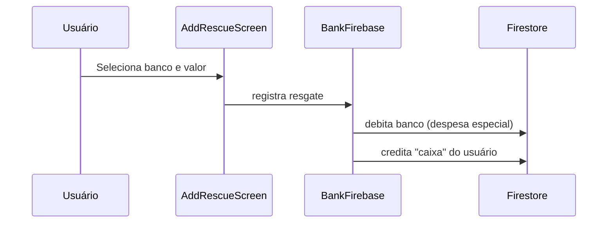

# Resgate de Caixa

<!-- spark-progress:start -->
## Progresso Spark — 23/10/2026

**F06 — Transferências, saques e pares: 80% implementado / 20% restante.** Notas P/I/D/E: **100/75/50/75**; cálculo e evidências em [[Status da Implementação Spark]].

O percentual corresponde ao módulo completo, incluindo integração e dados, e não somente ao serviço descrito nesta página. **Próxima entrega:** Completar fontes antigas sem identidade resolvível, assistente e homologação. Pares nativos de investimento e importados com permissão explícita já têm estorno no extrato.

Esta revisão prevalece sobre listas de pendências datadas das entregas anteriores abaixo. Implementação local e logs não aprovam publicação nem migração real.
<!-- spark-progress:end -->

## Saque utilizável Web/mobile — 23/10/2026

`useRescueFormData(selectedBankId)` centraliza contexto, catálogo e saldo de origem. Spark exige o Caixa canônico `cash` ativo e não arquivado; sua ausência impede preparar outro saque. Erros de contexto/catálogo não autorizam consultas ao legado. Apenas ausência confirmada de Spark e do razão anterior libera esse caminho. Cada leitura usa UID, seleção e revisão de recarga; respostas antigas são descartadas e falha de saldo não vira zero.

As duas telas mostram carregamento/erro persistentes e **Tentar novamente**, orientam cadastrar banco quando não há opção e oferecem atualização explícita. Sucesso recarrega catálogo, disponibilidade do Caixa e saldo bancário mesmo com os campos mantidos pelo pós-submit. Essa recarga é apenas leitura e não repete o saque. Troca de sessão/desmontagem suprime feedback e retorno tardios.

Saque que torna o banco negativo exige justificativa nas observações: 3 a 500 caracteres no Spark, mínimo de três no razão anterior. Legado mantém saldo suficiente. Resultado incerto bloqueia banco, valor, data e observações; **Confirmar saque anterior** recupera a mesma intenção mesmo com saldo já debitado ou leitura indisponível. O argumento `overdraftReason` permanece estável no retry, sem depender de uma nova avaliação do saldo. Recuperação material continua somente em memória no formulário.

A revisão local `withdrawal-2026-10-23` habilita apenas `addRescue` uma vez; desligamentos posteriores e demais preferências são preservados. Protocolo financeiro e estorno existente permanecem. F06 mantém 80% (100/75/50/75), financeiro 78% e geral 56%; a revisão não conclui compatibilidade, assistente, recuperação após reload ou homologação.

Validação: 57 testes focados distintos em seis suítes, tipagem do aplicativo, estilos e diff-check aprovados. Detalhes e roteiro pendente em [[Versão Usável por Telas]]. Sem novo aceite visual autenticado, Emulator, export/build ou aparelho, deploy ou escrita em dados reais nesta revisão.

## Integração Web/mobile — 20/10/2026

`SparkPairFormFirebase` e `useSparkPairForm` conectam os dois formulários de transferência e os dois de saque aos serviços Spark. Somente contexto legado confirmado permite o fluxo anterior; erro, revogação ou contexto ausente depois de preparar intenção não liberam o escritor antigo. Campos/data são copiados antes das esperas; resultado incerto conserva ID, modo e argumentos e impede alterar o material. Depois do sucesso, um envio explícito inicia outra intenção mesmo com campos iguais. Essa recuperação permanece em memória, sem promessa de retomada após reload/desmontagem.

Operações do dia civil de São Paulo usam o instante autoritativo do commit. Datas passadas usam o serviço datado e conservam o Timestamp no reenvio; datas futuras são recusadas. Isso evita rejeitar um lançamento de hoje por relógio do navegador ligeiramente adiantado. Se o dia muda com resultado incerto, só se recupera um receipt existente: não se cria silenciosamente uma operação em outro dia.

Os painéis usam `getBankCurrentBalanceInCentsFirebase`, com contexto e validade temporal Spark, em vez do leitor exclusivamente antigo. A leitura de origem descarta respostas atrasadas após trocar a seleção. Saque exige o Caixa canônico ativo; não aceita trocar o destino nem reivindicar propriedade do Caixa compartilhado. Justificativa de saldo bancário negativo, quando necessária no saque, mantém o contrato de 3–500 caracteres; Caixa não pode ficar negativo. O formulário de transferência continua exigindo saldo suficiente.

O extrato Web/mobile oferece Estornar para transferência/saque nativo vigente, com confirmação das duas contas, intenção estável e compensação atômica no commit. As Rules/serviço verificam autoria ou administrador, saldo e claim único. Se a contrapartida já foi gasta, o estorno é recusado sem alterar saldos; depois de recompor o saldo, o mesmo comando pode ser reenviado. Originais resolvidos e pares especiais/importados permanecem sem ações genéricas. Não existe exclusão física de movimentos Spark.

`SparkStatementFirebase` enriquece nomes com uma leitura por contraparte distinta do período e reconfere a sessão/contexto. Os nomes são rótulos atuais do catálogo, não snapshots imutáveis da operação nem prova de titularidade. Saques Spark e seus estornos ficam fora dos totais econômicos em `shouldIncludeMovementInGainExpenseTotals`; o comportamento anterior do saque legado é preservado.

Validação: gate geral com estilos/tipos, 104 testes de ferramentas e 960 comuns aprovados (89 condicionais ignorados); dez novos cenários SDK Auth/Firestore/Rules, zero ignorados, incluindo relógio +1,5 s, retry, concorrência, histórico/checkpoint, estornos, saldo insuficiente e acesso revogado. Exports finais Web/Android aprovados; Android conserva o aviso conhecido de `web-streams-polyfill` com fallback. Navegador autenticado registrou transferência de R$ 50,00 e saque de R$ 20,00, estornou ambos e confirmou saldo R$ 100,00, ganhos R$ 100,00 e despesas zero no banco de teste. Evidências `.expo/spark-pairs-final-gate.log`, `spark-pairs-sdk-verified.log`, `spark-pairs-ui-final.log`, `spark-pairs-web-final.log`, `spark-pairs-android-final.log` e `spark-pairs-browser.png`. Nenhuma Rule foi alterada nesta entrega; a regressão de 1.037 cenários é evidência anterior reaproveitada, não nova execução integral.

F06 passa a 80% (P/I/D/E = 100/75/50/75). Assistente, pares importados e de investimentos nas telas, formatos antigos e homologação em aparelhos permanecem pendentes. Não houve dado real, migração, publicação ou cobrança.

Permite registrar a retirada de dinheiro em espécie de uma conta bancária, creditando o valor no saldo "em caixa" (dinheiro físico) do usuário.

> **Após o corte do grupo financeiro**, Caixa deixa de ser um campo especial: é a única conta compartilhada do grupo, do tipo cash. A rota e o nome Saque são mantidos por compatibilidade. AddRescueScreen usa a ponte Spark para criar uma transferência banco → Caixa com duas pernas imutáveis.

## Caminho legado

O diagrama abaixo descreve o fluxo anterior. No Spark vale o par atômico da seção atual acima.

1. `AddRescueScreen.tsx` coleta: banco de origem e valor do resgate; o banco é selecionado pelo ActionSheet compartilhado com ícone e, quando selecionado, o saldo disponível ou seu estado de carregamento/indisponibilidade aparece conectado ao trigger por `bank-balance-attached-panel.tsx`
2. `BankFirebase.ts` registra a operação:
   - Débita o valor do banco selecionado (cria despesa especial)
   - Credita no total de "caixa" do usuário
3. Após registrar o saque, `AddRescueScreen.tsx` aplica [[Comportamento Pós-Registro]] depois do feedback de sucesso
4. O saldo em caixa aparece destacado no [[Dashboard Home]]
5. Feedback via `notifier-alert.tsx`

## Arquivos principais

- `screens/mobile/AddRescueScreen.tsx` / `screens/web/AddRescueScreen.web.tsx` — Formulário de resgate por plataforma, com labels e campos alinhados ao padrão Web de despesas
- `functions/BankFirebase.ts` — Operação de resgate
- `components/uiverse/banks/bank-actionsheet-selector.tsx` — Seletor de banco de origem
- `components/uiverse/banks/bank-balance-attached-panel.tsx` — Painel conectado que apresenta o saldo disponível e os estados de leitura do banco
- `app/mobile/add-rescue.tsx` — Rota
- `utils/navigation.ts` — Saída explícita para Home pelo voltar físico/navigator
- `hooks/usePostSubmitBehavior.ts` — Aplica retorno/limpeza após salvar

## Integrações

- [[Gerenciamento de Bancos]] — Banco de origem é debitado
- [[Dashboard Home]] — Saldo em caixa exibido separadamente no dashboard
- [[Transações de Receitas]] / [[Transações de Despesas]] — Gera movimentos especiais
- [[Notificações]] — Feedback via `notifier-alert.tsx`
- [[Comportamento Pós-Registro]] — Define retorno/limpeza após registrar saque

## Configuração

- Sem configuração especial

## Observações importantes

- No razão, Caixa é uma conta compartilhada, materializada em centavos e não pode ficar negativa.
- Banco pode ficar negativo, mas o saque exige justificativa gravada no evento quando isso ocorrer.
- Grupos ainda não migrados continuam no adaptador legado até o administrador aprovar o corte.

- "Caixa" é um conceito separado de "banco" — representa dinheiro físico disponível
- O resgate não cria um banco chamado "Caixa" — é um campo especial no documento do usuário
- Após registrar um saque, banco, valor, data, descrição e saldo carregado só são limpos quando a preferência da tela manda permanecer e limpar; o submit usa trava síncrona para impedir múltiplos saques iguais antes da resposta do Firestore

## Integração com o Assistente Lumus

- [[Assistente Lumus]] valida banco, saldo mensal e saldo disponível antes de registrar o saque.
- Desfazer resolve o saque por referência textual no catálogo opaco e confirma propriedade/fingerprint e efeito no chat. No legado remove somente o saque escolhido com recibo idempotente; no razão estorna o evento e preserva as duas pernas e o histórico. `transferFunds` mantém Caixa compartilhado sem saldo negativo. Ver [[Comandos Financeiros Conversacionais]].

## Desfazimento pelo Assistente - 26/10/2026

[[Assistente Lumus]] lista os saques Spark ativos e prepara o estorno do par inteiro, com confirmação de valor/direção, origem live/imported e retry do mesmo comando. Usa os preparadores/executores existentes de pares; preserva original/inverso e exclusão dos totais econômicos. Evidências e limitações em [[Versão Usável por Telas]].
