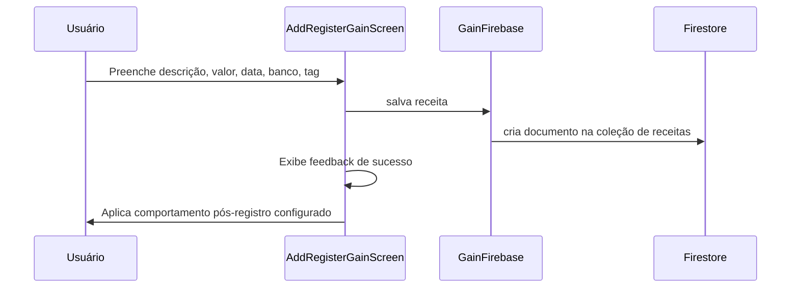

# Transações de Receitas

<!-- spark-progress:start -->
## Progresso Spark — 22/10/2026

**F04 — Despesas, receitas, edição e estorno: 80% implementado / 20% restante.** Notas P/I/D/E: **100/75/50/75**; cálculo e evidências em [[Status da Implementação Spark]].

O percentual corresponde ao módulo completo, incluindo integração e dados, e não somente ao serviço descrito nesta página. **Próxima entrega:** Conectar assistente, completar formatos legados/especiais e homologar. Sugestões recorrentes e origens de aporte/resgate já usam os serviços Spark.

Esta revisão prevalece sobre listas de pendências datadas das entregas anteriores abaixo. Implementação local e logs não aprovam publicação nem migração real.
<!-- spark-progress:end -->

Permite registrar entradas financeiras vinculadas a uma conta bancária, com categorização por tags, data e valor. Suporta receitas comuns, resgates de investimentos e créditos de transferências.

## Implementação Spark em preparação

Continuação de 20/10/2026: as telas Web/mobile enviam ganhos comuns e correções via `useSparkMovementForm`; os leitores de listas escolhem o journal vigente Spark. Reenvio incerto conserva ID/data/material; edição no mesmo dia mantém o Timestamp original e uma nova edição intencional usa o substituto. O extrato edita/estorna ordinários sem apagar histórico. Recebimentos recorrentes/investimentos precisam de seus protocolos atômicos e são recusados nesse ramo Spark antes de qualquer ganho parcial. As descrições anteriores de 19/10 abaixo são checkpoints históricos.

Continuação de 19/10/2026: os seletores bancários Web/mobile já consultam contas Spark ativas. O contrato `SparkMovementCommandFirebase` preserva confirmação, alvo e replay de criação/correção/estorno, mas o envio e os leitores de `GainFirebase` ainda precisam ser migrados juntos. Datas/IDs de intenção no estado da tela e o recebimento recorrente atômico permanecem abertos. F04 continua em 65% por esse motivo.

[[Operações Ordinárias Spark]] acrescenta serviços compartilhados de criação, edição imutável e estorno de receita comum com data, categoria, revisão/cota e saldo protegido pelas Rules, incluindo Caixa. Edição aplica inverso e substituto na nova data e admite mudar de conta. Essa prova ainda não substitui `GainFirebase`, os formulários ou o assistente publicados. Receita importada com referência especial/recorrente permanece no fluxo específico até seu adaptador preservar também o ciclo e os metadados.

## Como funciona

1. Usuário acessa `AddRegisterGainScreen.tsx`
2. Preenche: descrição, valor, formato do ganho (quando exibido), data, banco de destino se o recebimento for em banco e tag; o formato do ganho é uma escolha única entre renda variável e pagamento externo. Banco e tag são escolhidos por ActionSheets customizados com ícone, nome e destaque da seleção atual, e a tag mantém a ação interna para criar uma nova categoria de ganho
3. `GainFirebase.ts` salva o documento no Firestore na coleção de receitas do usuário
4. Após criar ou editar uma receita, `AddRegisterGainScreen.tsx` aplica [[Comportamento Pós-Registro]] depois do feedback de sucesso; por padrão volta para [[Dashboard Home]]
5. O movimento aparece na timeline do [[Dashboard Home]] e em [[Gerenciamento de Bancos|BankMovementsScreen]]
6. O saldo do banco selecionado é incrementado automaticamente nos cálculos

## Tipos de Receita (flags booleanas)

| Flag | Descrição | Entra nos totais? |
|---|---|---|
| (nenhuma flag) | Receita comum | Sim |
| `isInvestmentRedemption` | Resgate de investimento | Não |
| `isFinanceInvestment` | Movimento de investimento | Não |
| `isFinanceInvestmentSync` | Sincronização de investimento | Não |

> **Nota:** A filtragem é feita por `shouldIncludeMovementInGainExpenseTotals()` em `utils/monthlyBalance.ts`, que verifica flags booleanas — não tipos string.

## Arquivos principais

- `screens/mobile/AddRegisterGainScreen.tsx` — Formulário de registro
- `screens/web/AddRegisterGainScreen.web.tsx` — Composição Web do formulário, baseada no shell responsivo de `AddRegisterExpensesScreen.web.tsx`
- `components/uiverse/categories/tag-actionsheet-selector.tsx` — Seletor de categoria em ActionSheet
- `components/uiverse/banks/bank-actionsheet-selector.tsx` — Seletor de banco em ActionSheet
- `functions/GainFirebase.ts` — CRUD de receitas no Firestore
- `app/mobile/add-register-gain.tsx` — Rota
- `hooks/usePostSubmitBehavior.ts` — Aplica retorno/limpeza após salvar

## Integrações

- [[Gerenciamento de Bancos]] — Banco selecionado é creditado
- [[Gerenciamento de Tags]] — Tag categoriza a receita (ícone via `<TagIcon />`)
- [[Dashboard Home]] — Aparece na timeline e nos totais
- [[Transferências]] — Transferências criam receitas com flags especiais
- [[Investimentos]] — Resgates criam receitas com `isInvestmentRedemption`
- [[Resgate de Caixa]] — Gera receita especial no banco de destino

## Configuração

- Valores armazenados em **centavos** (integer)
- Data armazenada como timestamp Firestore
- O seed do emulador cria ganhos de demonstração diretamente em `gains`, com `name` e `valueInCents`, para que sejam lidos pelo mesmo fluxo das receitas registradas no app.

## Observações importantes

- Consultas de ganhos no cliente são sempre escopadas por `personId` do usuário autenticado e pelos usuários relacionados. A fachada legada `getAllGainsFirebase()` não faz varredura global, pois as Firestore Rules não filtram resultados depois da consulta.

- Receitas com flags de investimento/transferência são excluídas dos totais de entradas para evitar dupla contagem
- Estrutura idêntica à de Despesas — seguem o mesmo padrão de campos no Firestore
- Usuários relacionados compartilham visibilidade das receitas
- O submit de novos registros e edições deve passar por [[Comportamento Pós-Registro]]; não usar `router.back()` nem strings livres de rota como retorno pós-submit
- Em novo registro, a limpeza dos campos é controlada pela preferência da tela quando o retorno automático está desligado; o submit usa trava síncrona para impedir duplo clique enquanto a persistência e integrações obrigatórias/investimento concluem
- Quando o campo de formato do ganho está visível, uma opção precisa estar selecionada antes de liberar o envio. A escolha fica controlada pela própria tela nas variantes mobile e Web.
- O campo de categoria não deve voltar para o menu padrão do Android nem exibir botão externo desalinhado; o fluxo usa o ActionSheet compartilhado para selecionar e criar categorias
- O campo de banco também usa ActionSheet compartilhado para exibir `iconKey`/`colorHex` dos bancos cadastrados e evitar regressão para o menu padrão do Android
- Android/iOS usam `AddRegisterGainScreen.tsx`; o navegador resolve `AddRegisterGainScreen.web.tsx`, sem duplicar consultas ou regras financeiras. A variante Web mantém o hero/sheet de [[Versão Web]], uma única rolagem e a grade responsiva, com foco amarelo e labels acessíveis.

## Integração com o Assistente Lumus

- [[Assistente Lumus]] usa os mesmos campos em centavos e resolve banco/categoria por handles temporários.
- Entradas vinculadas a transferência, recebimento obrigatório ou resgate de investimento não aceitam edição genérica no chat.
- Uma fala com várias receitas gera cartões independentes e cada gravação exige seu próprio botão de confirmação.

## Versão usável por fluxo — 23/10/2026

Web/mobile usam useMovementFormEntry para preparar o contexto de um novo lançamento e carregar o registro canônico de uma edição. Enquanto não estiver pronto, campos e envio permanecem bloqueados. Erro é persistente e oferece **Tentar novamente**; não se transforma em formulário vazio editável. Falha Spark não consulta a coleção legada. Fonte antiga só é aceita quando o contexto confirma o transporte legado.

useSparkMovementForm confere novamente o UID após inicializar/carregar; respostas de outra rota, fonte ou sessão não preenchem o formulário. Nome, centavos, data civil, categoria, banco/Caixa, observação e formatos existentes continuam sendo mapeados como antes. Carregamento/erro compartilham MovementFormStatus, sem novo estilo inline.

O executor financeiro existente mantém ID/data no reenvio incerto, corrige por inverso e substituto e invalida consultas após confirmação. Esta entrega não altera Rules, histórico financeiro ou preferências de telas. F04 conserva as notas 100/75/50/75 e 80%; teste local não substitui homologação Web/aparelho e integração Emulator. Evidências e roteiro: [[Versão Usável por Telas]].
