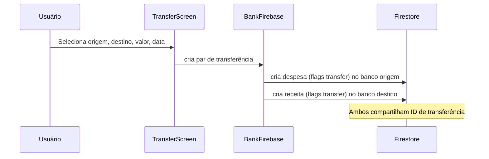

# Transferências

<!-- spark-progress:start -->
## Progresso Spark — 23/10/2026

**F06 — Transferências, saques e pares: 80% implementado / 20% restante.** Notas P/I/D/E: **100/75/50/75**; cálculo e evidências em [[Status da Implementação Spark]].

O percentual corresponde ao módulo completo, incluindo integração e dados, e não somente ao serviço descrito nesta página. **Próxima entrega:** Completar fontes antigas sem identidade resolvível, assistente e homologação. Pares nativos de investimento e importados com permissão explícita já têm estorno no extrato.

Esta revisão prevalece sobre listas de pendências datadas das entregas anteriores abaixo. Implementação local e logs não aprovam publicação nem migração real.
<!-- spark-progress:end -->

## Integração Web/mobile — 20/10/2026

`SparkPairFormFirebase` e `useSparkPairForm` conectam os dois formulários de transferência e os dois de saque aos serviços Spark. Somente contexto legado confirmado permite o fluxo anterior; erro, revogação ou contexto ausente depois de preparar intenção não liberam o escritor antigo. Campos/data são copiados antes das esperas; resultado incerto conserva ID, modo e argumentos e impede alterar o material. Depois do sucesso, um envio explícito inicia outra intenção mesmo com campos iguais. Essa recuperação permanece em memória, sem promessa de retomada após reload/desmontagem.

Operações do dia civil de São Paulo usam o instante autoritativo do commit. Datas passadas usam o serviço datado e conservam o Timestamp no reenvio; datas futuras são recusadas. Isso evita rejeitar um lançamento de hoje por relógio do navegador ligeiramente adiantado. Se o dia muda com resultado incerto, só se recupera um receipt existente: não se cria silenciosamente uma operação em outro dia.

Os painéis usam `getBankCurrentBalanceInCentsFirebase`, com contexto e validade temporal Spark, em vez do leitor exclusivamente antigo. A leitura de origem descarta respostas atrasadas após trocar a seleção. Saque exige o Caixa canônico ativo; não aceita trocar o destino nem reivindicar propriedade do Caixa compartilhado. Justificativa de saldo bancário negativo, quando necessária no saque, mantém o contrato de 3–500 caracteres; Caixa não pode ficar negativo. O formulário de transferência continua exigindo saldo suficiente.

O extrato Web/mobile oferece Estornar para transferência/saque nativo vigente, com confirmação das duas contas, intenção estável e compensação atômica no commit. As Rules/serviço verificam autoria ou administrador, saldo e claim único. Se a contrapartida já foi gasta, o estorno é recusado sem alterar saldos; depois de recompor o saldo, o mesmo comando pode ser reenviado. Originais resolvidos e pares especiais/importados permanecem sem ações genéricas. Não existe exclusão física de movimentos Spark.

`SparkStatementFirebase` enriquece nomes com uma leitura por contraparte distinta do período e reconfere a sessão/contexto. Os nomes são rótulos atuais do catálogo, não snapshots imutáveis da operação nem prova de titularidade. Saques Spark e seus estornos ficam fora dos totais econômicos em `shouldIncludeMovementInGainExpenseTotals`; o comportamento anterior do saque legado é preservado.

Validação: gate geral com estilos/tipos, 104 testes de ferramentas e 960 comuns aprovados (89 condicionais ignorados); dez novos cenários SDK Auth/Firestore/Rules, zero ignorados, incluindo relógio +1,5 s, retry, concorrência, histórico/checkpoint, estornos, saldo insuficiente e acesso revogado. Exports finais Web/Android aprovados; Android conserva o aviso conhecido de `web-streams-polyfill` com fallback. Navegador autenticado registrou transferência de R$ 50,00 e saque de R$ 20,00, estornou ambos e confirmou saldo R$ 100,00, ganhos R$ 100,00 e despesas zero no banco de teste. Evidências `.expo/spark-pairs-final-gate.log`, `spark-pairs-sdk-verified.log`, `spark-pairs-ui-final.log`, `spark-pairs-web-final.log`, `spark-pairs-android-final.log` e `spark-pairs-browser.png`. Nenhuma Rule foi alterada nesta entrega; a regressão de 1.037 cenários é evidência anterior reaproveitada, não nova execução integral.

F06 passa a 80% (P/I/D/E = 100/75/50/75). Assistente, pares importados e de investimentos nas telas, formatos antigos e homologação em aparelhos permanecem pendentes. Não houve dado real, migração, publicação ou cobrança.

Prova Spark v0.14 em desenvolvimento: [[Movimentos Datados em Par Spark]] acrescenta transferência/aporte/resgate/estorno com data explícita e efeito atual pela referência de cada conta, preservando o modo commit. Os modos compartilham claim único de estorno, duas posições e cota atômicos. Membro só estorna o próprio lançamento e admin pode estornar outro do grupo. Os formulários Spark estão conectados conforme a seção atual acima; o diagrama abaixo descreve o caminho legado, conservado somente para contexto realmente legado.

Permite mover valores entre contas bancárias do mesmo usuário. Gera dois movimentos simultâneos: um débito no banco de origem e um crédito no banco de destino.

> **Após o corte do grupo financeiro**, uma transferência é um único evento do razão com duas pernas, clientActionId idempotente e referências de origem. O extrato continua mostrando saída na origem e entrada no destino, mas não existem dois documentos financeiros mutáveis.

## Caminho legado

1. `TransferScreen.tsx` coleta: banco de origem, banco de destino, valor, data e descrição; origem e destino usam o ActionSheet compartilhado com ícones e mostram o saldo disponível em um painel conectado abaixo de cada seletor. O saldo da origem mantém a validação da transferência; o saldo do destino é apenas informativo.
2. `BankFirebase.ts` cria dois documentos no Firestore:
   - Uma [[Transações de Despesas|despesa]] com flags de transferência no banco de origem
   - Uma [[Transações de Receitas|receita]] com flags de transferência no banco de destino
3. Ambos os movimentos compartilham um ID de transferência para rastreabilidade
4. Feedback via `notifier-alert.tsx`
5. Após registrar a transferência, `TransferScreen.tsx` aplica [[Comportamento Pós-Registro]] depois do feedback de sucesso

## Por que dois movimentos?

A arquitetura de transferência como par débito/crédito permite que o [[Gerenciamento de Bancos|BankMovementsScreen]] exiba o movimento individualmente em cada banco, enquanto o `shouldIncludeMovementInGainExpenseTotals()` filtra esses tipos para evitar que o total de despesas/receitas do [[Dashboard Home]] seja inflado.

Na busca do extrato bancário, `getBankMovementsByPeriodFirebase()` considera tanto o `bankId` gravado no movimento quanto os metadados `bankTransferSourceBankId` e `bankTransferTargetBankId`. Assim, uma transferência aparece como saída no banco de origem e como entrada no banco de destino.

## Arquivos principais

- `screens/mobile/TransferScreen.tsx` / `screens/web/TransferScreen.web.tsx` — Formulário de transferência por plataforma, com labels, popover de origem e campos alinhados ao padrão Web de despesas
- `components/uiverse/banks/bank-actionsheet-selector.tsx` — Seletores de origem e destino
- `components/uiverse/banks/bank-balance-attached-panel.tsx` — Painéis de saldo conectados aos seletores de origem e destino
- `functions/BankFirebase.ts` — Criação dos dois movimentos
- `app/mobile/transfer-screen.tsx` — Rota
- `utils/monthlyBalance.ts` — Filtra movimentos de transferência dos totais
- `utils/navigation.ts` — Saída explícita para Home pelo voltar físico/navigator
- `hooks/usePostSubmitBehavior.ts` — Aplica retorno/limpeza após salvar

## Integrações

- [[Gerenciamento de Bancos]] — Dois bancos envolvidos na operação
- [[Transações de Despesas]] — Gera despesa com flags de transferência
- [[Transações de Receitas]] — Gera receita com flags de transferência
- [[Dashboard Home]] — Movimentos aparecem na timeline mas não nos totais de entrada/saída
- [[Notificações]] — Feedback via `notifier-alert.tsx`
- [[Comportamento Pós-Registro]] — Define retorno/limpeza após registrar transferência

## Configuração

- Sem configuração especial

## Observações importantes

- No razão, transferências e aportes/resgates não entram nos totais de receita/despesa; adaptadores analíticos devem usar o tipo do lançamento, sem recontar as duas pernas.

- Transferência entre o mesmo banco é bloqueada no formulário e em `transferBetweenBanksFirebase()`
- Após uma transferência bem-sucedida, origem, destino, valor, data, descrição e saldo carregado só são limpos quando a preferência da tela manda permanecer e limpar; o submit usa trava síncrona para impedir novo envio antes da conclusão do par débito/crédito
- O fluxo manual e o [[Assistente Lumus]] usam o mesmo executor de domínio: transação autoritativa no legado e `transferFunds` no razão. Transferência, saída e entrada são commits atômicos, sem documento parcial
- Os movimentos usam flags booleanas (não tipos string) para serem excluídos dos totais
- O extrato de bancos usa os metadados de origem/destino como reforço de leitura para transferências, sem transformar esses movimentos em despesas/receitas comuns nos totais do dashboard

## Integração com o Assistente Lumus

- O assistente resolve origem/destino por texto, exige bancos ativos distintos e resume o efeito para a confirmação da versão atual no chat.
- No legado, três IDs e o recibo derivam da identidade do pedido; transferência, saída e entrada são escritos juntos. No razão, `transferFunds` grava as duas pernas, revalida escopo/papel/saldo e mantém recibo/auditoria. Os movimentos ficam fora dos totais de ganho/despesa. Ver [[Comandos Financeiros Conversacionais]] para evidência de saldo, autorização, retries e pedidos concorrentes no legado e no razão.

## Layout adaptativo — 2026-10-15

Origem e destino são empilhados abaixo de 768px e usam duas colunas a partir desse ponto em Web/iOS/Android. A pilha de campos tem altura intrínseca para a rolagem alcançar descrição e confirmação. Saldos e regras financeiras não mudam. Ver [[Auditoria de Design]].

## Entrega por tela — 23/10/2026

`useTransferFormData` compartilha carregamento de bancos e saldos entre Web/mobile. O catálogo reutiliza `getBanksWithUsersByPersonFirebase`, que já resolve o contexto Spark e só permite fonte anterior quando ela foi confirmada; não acrescenta uma consulta redundante ao contexto. Erros persistem com **Tentar novamente**. Sem dois bancos ativos a tela explica a preparação necessária e permite atualizar a lista. Banco removido/desativado após recarga é recusado; sua seleção antiga não certifica saldo.

Saldo de origem e destino é confirmado separadamente, vinculado ao UID e à seleção. Resposta atrasada não substitui outra conta; troca de sessão/desmontagem descarta resultados. Recarga limpa imediatamente os dois saldos até a nova leitura. Uma transferência nova só é liberada quando catálogo/contas/saldos estão disponíveis e há saldo suficiente na origem. Inteiros positivos são exigidos no formulário; os limites e o commit atômico permanecem nos serviços/Rules existentes.

Sucesso confirmado dispara recarga das duas contas antes de aplicar o pós-submit. Ao permanecer na tela com campos mantidos, os painéis passam a mostrar a nova posição; falha dessa leitura oferece retry, sem refazer a transferência. Troca de UID limpa o formulário/intenção local; resposta de envio de outra sessão ou tela desmontada não apresenta sucesso nem navega. Escrita já confirmada não é desfeita pelo fechamento da tela.

Resultado incerto bloqueia origem, destino, valor, data e descrição. **Confirmar envio anterior** reenvia o material original pelo serviço existente, inclusive quando o saldo já foi debitado ou sua leitura falhou. O contexto/recibo continuam verificados no serviço; uma falha não autoriza fallback legado. A data civil e o modo datado/commit não mudam nessa recuperação. Recuperação material após reload permanece pendente em [[Recuperação de Operações Spark]].

Revisão `transfer-2026-10-23` habilita somente a tela de transferência uma vez, preservando as outras preferências e desligamentos posteriores. Saque e ajuste de saldo ainda não são liberados por esta entrega. F06 permanece 80% (100/75/50/75); financeiro 78% e geral 56%. Validação: 49 testes focados distintos aprovados em seis suítes (transferFormData 9, transferScreens 6, sparkPairForm 9, screenValidation 10, bankMovementTotals 4, bankMovementsSpark 11), tipagem do aplicativo, estilos e diff-check aprovados. As seis interações de Web/mobile usam componentes de apresentação e serviços simulados; não substituem navegador/aparelho. A sondagem local encontrou a porta 8081 aberta, mas a navegação no navegador disponível terminou em ERR_CONNECTION_RESET; sem aceite visual autenticado, Emulator ou aparelho nesta revisão. Nenhum deploy ou dado real alterado. Ver [[Versão Usável por Telas]].
